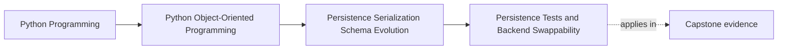

# Persistence Tests and Backend Swappability

<!-- page-maps:start -->
## Page Maps

<!-- page-maps:end -->

Read the first diagram as a placement map: this page is one concept inside its parent
module, not a detached essay, and the capstone is the pressure test for whether the
idea holds. Read the second diagram as the working rhythm for the page: name the
problem, study the example, identify the boundary, then carry one review question
forward.

## Why this lesson matters

Persistence code often looks stable until a backend changes.

A repository that works against one in-memory implementation may fail when moved to:

- a file-backed store
- a relational database
- a message-backed persistence path

Backend swappability is not about pretending all backends are identical. It is about
proving that the repository contract, mapping rules, and persistence guarantees survive a
change in persistence mechanism.

## Test the contract, not just one implementation

The central question is:

what promises should every supported backend keep?

Examples:

- authoritative aggregates rehydrate correctly
- saves preserve invariants rather than bypass them
- version conflicts are detected
- unsupported data fails honestly

Once those promises are named, tests can focus on the contract instead of only on the
mechanics of one storage tool.

## Swappability does not mean zero differences

Students often misunderstand swappability as "every backend behaves exactly the same in
all details."

That is not realistic.

Backends may differ in:

- performance
- transaction semantics
- indexing capabilities
- operational failure modes

Swappability means that the repository contract and critical correctness guarantees stay
stable enough that the rest of the application does not need to relearn the domain every
time the backend changes.

## Test the dangerous persistence surfaces first

High-value persistence tests usually cover:

- round-trip rehydration of authoritative aggregates
- version or conflict behavior
- schema compatibility or migration paths
- publication coordination when persistence is part of a larger workflow

These tests matter more than broad generic CRUD coverage because they guard the places
where storage most often damages domain meaning.

## Use fakes, but do not stop at fakes

An in-memory fake is useful because it keeps the contract small and readable.

But it should not be the only proof surface.

If the real backend introduces:

- session attachment behavior
- transaction differences
- serialization quirks
- concurrency constraints

then at least some tests must exercise those realities directly.

Otherwise "swappable" only means "our fake agreed with itself."

## Contract tests are especially valuable here

One strong approach is to define a shared suite that every backend implementation must
pass.

That suite can express:

- load/save semantics
- failure expectations
- compatibility guarantees
- stale-write rejection

This makes backend differences visible without forcing every application test to be
rewritten per storage engine.

## Common mistakes

- calling a backend swappable because an in-memory fake exists
- testing only happy-path save and load behavior
- ignoring conflict, migration, or malformed-data cases
- coupling the rest of the application to one backend's quirks
- writing tests that prove the framework works rather than that the repository contract holds

These mistakes create false confidence about replaceability.

## Review checklist

| Question | Good sign |
| --- | --- |
| are the repository promises named independently of one backend? | yes |
| do tests cover the highest-risk persistence semantics? | yes |
| is there at least some proof beyond an in-memory fake? | yes |
| can backend differences exist without redefining domain meaning? | yes |

## Capstone connection

The capstone's in-memory repository is a teaching advantage because it reveals the
contract cleanly.

Use that clarity to ask:

- which tests should every future backend still pass?
- which backend-specific risks would need extra proof?
- what would count as a real contract break rather than a mere implementation difference?

Those questions turn persistence testing into design evidence instead of framework
coverage.

## Exit check

Leave this lesson only when you can do all of these:

- explain what backend swappability should and should not mean
- identify which persistence guarantees deserve contract-level tests
- name one fake-only blind spot that a real backend test must eventually cover
