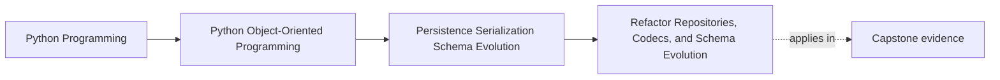

# Refactor Repositories, Codecs, and Schema Evolution

<!-- page-maps:start -->
## Page Maps

<!-- page-maps:end -->

Read the first diagram as a placement map: this page is one concept inside its parent
module, not a detached essay, and the capstone is the pressure test for whether the
idea holds. Read the second diagram as the working rhythm for the page: name the
problem, study the example, identify the boundary, then carry one review question
forward.

## Why this lesson matters

This page is where Module 06 stops being a set of storage warnings and becomes a usable
change route.

The earlier lessons taught:

- repository contracts
- mapping boundaries
- explicit codecs
- session and persistence lifetime discipline
- rebuild trade-offs
- schema evolution
- conflict detection
- publication coordination
- backend contract testing
- migration safety

The real test is whether you can now introduce persistence or evolve it without
rewriting the domain around storage convenience.

## Start with the preserved truth

Before refactoring, state what must remain true.

Usually that includes:

- aggregate invariants
- public domain-facing repository contract
- current supported persisted shapes
- conflict behavior
- durability and publication ordering guarantees

If those preserved truths are not named first, the refactor can easily improve storage
plumbing while weakening the model itself.

## Add persistence as a boundary, not as seepage

The safe move is not "thread storage details through the code until saving works."

The safe move is:

1. keep aggregate authority where it already belongs
2. introduce repository contracts in aggregate language
3. add explicit mapping between domain and storage
4. add codecs for serialized representations
5. keep historical evolution and migration logic near those codec boundaries

This sequence matters because it prevents persistence pressure from changing the domain
first and being corrected later only if someone notices.

## Use one honest refactor route

When the system is currently in-memory-only or persistence-light, a reliable route is:

1. identify the authoritative aggregate boundary
2. define a repository contract around that boundary
3. introduce storage records or serialized payload shapes separately from the domain
4. add explicit mapper and codec logic
5. prove round-trip reconstruction
6. add conflict detection
7. align publication with the durable boundary
8. add migration or upcast support only where historical data actually requires it

This route is intentionally boring. That is good. Persistence refactors should reduce
risk, not perform cleverness.

## Keep historical burden out of current domain objects

One of the easiest mistakes is to let the present-tense domain absorb all historical
representation concerns.

That leads to:

- constructors that know old storage trivia
- entities that accept raw persistence shapes directly
- version branching scattered through the model

A stronger refactor keeps historical burden at the persistence edge:

- repositories
- codecs
- migration steps
- upcasters

This preserves the domain as the place for current business meaning.

## Add proofs as you add structure

A persistence refactor is only trustworthy if proof grows alongside it.

Useful proof surfaces include:

- aggregate round-trip tests
- schema-version load tests
- stale-write conflict tests
- publication-after-durability tests
- backend contract tests

These proofs are what let you say the refactor preserved truth instead of merely
rearranging files.

## Watch for false progress

Some changes look like progress while still leaving the dangerous pressure intact:

- introducing repositories but still returning raw storage rows
- adding codecs but still serializing ad hoc elsewhere
- adding version fields with no owned translation path
- claiming backend swappability based only on a fake

These changes improve vocabulary without improving the boundary.

## Common mistakes

- starting with framework-specific persistence code before naming the repository contract
- letting storage shapes become the first-class application vocabulary
- treating migration as cleanup work for later
- separating publication from durability without an honest coordination plan
- adding compatibility logic everywhere instead of at the persistence edge

These mistakes are exactly what this module is supposed to prevent.

## Review checklist

| Question | Good sign |
| --- | --- |
| are the preserved domain truths named before the refactor begins? | yes |
| does persistence enter through repositories, mappers, and codecs instead of leaking inward? | yes |
| are conflict, migration, and publication guarantees tested as part of the refactor? | yes |
| is historical compatibility burden kept out of present-tense domain objects? | yes |

## Capstone connection

Use the capstone as the practice route for the whole module:

- define the repository contract
- decide the persisted shape
- add explicit codec and mapping boundaries
- test round-trip and stale-write behavior
- state what migration policy would apply if the persisted shape changed after July 27, 2026

If you can walk the capstone through that route, the module is doing real work.

## Exit check

Leave this lesson only when you can do all of these:

- describe a safe order for introducing or evolving persistence boundaries
- explain how to keep current domain meaning separate from historical storage burden
- identify which Module 06 proofs must exist before calling a persistence refactor trustworthy
