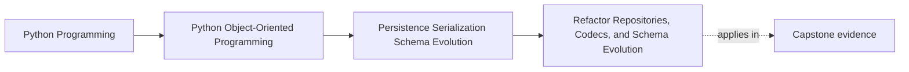
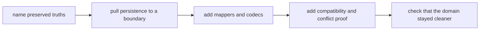

# Refactor Repositories, Codecs, and Schema Evolution

<!-- page-maps:start -->
## Page Maps

<!-- page-maps:end -->

Read the first diagram as a placement map: this page is the practical synthesis of
Module 06. Read the second diagram as the refactor route itself: name what must survive,
move persistence pressure to a boundary, make translation explicit, then prove that the
system is safer instead of merely busier.

## Why this refactor matters

Persistence refactors often go wrong in a predictable way:

- storage support is needed quickly
- ad hoc save logic appears in service code
- historical schema handling is sprinkled through constructors
- concurrency checks arrive after silent overwrite bugs

The result looks more capable because it talks to a database, but the model is weaker
than before.

This page teaches a different route: add storage power while making the system easier to
review.

## Running refactor target

Use one concrete target all the way through:

- `WorkshopEnrollment`

Messy starting point:

- service code assembles rows directly
- constructor bypass happens during load
- serialization logic is duplicated in many call sites
- old data shape is handled with inline conditionals
- write conflict is implicit last-write-wins behavior

Refactor goal:

- one repository contract in aggregate language
- one honest rehydration path
- one explicit translation surface for storage shapes
- one compatibility story for old data
- one explicit conflict contract

## Step 1: Name the truths that must survive

Before moving code, write down the truths you refuse to lose.

For `WorkshopEnrollment`, that usually includes:

- confirmed attendees must never exceed capacity
- waitlist order must stay meaningful
- callers should still think in aggregates, not rows
- old data must either load honestly or fail honestly
- stale writes must not silently replace newer truth

If you skip this step, the refactor easily drifts into storage cleanup that weakens the
actual semantics.

## Step 2: Move repository vocabulary into aggregate language

The first structural change is not a table mapper. It is a contract.

Good direction:

- `load(workshop_id)`
- `save(enrollment, expected_version)`

Bad direction:

- `fetch_workshop_rows`
- `save_attendee_relations`
- `update_waitlist_table`

This step matters because it defines what the rest of the refactor is trying to protect.
If the repository still sounds like storage maintenance, the later code will follow that
shape.

## Step 3: Rebuild through one honest rehydration path

Now decide how stored data becomes a valid aggregate again.

Strong route:

1. fetch storage representation
2. decode through one mapper or codec
3. call a constructor or factory that enforces invariants

Weak route:

1. instantiate an empty object
2. assign fields directly from rows
3. trust the database more than the model

The strong route can still support migration and historical compatibility. It simply
refuses to teach the aggregate that persistence is allowed to bypass meaning.

## Step 4: Separate translation from the domain

Once the contract and rehydration path exist, introduce the storage translation surface.

Keep explicit ownership for:

- row mapping
- serialization details
- field aliases across schema versions
- optional snapshot or event encoding

Do not spread these details into:

- domain methods
- service orchestration
- caller-side assembly code

One good review question here is:

> If the stored shape changed tomorrow, how many domain files would have to change?

The right answer should be "very few."

## Step 5: Place schema history at the persistence edge

Historical burden belongs with persistence translation, not with present-tense domain
meaning.

For example, if older records store `confirmed_attendees_csv`, the refactor should move
that burden into:

- compatibility decoders
- upcasters
- migration scripts

It should not leave CSV parsing logic inside the aggregate forever.

That would freeze a temporary historical shape into the permanent object design.

## Step 6: Add conflict handling before claiming the refactor is safe

A persistence refactor is incomplete if it only teaches the system how to save, not how
to fail honestly under race conditions.

For this aggregate, add:

- versioned save expectations
- an explicit stale-write failure path
- one test that proves a second writer cannot silently overwrite the first

This is not an advanced extra. It is part of what makes persistence semantics real.

## Step 7: Add proofs beside the structure

The refactor is trustworthy only if proof grows alongside it.

Useful proof surfaces:

- round-trip aggregate reconstruction tests
- historical record fixtures
- stale-write conflict tests
- migration rehearsal fixtures
- publication-after-durability checks when downstream work exists

Without these, the refactor may feel organized while still hiding the same risk.

## Worked before-and-after comparison

| Surface | Before | After |
| --- | --- | --- |
| repository boundary | storage-shaped helpers | aggregate-shaped contract |
| load path | manual field assignment | invariant-preserving rehydration |
| old data handling | inline special cases | explicit compatibility path |
| serialization | duplicated ad hoc code | one codec or mapper surface |
| concurrency | accidental last write wins | explicit version conflict |

This table is worth using in code review. It forces the team to prove that the design
actually became clearer.

## Common false progress

These moves often look impressive while leaving the main risk intact:

- introducing repositories that still return ORM objects
- adding codecs while leaving hand-written serialization elsewhere
- adding version fields without making conflict part of the public save contract
- claiming schema evolution is solved because a one-time migration script exists

If the boundary is still blurry, the refactor is still incomplete.

## Capstone connection

Use the capstone to practice the whole route:

1. name the aggregate truth you are protecting
2. define the repository contract the caller should see
3. isolate the persistence translation surface
4. choose one historical shape to support or reject honestly
5. state which proof should fail first if the refactor drifts

That sequence turns persistence refactoring into one reviewable design change instead of
many disconnected edits.

## Exit check

Leave this page only when you can do all of these:

- describe an ordered route for adding persistence without letting storage redefine the
  domain
- explain where historical schema burden should live after the refactor
- name the proof surfaces that must exist before calling the refactor safe
