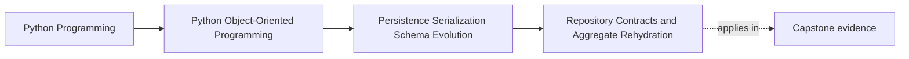

# Repository Contracts and Aggregate Rehydration

<!-- page-maps:start -->
## Page Maps

<!-- page-maps:end -->

Read the first diagram as a placement map: this page is one concept inside its parent
module, not a detached essay, and the capstone is the pressure test for whether the
idea holds. Read the second diagram as the working rhythm for the page: name the
problem, study the example, identify the boundary, then carry one review question
forward.

## Why this lesson matters

Repositories are often taught too loosely. Students hear "a repository loads and saves
things" and end up building generic data-access helpers that leak rows, records, and ORM
objects back into the application layer.

That is not a small style issue. It blurs the line between:

- authoritative domain objects
- storage representations
- workflow logic

Once that line blurs, invariants become easier to bypass and persistence starts
rewriting the shape of the model.

## A repository is a domain-facing contract

A repository should speak in the language of the aggregate it owns.

Good repository methods look like:

- load a policy by policy identifier
- save a modified policy aggregate
- check existence of an authoritative aggregate

Weak repository methods look like:

- fetch rows by table detail
- expose partial storage fragments that the caller must assemble
- provide generic CRUD surfaces with no aggregate meaning

The more the repository sounds like table maintenance, the less it is protecting the
object model.

## Rehydration is part of the repository job

Loading persisted state is not just retrieval. It is rehydration: reconstructing a valid
aggregate from stored representation.

That means the repository must answer:

- how does stored data become domain values again?
- how are invariants respected during reconstruction?
- what happens when persisted data is malformed or out of contract?

If callers must manually reconstruct aggregates from records, the repository boundary is
already too weak.

## Storage is not permission to create impossible objects

One of the most important lessons in this module is this:

stored data does not outrank domain rules.

If the repository finds persisted state that cannot be turned back into a valid
aggregate, that should not be normalized away quietly. It should usually:

- fail loudly
- route through a deliberate repair or migration path
- or reject the representation as unsupported

Otherwise the repository becomes a corruption tunnel that can create states the domain
itself would never accept.

## Keep repository responsibility narrow

A repository answers:

- how do I load this authoritative aggregate?
- how do I save it back through the persistence boundary?

It does not automatically answer:

- how multiple aggregates commit together
- how messages are published after save
- how dashboards or projections are queried

Those belong to other boundaries such as:

- the unit of work
- outbox or publication coordination
- read-model or query services

When repositories absorb those responsibilities, they become vague buckets rather than
durable contracts.

## Read models are not aggregate repositories

Students often widen repositories because they need:

- search screens
- summaries
- dashboards
- audit tables

Those can be valid needs without belonging to the aggregate repository.

If a query returns something other than the authoritative aggregate shape, that is
usually a sign you are in read-model or query-service territory instead.

Keeping that distinction clear prevents one repository from turning into a catch-all data
surface.

## Repository design should preserve aggregate authority

The repository should make it easier, not harder, to preserve the aggregate as the
authoritative unit.

That usually means:

- load and save whole authoritative units
- keep mutation logic outside raw storage shapes
- do not encourage partial updates that bypass aggregate rules

The goal is not dogma about "always load everything." The goal is to avoid teaching a
shape where persistence mechanics redefine the domain boundary.

## Common mistakes

- returning raw rows or ORM entities to the application layer
- forcing callers to reassemble aggregates manually
- hiding migration or corruption issues through silent coercion
- mixing commit coordination into repository save methods
- widening repositories with reporting queries that are not aggregate loads

These mistakes all weaken the same thing: the repository's role as a domain-facing
contract.

## Review checklist

| Question | Good sign |
| --- | --- |
| does the repository speak in aggregate language rather than table language? | yes |
| does it own rehydration instead of pushing reconstruction onto callers? | yes |
| can invalid stored data fail loudly or route to repair? | yes |
| are read-model queries kept separate from authoritative aggregate loading? | yes |

## Capstone connection

Use the capstone repository surface to ask:

- what exactly is authoritative here?
- which storage details are still hidden from the caller?
- if the stored shape became corrupted, where would that be detected?

Those questions make the repository a learning boundary instead of just a persistence
utility.

## Exit check

Leave this lesson only when you can do all of these:

- explain why a repository is a domain-facing contract rather than generic data access
- describe what rehydration must protect when loading persisted state
- identify one query that belongs outside an aggregate repository because it is really a read-model concern
