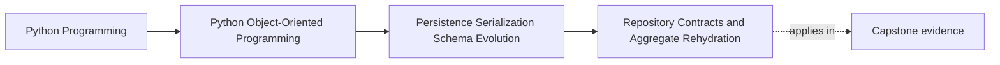
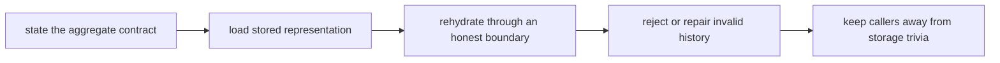

# Repository Contracts and Aggregate Rehydration

<!-- page-maps:start -->
## Page Maps

<!-- page-maps:end -->

Read the first diagram as a placement map: this page establishes the foundation for the
rest of Module 06. Read the second diagram as the reasoning route: name the aggregate
contract first, then decide how stored representation becomes that aggregate again
without letting storage history leak into caller expectations.

## Why this lesson matters

Repositories are often taught too loosely. Learners hear "a repository loads and saves
things" and then build generic data-access helpers that hand rows, ORM objects, or
partial fragments back to the application layer.

That is not a harmless style preference. It changes who appears to own the system:

- the aggregate stops looking authoritative
- storage shape becomes part of application vocabulary
- invariant enforcement becomes optional during load

This lesson tightens the boundary before the rest of the persistence module builds on
it.

## A repository is a domain-facing contract

The first question is not "which database are we using?" It is:

> What should a caller be able to ask for without learning storage structure?

Strong repository methods sound like:

- load a workshop enrollment by workshop identifier
- save one modified enrollment aggregate
- confirm whether an authoritative aggregate exists

Weak repository methods sound like:

- fetch workshop rows
- read attendee join entries
- update waitlist relation table
- expose generic CRUD over persistence objects

The difference is not cosmetic. A strong repository preserves the aggregate as the unit
of meaning. A weak repository teaches callers to assemble meaning themselves.

## What the repository owns

At minimum, a repository owns two responsibilities:

1. loading one authoritative aggregate honestly
2. saving one authoritative aggregate honestly

It does not automatically own:

- query-model reporting
- projection reads
- cross-aggregate commit coordination
- outbound publication delivery

Those may live nearby, but they are not the same contract.

This matters because repository surfaces become vague buckets very quickly when every
data-related concern is pushed through one abstraction.

## Rehydration is part of the contract, not an implementation footnote

Loading persisted state is not just retrieval. It is re-entry into the domain.

That means the repository must answer:

- how stored representation becomes domain values again
- where invariant-enforcing construction happens
- what counts as malformed or unsupported history
- how callers are protected from storage-specific repair steps

If the repository returns raw pieces and expects callers to reassemble the aggregate, it
has already failed at the most important part of the job.

## Worked contrast: weak load path versus strong load path

Weak path:

1. fetch rows
2. hand them to service code
3. set fields manually on an object
4. hope the data still makes sense

Strong path:

1. fetch the stored representation
2. decode it through one mapper or codec
3. call an invariant-preserving constructor or factory
4. return only a valid aggregate or fail honestly

The strong path is not stricter because it is fancier. It is stricter because it keeps
the repository from becoming a corruption tunnel.

## Stored data does not outrank domain rules

This is the sentence to remember from the page:

stored data is evidence of what happened, not automatic permission to create any object.

If the repository finds data that cannot be turned back into a valid aggregate, the
system should usually:

- fail loudly
- route through deliberate repair or migration
- or reject that representation as unsupported

What it should not do is quietly normalize the problem away inside load logic and return
something that only resembles the real aggregate.

That pattern is how corruption becomes durable truth.

## Keep authoritative loads separate from read models

Students often widen repositories because they also need:

- search screens
- dashboards
- reporting summaries
- audit tables

Those needs are real, but they are usually not aggregate loads.

One good test is:

> If the returned shape is not the authoritative aggregate, why is this method still on
> the aggregate repository?

If the answer is only convenience, the boundary is likely too wide. Separate read-model
or query services protect the repository from becoming a catch-all surface.

## Design repository methods to preserve aggregate authority

In practice, strong repository design often means:

- load whole authoritative units
- save whole authoritative units
- keep mutation rules outside raw storage shapes
- avoid partial update APIs that bypass aggregate logic

This is not dogma about always loading every possible relation. It is about refusing to
let persistence mechanics redefine where the important invariants live.

## Review drill: ask four questions about every repository

For any repository surface, ask:

1. does the method speak in aggregate language or storage language?
2. who reconstructs the aggregate from stored representation?
3. what happens if historical data is malformed or unsupported?
4. what read concern is being smuggled in that belongs elsewhere?

If you cannot answer one of those quickly, the boundary is probably still too weak.

## Common mistakes

- returning raw rows or ORM entities to application code
- forcing callers to reassemble aggregates manually
- hiding corruption through silent coercion
- mixing query-model reads into the aggregate repository
- using "generic repository" as a reason to avoid naming the real contract

All of these mistakes blur the same line: who actually owns the meaning of the loaded
object.

## Capstone connection

Use the capstone repository surface to ask:

- what exactly counts as the authoritative aggregate here?
- which storage details are still hidden from the caller?
- where would malformed history be detected today?
- what method should move out because it is really a query or report surface?

Those questions turn the repository into a reviewable design boundary instead of a
persistence utility.

## Exit check

Leave this lesson only when you can do all of these:

- explain why a repository is a domain-facing contract rather than generic data access
- describe the honest rehydration route for one aggregate
- identify one query that belongs outside the aggregate repository because it is really a
  read-model concern
