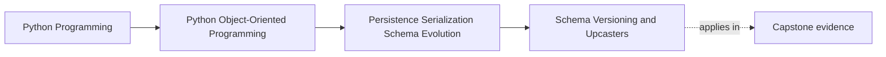

# Schema Versioning and Upcasters

<!-- page-maps:start -->
## Page Maps

<!-- page-maps:end -->

Read the first diagram as a placement map: this page is one concept inside its parent
module, not a detached essay, and the capstone is the pressure test for whether the
idea holds. Read the second diagram as the working rhythm for the page: name the
problem, study the example, identify the boundary, then carry one review question
forward.

## Why this lesson matters

Stored data has a longer memory than the code that wrote it.

If a system survives even a few revisions, new code will eventually read old shapes.
That is why schema evolution is not an edge case. It is the default future of any
durable system.

Students need a clearer mental model than "add a field and hope it still loads." They
need to know:

- how representations declare their version
- where older shapes are upgraded
- when old data should be rejected rather than guessed at

## Versioning is a contract acknowledgement

Adding a schema version marker is not bureaucracy. It is the system admitting that
representations change over time.

Without that admission, new readers are forced to infer:

- which shape they received
- which fields are missing because they are old
- which fields are missing because the payload is broken

That ambiguity makes compatibility work harder and corruption easier to hide.

## What an upcaster does

An upcaster transforms an older representation into a newer supported shape before the
rest of the system continues reading it.

Its purpose is not to create permanent complexity everywhere. Its purpose is to
concentrate compatibility logic in one owned place.

That means:

- old version comes in
- upcaster translates to a newer representation
- the codec or loader continues with the supported contract

The domain object should not need to understand every historical shape directly.

## Upcasting is translation, not repair theater

An upcaster should perform deliberate, explainable translation.

Good examples:

- rename a field while preserving meaning
- introduce a new optional field with a safe default
- normalize a formerly loose representation into a stricter current form

Weak examples:

- guess at missing semantics with no clear rule
- silently discard incompatible meaning
- pretend broken or ambiguous old data is just another old version

If a representation is truly unsupported or corrupted, rejecting it may be more honest
than inventing meaning.

## Keep version logic near the representation boundary

Version awareness should usually live near:

- codecs
- loaders
- migration layers

It should not be scattered across:

- domain constructors
- workflow services
- unrelated application handlers

Once version branching spreads too widely, the code stops having one owned compatibility
boundary and starts teaching every layer about old storage trivia.

## Evolution needs tests that match reality

Good schema-evolution tests answer questions like:

- can current code read a version-one payload on July 27, 2026?
- does unsupported version handling fail clearly?
- does upcasting preserve the meaning that the domain expects now?

That last point matters. Passing the parser is not enough if the translated state no
longer means the same thing after loading.

## When not to upcast

Not every change deserves indefinite compatibility.

Sometimes the honest answer is:

- this version is too old to support automatically
- this representation is corrupt
- this migration must happen offline before runtime use

Students should learn that explicit unsupported-version failure is often healthier than
indefinite silent accommodation.

## Common mistakes

- storing long-lived data with no version marker at all
- scattering historical branching through many layers
- treating corrupted payloads as if they were merely old versions
- upcasting with undocumented guesswork
- assuming a successful parse proves semantic compatibility

These mistakes cause the compatibility surface to expand without clear ownership.

## Review checklist

| Question | Good sign |
| --- | --- |
| can the reader identify which version it received? | yes |
| is historical translation concentrated in one boundary? | yes |
| are unsupported or corrupted shapes rejected honestly? | yes |
| does upcasting preserve current domain meaning, not just structure? | yes |

## Capstone connection

Imagine the capstone persisted policy state on April 12, 2026 and the code on July 27,
2026 needed to read it.

Ask:

- where would version markers live?
- where would an old field rename be handled?
- which change should be upcast at runtime, and which should require a more explicit migration path?

That exact date gap is the pressure this lesson is about.

## Exit check

Leave this lesson only when you can do all of these:

- explain why schema versioning is an explicit contract rather than a convenience extra
- describe where an upcaster should live and what it should protect
- identify one case where rejection is more honest than automatic upcasting
