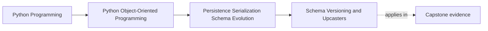
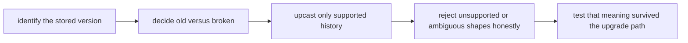

# Schema Versioning and Upcasters

<!-- page-maps:start -->
## Page Maps

<!-- page-maps:end -->

Read the first diagram as a placement map: this page explains how durable data keeps
pressure on the rest of Module 06 long after one release ships. Read the second diagram
as the lesson route: identify the version, separate old from broken, translate only
supported history, then prove that the upgraded representation still means the right
thing.

## Why this lesson matters

Stored data remembers longer than the code that wrote it.

If a system survives even a few revisions, newer code will eventually read older shapes.
That means schema evolution is not a rare migration concern. It is the normal future of
any durable system.

Learners need a mental model stronger than "add a field and hope it still loads." They
need to know:

- how a representation says which version it is
- where older shapes get translated
- when old data should be rejected rather than guessed at

## Start with one uncomfortable question

Ask this directly:

> If code released on July 27, 2026 reads a record written months earlier, how will it
> know whether the shape is old, missing, or broken?

That question forces the system to admit that history exists.

Without an explicit answer, the reader is left guessing:

- which fields are absent because this is version one
- which fields are absent because the payload is damaged
- which default is safe and which one invents meaning

That is why versioning is not bureaucratic overhead. It is contract honesty.

## Version markers are acknowledgements, not ornament

A schema version marker says:

- this representation has history
- the reader must not infer shape purely from field accidents

Without that marker, compatibility logic becomes speculative. Readers are forced to
reverse-engineer history from missing fields and field combinations, which is exactly how
broken payloads get mistaken for merely old ones.

Versioning is the system admitting that representation change is expected and must be
owned.

## Separate three cases: current, old, and broken

Many weak loaders collapse these very different cases:

- current supported shape
- older supported shape
- malformed or unsupported shape

That collapse leads to permissive guessing.

A stronger loader keeps them separate:

| Case | Meaning | Typical action |
| --- | --- | --- |
| current | already matches a supported contract | decode normally |
| old but supported | historical shape the system still knows how to upgrade | upcast or migrate deliberately |
| broken or unsupported | ambiguous, corrupt, or beyond support policy | reject or route to repair |

This table matters because "old" and "broken" are not the same operational story.

## What an upcaster should really do

An upcaster transforms an older supported representation into a newer supported one
before the rest of the system continues.

Its job is not to keep historical complexity alive everywhere forever. Its job is to
concentrate compatibility logic in one owned place.

Healthy upcasting usually looks like:

- rename a field while preserving meaning
- add a new optional field with a deliberate default
- normalize a formerly loose representation into the stricter current form

Weak upcasting looks like:

- guessing missing semantics with no rule
- dropping incompatible meaning silently
- pretending damaged payloads are simply older versions

Upcasting is translation, not repair theater.

## Keep schema history near the representation boundary

Version awareness usually belongs near:

- codecs
- persistence loaders
- migration or compatibility layers

It usually does not belong inside:

- domain constructors
- workflow services
- application handlers that only care about current meaning

Once version branching spreads too far, every layer starts carrying old storage trivia.
That is exactly what the Module 06 boundary is supposed to prevent.

## Rejection is often more honest than automatic accommodation

Not every shape deserves indefinite runtime compatibility.

Sometimes the strongest answer is:

- this version is too old to support automatically
- this record is corrupt
- this migration must happen offline before normal runtime use

Students should hear this plainly: explicit unsupported-version failure is often
healthier than endless silent accommodation.

Compatibility is a policy choice, not an obligation to guess forever.

## Test for preserved meaning, not only successful parsing

A schema-evolution test is weak if it stops at "the reader did not crash."

The stronger question is:

> After translation, does the loaded state still mean what the current domain expects it
> to mean?

Good tests therefore prove:

- an old shape can still load on July 27, 2026
- unsupported versions fail clearly
- the upcast state preserves the same current invariant or behavior expectations

Passing the parser is not enough if the resulting aggregate now tells a different story.

## Worked pressure example

Suppose a historical `WorkshopEnrollment` record stored:

- `confirmed_attendees_csv`
- no explicit waitlist order
- no version field in the earliest release

A stronger current design would:

- assign or infer version only through a documented compatibility rule
- decode the CSV at the boundary
- rebuild waitlist order according to a known migration or upcast policy
- reject records whose meaning cannot be recovered honestly

What it should not do is let the aggregate itself parse CSV forever just because history
once used it.

## Review drill

For any durable stored shape, ask:

1. how does the reader know which version it received?
2. what supported old version can be translated automatically?
3. what malformed or unsupported shape must be rejected?
4. what test proves current meaning survived the upgrade path?

If those answers are unclear, the compatibility boundary is still too weak.

## Common mistakes

- storing long-lived data with no version marker at all
- scattering historical branching through many layers
- treating corrupted payloads as if they were merely old versions
- upcasting through undocumented guesswork
- assuming successful parse proves semantic compatibility

All of these mistakes expand the compatibility surface without clear ownership.

## Capstone connection

Imagine the capstone persisted state on April 12, 2026 and the code on July 27, 2026
needed to read it.

Ask:

- where would version markers live?
- where would a field rename be handled?
- which change should be upcast at runtime?
- which one should require an explicit migration or repair step first?

That exact date gap is the pressure this lesson is about.

## Exit check

Leave this lesson only when you can do all of these:

- explain why schema versioning is an explicit contract rather than a convenience extra
- describe where an upcaster should live and what it should protect
- identify one case where rejection is more honest than automatic upcasting
