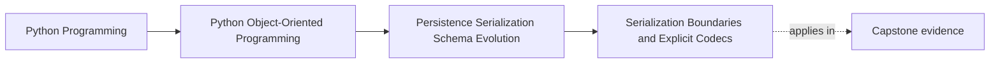

# Serialization Boundaries and Explicit Codecs

<!-- page-maps:start -->
## Page Maps

<!-- page-maps:end -->

Read the first diagram as a placement map: this page is one concept inside its parent
module, not a detached essay, and the capstone is the pressure test for whether the
idea holds. Read the second diagram as the working rhythm for the page: name the
problem, study the example, identify the boundary, then carry one review question
forward.

## Why this lesson matters

The moment state leaves your process, it becomes a format contract.

That may be:

- JSON in a file
- a message payload
- a snapshot document
- a request or response body

If the course teaches serialization as "just call `json.dumps` on a dict," it misses the
most important part: another reader, another version, or another system may depend on
that exact shape later.

## Serialization is not a domain method by default

Students often add methods like `to_dict()` or `to_json()` directly to core domain
objects because it feels convenient.

That convenience has a cost:

- transport shape leaks into the model
- versioning decisions spread across many objects
- strictness and compatibility policy become harder to centralize

Most of the time, serialization belongs at a boundary codec rather than inside every
domain type.

## What a codec owns

A codec is responsible for translating between:

- domain state or domain values
- an external serialized representation

That includes decisions such as:

- required versus optional fields
- type encodings for timestamps, enums, and identifiers
- version markers
- unknown-field handling
- malformed-input failure behavior

This is why codecs are such an important teaching surface: they make format policy
explicit instead of incidental.

## Encode meaning, not accident

Weak serialization usually leaks the internal shape of today's implementation.

Strong serialization chooses a representation that reflects meaning clearly:

- identifiers are named clearly
- timestamps are encoded with a deliberate convention
- semantic values do not become anonymous positional blobs
- fields are chosen because they belong to the contract, not because they happened to be nearby in memory

When readers can explain why a field exists in the payload, the codec is doing real
boundary work.

## Strictness is part of the contract

One of the biggest mistakes in data-bound systems is silent coercion.

For example:

- unknown fields are ignored automatically
- malformed values are coerced into defaults
- invalid enums are turned into "best guess" strings

That can feel forgiving, but it often hides broken producers and corrupts the meaning of
the format.

A stronger default is:

- reject malformed or incompatible data early
- add compatibility shims deliberately when you truly need them

This keeps format evolution intentional rather than accidental.

## Version pressure belongs near the codec

The codec is often the first honest place to answer:

- what version of this representation is this?
- which earlier versions can still be read?
- which differences require translation or upcasting?

If version handling is scattered through domain constructors and random callers, the
system stops having one owned format boundary.

The domain should receive meaningful state, not every historical transport detail.

## Codecs should stay close to the boundary

Good codec placement usually means:

- they live near persistence, transport, or message boundaries
- they are tested as contract surfaces
- they are reused consistently instead of bypassed by ad hoc `dumps` calls

The goal is not to create ceremony. The goal is to stop format choices from being
reimplemented differently in five places.

## Common mistakes

- putting transport-specific `to_json()` logic on every domain object
- letting raw dictionaries spread through application logic
- ignoring unknown or malformed data without a deliberate compatibility policy
- encoding semantic values ambiguously
- versioning payloads in scattered helper code instead of one explicit boundary

These mistakes make formats harder to evolve and harder to trust.

## Review checklist

| Question | Good sign |
| --- | --- |
| is there one owned serialization boundary for this format? | yes |
| does the payload encode meaning clearly rather than leaking internal layout? | yes |
| are malformed and incompatible inputs handled deliberately? | yes |
| is version pressure centered in the codec instead of scattered? | yes |

## Capstone connection

Use the capstone persistence or snapshot path to ask:

- what exact external representation is being promised?
- where is its strictness enforced?
- where would an older format be translated if the shape changed later?

Those questions turn serialization from a helper concern into an architectural contract.

## Exit check

Leave this lesson only when you can do all of these:

- explain why serialization should usually live in explicit codecs rather than in core domain objects
- identify one place where strict rejection is better than silent coercion
- describe where format version pressure should live when a payload evolves
