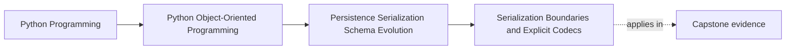
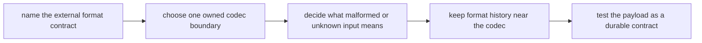

# Serialization Boundaries and Explicit Codecs

<!-- page-maps:start -->
## Page Maps

<!-- page-maps:end -->

Read the first diagram as a placement map: this lesson explains what happens when state
crosses the process boundary and becomes a format promise. Read the second diagram as
the route through the page: name the contract, choose one codec boundary, decide how
strictness works, then keep format history and proof close to that boundary.

## Why this lesson matters

The moment state leaves your process, it stops being "just data" and becomes a format
contract.

That contract may be:

- JSON in a file
- a snapshot document
- a message payload
- a request or response body

If the course teaches serialization as "turn the object into a dict and dump it," it
misses the real problem: someone else, some later version, or some recovery path may
depend on that exact shape.

Serialization is not just output. It is a long-lived promise about meaning.

## Start by naming the format consumer

Before writing a codec, ask:

> Who will read this representation later, and what must they be able to rely on?

Possible answers:

- the same program after restart
- a newer version of the same program
- a worker or downstream service
- an operator replaying historical state

That question changes the design. A casual debug dump and a durable snapshot may both be
JSON, but they are not the same kind of contract.

## Serialization should usually live at a boundary, not inside the model

Students often add methods such as `to_dict()` or `to_json()` directly to domain objects
because it feels convenient.

That convenience has a cost:

- transport shape leaks into the model
- versioning decisions spread across many types
- malformed-input and unknown-field policy become harder to centralize

Most of the time, the stronger design is:

- domain object owns meaning
- codec owns representation

That leaves the model free to change internally without automatically changing every
external format promise.

## What an explicit codec owns

A codec translates between:

- domain state or domain values
- one external serialized representation

That includes decisions such as:

- required versus optional fields
- identifier, enum, and timestamp encoding
- field names
- unknown-field handling
- malformed-input failure behavior
- version markers

This is why codecs are such an important teaching surface. They make format policy
explicit instead of accidental.

## Worked contrast: ad hoc dump versus owned codec

Weak route:

1. build a dict near the call site
2. dump whatever fields are convenient today
3. parse loosely somewhere else later

Strong route:

1. one codec defines the payload shape
2. one decoder rebuilds meaningful state from that shape
3. tests treat the payload as a durable contract

The strong route does not exist to create ceremony. It exists so the system has one
owned answer to "what does this format mean?"

## Encode meaning, not implementation accident

Weak serialization often leaks today's internal layout.

Strong serialization chooses a payload because its fields help another reader understand
the contract:

- identifiers are named explicitly
- timestamps use a deliberate convention
- semantic values are not anonymous blobs
- fields exist because the format needs them, not because the object happened to store
  them nearby

One good review question is:

> If this payload were handed to someone who never saw the in-memory object, would they
> still understand why each field exists?

If not, the codec may still be leaking implementation accident.

## Strictness is part of the contract

One of the most dangerous format habits is silent coercion.

Examples:

- unknown fields are ignored automatically
- malformed values become defaults
- invalid enums become "best guess" strings

That can feel forgiving, but it often hides broken producers and corrupts meaning.

A stronger default is:

- reject malformed or incompatible data early
- add compatibility shims deliberately when the system truly needs them

This makes format evolution intentional rather than vague.

## Version pressure belongs near the codec

The codec is often the first honest place to answer:

- what version is this representation?
- which earlier versions can still be read?
- which differences need translation or upcasting?

If version handling is scattered through constructors, repositories, and random helpers,
the system no longer has one owned format boundary.

The domain should receive meaningful state, not every historical transport detail.

## Keep raw dictionaries and payload fragments from spreading inward

Another common failure mode is letting raw dicts travel through application logic long
after decoding should have happened.

That blurs:

- what is still transport state
- what is already validated domain meaning

The codec boundary should be early and decisive. Once a payload is accepted, the rest of
the system should mostly stop talking in terms of raw representation pieces.

## Review drill

For any serialized format, ask these questions:

1. who reads this format later?
2. where is the one codec that owns it?
3. what malformed input should fail instead of being guessed at?
4. where does version history get absorbed before domain code sees the result?

If those answers are scattered, the boundary is still too weak.

## Common mistakes

- putting transport-specific `to_json()` logic on every domain object
- letting raw dictionaries spread through application logic
- ignoring malformed or unknown data without a deliberate compatibility policy
- encoding semantic values ambiguously
- scattering version behavior across helper code instead of one explicit codec boundary

All of these mistakes make formats harder to evolve and harder to trust.

## Capstone connection

Use the capstone snapshot or message path to ask:

- what exact representation is being promised?
- where is strictness enforced?
- what field exists only because the format needs it?
- where would an older payload be translated if the shape changed later?

Those questions turn serialization from helper code into a durable architectural
contract.

## Exit check

Leave this lesson only when you can do all of these:

- explain why serialization should usually live in explicit codecs rather than inside
  core domain objects
- identify one place where strict rejection is healthier than silent coercion
- describe where format version pressure should live when a payload evolves
