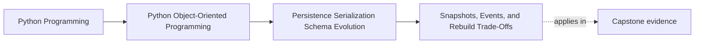

# Snapshots, Events, and Rebuild Trade-Offs

<!-- page-maps:start -->
## Page Maps

<!-- page-maps:end -->

Read the first diagram as a placement map: this page is one concept inside its parent
module, not a detached essay, and the capstone is the pressure test for whether the
idea holds. Read the second diagram as the working rhythm for the page: name the
problem, study the example, identify the boundary, then carry one review question
forward.

## Why this lesson matters

Once a system persists state over time, students quickly face a design question:

- do we save complete snapshots?
- do we save events and rebuild from them?
- do we combine both?

The wrong way to teach this is as a tool preference. The right way is to teach it as a
trade-off between:

- authoritative history
- rebuild cost
- compatibility pressure
- operational complexity

## Start with the real question

The most useful first question is not "which pattern is advanced?" It is:

what are we treating as the authoritative source of truth?

If the authoritative source is:

- the current aggregate snapshot
- the sequence of historical domain events
- or a hybrid arrangement

then rebuild, compatibility, and migration work will look very different.

Students need that anchor before they compare performance or storage convenience.

## What a snapshot gives you

A snapshot stores a full state representation at a point in time.

Benefits:

- simpler load path
- faster reconstruction
- less replay cost
- easier operational inspection in many systems

Costs:

- historical reasoning may be weaker if prior transitions are not preserved elsewhere
- schema drift affects the stored state shape directly
- snapshots can tempt teams to bypass domain reconstruction discipline

Snapshots are often excellent, but they are not free of evolution pressure.

## What event-backed rebuild gives you

An event-backed rebuild stores the meaningful history of accepted changes and
reconstructs current state by replaying them.

Benefits:

- historical transitions are explicit
- some audit and reasoning surfaces become stronger
- rebuild can preserve how state became what it is, not only what it is now

Costs:

- replay can become expensive
- versioning pressure applies to event history too
- event semantics must stay trustworthy for much longer
- rebuild complexity is higher

Students should not leave this lesson thinking event-backed rebuild is automatically
"more advanced and therefore better."

## Hybrids exist for a reason

Many systems use both:

- events as authoritative history
- periodic snapshots as replay accelerators

Or:

- current-state snapshots as primary persistence
- separate event or audit streams for operational traceability

The key is not the existence of both. The key is being honest about which one is
authoritative for which purpose.

## Rebuild is a compatibility problem too

Whatever you persist today must still be interpretable later.

That means rebuild strategy interacts with:

- schema versioning
- upcasters or migration steps
- event compatibility
- snapshot translation rules

If a team chooses replay or snapshots without considering long-term interpretability, the
system may become cheaper today and more fragile tomorrow.

## Avoid false purity

Students sometimes absorb an unhelpful binary:

- snapshots are simplistic
- event replay is elegant

That framing is too shallow.

The real design question is whether the chosen representation:

- preserves the needed truth
- keeps reconstruction honest
- stays operable at the expected scale
- can evolve without corrupting meaning

Purity is not the educational goal. Honest trade-offs are.

## Common mistakes

- choosing an event-backed rebuild story only because it sounds more sophisticated
- treating snapshots as if they remove the need for version discipline
- failing to state which representation is authoritative
- assuming replay cost and compatibility cost are minor details
- using hybrids without naming what each persisted form is actually for

These mistakes usually come from discussing storage patterns before discussing truth and
rebuild responsibility.

## Review checklist

| Question | Good sign |
| --- | --- |
| is the authoritative persisted truth named clearly? | yes |
| are snapshot and replay choices justified by rebuild needs rather than fashion? | yes |
| is compatibility pressure considered for the chosen representation? | yes |
| does the design explain why a hybrid exists if one is used? | yes |

## Capstone connection

The capstone is intentionally small, which is useful here.

Ask:

- if the system grew beyond in-memory state, what would be easiest to rebuild honestly?
- which representation would make future compatibility work clearer?
- what proof route would fail first if the persisted truth and reconstructed truth drifted apart?

That is the right learning pressure before adding more persistence machinery.

## Exit check

Leave this lesson only when you can do all of these:

- explain the trade-off between snapshot simplicity and replay richness
- identify what must be named before choosing a rebuild strategy
- describe one way compatibility pressure changes the storage choice over time
