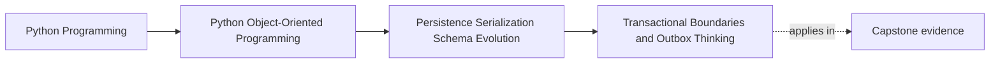
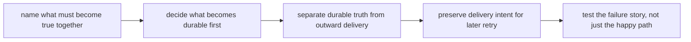

# Transactional Boundaries and Outbox Thinking

<!-- page-maps:start -->
## Page Maps

<!-- page-maps:end -->

Read the first diagram as a placement map: this page connects the repository and
concurrency lessons to the moment when persisted truth has to coordinate with outward
effects. Read the second diagram as the lesson route: name what must become true
together, separate durable truth from later delivery, preserve publication intent, then
prove the failure story honestly.

## Why this lesson matters

Persistence gets dangerous when the system saves state and emits outward effects under
different ideas of "done."

For example:

- the aggregate save succeeds
- event publication fails

or:

- the event is published
- the aggregate save never becomes durable

In both cases, the system tells two different stories about reality. This page teaches
how to keep those stories aligned.

## A transactional boundary is a truth boundary

Students often hear "transaction" and think only of a database primitive.

The more useful teaching idea is:

> a transactional boundary says what changes become authoritative together

That boundary may include:

- aggregate state
- version tokens
- recorded domain events
- outbox rows that preserve later delivery intent

The key question is not "did we use SQL transactions?" The key question is "which facts
can the system now stand behind as durable truth?"

## Start with one review question

Ask this directly:

> If the process crashes one millisecond after this step, what truth should another
> reader still be able to find?

That question cuts through implementation noise.

It forces the design to distinguish:

- what is authoritative now
- what is only intended next
- what still needs retry or repair

Without that distinction, "commit" becomes a vague feeling instead of a boundary the
rest of the system can trust.

## Direct publish-after-mutate is a truth mismatch

A weak design often does this:

1. mutate aggregate state in memory
2. publish a message immediately
3. save the aggregate afterward

That order is dangerous because the published fact may escape before authoritative state
is durable.

If the save then fails, the outside world learned something the system itself cannot yet
stand behind.

This is not a tiny race. It is a truth mismatch between the system and everyone who
heard from it.

## Outbox thinking preserves delivery intent beside durable truth

Outbox thinking is a way to keep outward publication tied to durable persistence.

The simplified route is:

1. save authoritative state
2. save the outgoing message record as part of the same durable boundary
3. publish later from that recorded outbox

This does not remove all delivery problems. It changes them into safer problems.

After the durable boundary completes, the system can say:

- the authoritative state exists
- the intent to publish exists durably
- later delivery now needs retry or repair, not truth reconstruction

That is a much healthier failure story.

## Domain fact and outbox record are not the same thing

One subtle teaching point matters here:

- the domain fact belongs to the business story
- the outbox record belongs to the persistence and delivery coordination story

Do not collapse those two.

The outbox is not the business event itself. It is the durable coordination mechanism
that helps the system avoid lying about whether delivery should still happen.

## Decide what must become durable together

For one workflow, make this explicit.

For example:

| Surface | Must become durable together? | Why |
| --- | --- | --- |
| aggregate state change | yes | authoritative truth changed |
| version update | yes | stale-write detection depends on it |
| outbox or publication intent record | yes | later delivery needs durable evidence |
| actual external send | no | happens after truth is already durable |

This table is useful because many designs skip straight to tooling and never name the
grouping of truths they are protecting.

## Ownership still belongs at a workflow or persistence boundary

Transactional coordination usually belongs with:

- the unit of work
- the persistence boundary
- the application workflow that owns the commit path

It usually does not belong:

- inside entities
- inside arbitrary helpers
- hidden in adapter code that callers do not realize is making truth claims

If coordination is scattered, the team loses the ability to answer:

- what definitely persisted?
- what definitely got scheduled for outward delivery?
- what now needs retry?

## Failure after durability is still a real problem

Outbox thinking does not eliminate delivery failure.

A send may still fail after the durable boundary closes. The difference is that the
system can now speak clearly:

- the aggregate truth is already authoritative
- delivery intent is preserved
- repair is now about notification, not about reconstructing whether the write happened

That clarity is the real win.

## Test the failure story, not only the success story

A weak test stops at:

- save succeeds
- message publishes

A stronger proof route asks:

- what if the save fails before any outward effect escapes?
- what if the durable write succeeds and delivery fails afterward?
- what evidence remains for retry?
- what truth can a later reader still rely on?

Those are the questions that make transactional design reviewable.

## Review drill

For any persistence-plus-publication path, ask:

1. what must become authoritative together?
2. what outward effect must wait until durability exists?
3. what durable evidence remains if later delivery fails?
4. which boundary actually owns that coordination?

If those answers are murky, the transactional boundary is still too weak.

## Common mistakes

- publishing directly from aggregate or service code before durability is established
- treating "database committed" and "external world notified" as if they were the same
  moment by default
- scattering outbox handling so ownership becomes unclear
- assuming outbox thinking removes the need for retry or repair policy
- confusing delivery coordination records with domain facts themselves

All of these mistakes weaken the boundary between authoritative truth and escaped
effects.

## Capstone connection

Use the capstone unit-of-work and publication path to ask:

- when does a rule change become authoritative?
- when may a notification or downstream publication leave?
- if delivery fails after save, what durable evidence remains for retry?

Those questions turn outbox thinking into a concrete review route instead of a slogan.

## Exit check

Leave this lesson only when you can do all of these:

- explain why durable state and outward publication must not drift apart silently
- describe what outbox thinking preserves even when later delivery fails
- identify one capstone path where publication should wait until the persistence boundary
  completes
