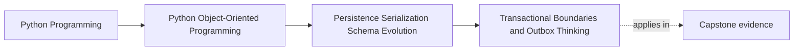

# Transactional Boundaries and Outbox Thinking

<!-- page-maps:start -->
## Page Maps

<!-- page-maps:end -->

Read the first diagram as a placement map: this page is one concept inside its parent
module, not a detached essay, and the capstone is the pressure test for whether the
idea holds. Read the second diagram as the working rhythm for the page: name the
problem, study the example, identify the boundary, then carry one review question
forward.

## Why this lesson matters

Persistence gets dangerous when the system saves state and emits outward effects under
different ideas of "done."

For example:

- the aggregate save succeeds
- the event publication fails

or:

- the event is published
- the aggregate save never becomes durable

In both cases, the system told two different stories about reality. This lesson exists
to teach how to keep those stories aligned.

## A transactional boundary is a truth boundary

Students often hear "transaction" and think only of databases. The more useful teaching
idea is:

a transactional boundary says what changes become authoritative together.

That can include:

- aggregate state
- version tokens
- queued domain events
- outbox records for later publication

The key question is not whether a specific SQL transaction exists. The key question is
which effects count as committed together and which must wait.

## Why direct publish-after-mutate is risky

A weak design often does this:

1. mutate the aggregate
2. publish a message immediately
3. save the aggregate

That order is dangerous because the published fact may escape before the authoritative
state is durable.

If the save then fails, the outside world learned something the system itself cannot yet
stand behind.

This is not a small race condition. It is a truth mismatch.

## What outbox thinking protects

Outbox thinking is a way to keep outward publication tied to durable persistence.

The simplified idea is:

1. save authoritative state
2. save the outgoing message record as part of the same durable boundary
3. publish from that recorded outbox afterward

This reduces the chance that:

- a fact is published without durable state
- durable state exists with no traceable publication intent

It does not remove every delivery problem, but it makes the persistence story much more
honest.

## The outbox is not the business fact

One subtle teaching point matters here:

- the domain event or business fact belongs to the domain story
- the outbox record belongs to the persistence and delivery coordination story

Do not confuse the two.

The outbox is a delivery mechanism that helps keep truth aligned. It is not the domain
itself.

## Boundary ownership still matters

Transactional coordination usually belongs with:

- the unit of work
- the persistence boundary
- or the application workflow that owns the commit path

It should not be improvised inside arbitrary entities or deep helpers.

The more scattered this coordination becomes, the harder it is to answer:

- what was definitely persisted?
- what was definitely scheduled for outward delivery?
- what still needs retry or repair?

## Failure after durability is still a real problem

Even with outbox thinking, publication can still fail later.

The difference is that after the durable boundary completes, the system can now say
something clearer:

- the authoritative state exists
- the intent to publish was preserved
- delivery now needs retry or repair, not truth reconstruction

That is a much safer failure story than losing track of whether the fact was ever
durable at all.

## Common mistakes

- publishing directly from aggregate or service code before durability is established
- treating "database committed" and "external world notified" as automatically the same moment
- scattering outbox handling so ownership becomes unclear
- assuming outbox thinking removes the need for retry or repair policy
- confusing transport coordination records with domain facts themselves

These mistakes all weaken the boundary between authoritative truth and escaped effects.

## Review checklist

| Question | Good sign |
| --- | --- |
| is there a clear answer to what becomes durable together? | yes |
| are outward effects prevented from escaping before durable state exists? | yes |
| is publication intent preserved if later delivery fails? | yes |
| is delivery coordination owned by the right persistence or workflow boundary? | yes |

## Capstone connection

Use the capstone's unit-of-work and publication path to ask:

- when does the rule change become authoritative?
- when would a notification or downstream publication be allowed to leave?
- if delivery failed after save, what evidence would remain for retry?

Those questions turn outbox thinking into a concrete review route rather than a slogan.

## Exit check

Leave this lesson only when you can do all of these:

- explain why durable state and outward publication must not drift apart silently
- describe what outbox thinking preserves even when later delivery fails
- identify one capstone path where publication should wait until the persistence boundary completes
