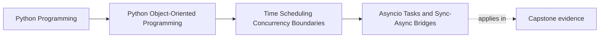
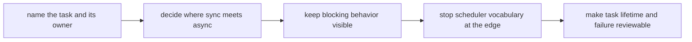

# Asyncio Tasks and Sync-Async Bridges

<!-- page-maps:start -->
## Page Maps

<!-- page-maps:end -->

Read the first diagram as a placement map: this page explains how asynchronous runtime
integration can enter the system without widening the whole model. Read the second
diagram as the lesson route: name the task and its owner, choose where sync meets async,
keep blocking behavior visible, then make lifetime and failure supervision explicit.

## Why this lesson matters

Async boundaries often spread farther than they should.

Learners add one async dependency and suddenly:

- every public method becomes `async`
- blocking work hides inside coroutines
- task ownership becomes unclear

The real lesson is not "use asyncio everywhere." The real lesson is to decide where
async coordination belongs and how synchronous and asynchronous surfaces meet honestly.

## Start with the ownership question

Ask this directly:

> Who started this task, who is responsible for awaiting or supervising it, and who
> decides what happens if it fails?

That question matters because an asyncio task is not just a lighter thread. It is owned
scheduled work.

If nobody owns those answers, tasks become ambient background behavior and failure turns
into log noise rather than a reviewable contract.

## A task is owned work

An asyncio task usually needs an owner who decides:

- when it starts
- how it is awaited or supervised
- how cancellation is handled
- what happens if it fails

That owner often lives at a runtime or integration boundary, not deep inside core domain
objects.

The domain may care about inputs, state, and invariants. The task owner cares about
scheduling and supervision.

## A sync-async bridge is a boundary, not a rewrite mandate

Most systems need a bridge somewhere between:

- synchronous domain logic
- asynchronous I/O or runtime integration

That bridge may:

- call sync code from async orchestration
- isolate blocking work away from the event loop
- translate async results into synchronous state changes

The important rule is that the bridge should stay near the edge where the two worlds
meet. It should not force the whole model to adopt scheduler vocabulary.

## Keep the seam narrow on purpose

One good review question is:

> If the async adapter became synchronous tomorrow, which layers should stay unchanged?

The healthier answer is:

- domain rules
- most application logic
- value and aggregate types

If a large part of the codebase would need to change, async behavior has probably leaked
too far inward.

## Hidden blocking is still blocking

One of the most dangerous async mistakes is hiding blocking work inside a coroutine as if
`async def` automatically made it non-blocking.

Learners should ask:

- does this operation still block a thread or event loop?
- where is that cost visible?
- should it be isolated at the boundary instead of widened through the API?

Async syntax changes scheduling structure. It does not magically remove blocking costs.

## Keep the core model scheduler-agnostic when possible

A domain rule normally does not care whether it was called from:

- a thread
- an asyncio task
- a worker loop

It cares about:

- inputs
- state
- invariants

That is why pushing task handles, loop details, and await semantics into core objects
often weakens the design instead of modernizing it.

## Supervision belongs beside task creation

Another common failure mode is creating background tasks with no clear supervision path.

If a task is started, the system should be able to answer:

- who will observe failure?
- who will cancel it if the parent workflow ends?
- who knows whether the work is complete?

If those answers are unclear, task lifetime has already become an architectural leak.

## Use one contrast table

| Design move | Strong form | Weak form |
| --- | --- | --- |
| starting async work | explicit owner starts and supervises task | background task launched and forgotten |
| sync-async seam | narrow bridge at runtime edge | async keywords spread through unrelated layers |
| blocking integration | isolated and acknowledged | hidden inside coroutine bodies |
| model vocabulary | scheduler-agnostic | loop or task details leak into domain types |

This table is useful because async code often looks modern while still being structurally
weaker than a simpler synchronous design.

## Review drill

For any async boundary, ask:

1. who owns this task?
2. where does synchronous logic meet asynchronous integration?
3. what blocking cost is still present?
4. which core objects should remain unchanged even if the integration path is async?

If those answers are fuzzy, the bridge is still too wide.

## Common mistakes

- widening async all the way into the model because one adapter needed it
- creating background tasks with no clear supervision
- hiding blocking calls inside coroutines
- confusing task ownership with domain ownership
- treating sync-async bridges as boilerplate instead of contract boundaries

All of these mistakes spread runtime mechanics farther inward than necessary.

## Capstone connection

Use the capstone runtime path to ask:

- where would an async adapter enter?
- which boundary should supervise tasks it starts?
- which core objects should remain unchanged even if the integration path becomes async?

Those questions keep async integration from turning into architectural sprawl.

## Exit check

Leave this lesson only when you can do all of these:

- explain why a sync-async bridge should stay near the edge
- identify one hidden-blocking risk inside coroutine-based code
- point to one surface that may become async without forcing the whole model to do the
  same
