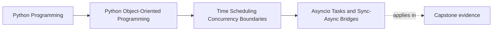

# Asyncio Tasks and Sync-Async Bridges

<!-- page-maps:start -->
## Page Maps

<!-- page-maps:end -->

Read the first diagram as a placement map: this page is one concept inside its parent
module, not a detached essay, and the capstone is the pressure test for whether the
idea holds. Read the second diagram as the working rhythm for the page: name the
problem, study the example, identify the boundary, then carry one review question
forward.

## Why this lesson matters

Async boundaries often spread farther than they should.

Students add one async dependency and suddenly:

- every public method becomes `async`
- blocking work hides inside coroutines
- task ownership becomes unclear

The real lesson is not "use asyncio everywhere." The real lesson is to decide where
async coordination belongs and how synchronous and asynchronous surfaces meet honestly.

## A task is owned work

An asyncio task is not just a lighter thread. It is a unit of scheduled work that needs
an owner who decides:

- when it starts
- how it is awaited or supervised
- how cancellation is handled
- what happens if it fails

If no one owns those answers, tasks become ambient background behavior.

## A bridge is a boundary, not a rewrite mandate

Most systems need a bridge somewhere between:

- synchronous domain logic
- asynchronous I/O or runtime integration

That bridge may:

- call sync code from async orchestration
- isolate blocking work away from the event loop
- translate async results into synchronous state changes

The important rule is that the bridge should stay near the edge where the two worlds
meet. It should not force the whole model to adopt the scheduler vocabulary.

## Blocking behavior must stay visible

One of the most dangerous async mistakes is hiding blocking work inside a coroutine as if
`async def` made it non-blocking automatically.

Students should ask:

- does this operation still block a thread or loop?
- where is that cost documented?
- should it be isolated at the boundary instead of widened through the whole API?

That honesty matters more than surface syntax.

## Keep the core model scheduler-agnostic when possible

A domain rule usually does not care whether it was called from:

- a thread
- an asyncio task
- a worker loop

It usually cares about inputs, state, and invariants.

That is why pushing task handles, event loop details, and async control semantics into
core objects often weakens the design instead of modernizing it.

## Common mistakes

- widening async all the way into the model because one adapter needed it
- creating background tasks with no clear supervision
- hiding blocking calls inside coroutines
- confusing task ownership with domain ownership
- treating sync-async bridges as if they were mere boilerplate instead of contract boundaries

These mistakes spread runtime mechanics farther than necessary.

## Review checklist

| Question | Good sign |
| --- | --- |
| is task lifetime and failure owned explicitly? | yes |
| does the sync-async bridge stay near the runtime edge? | yes |
| is blocking behavior still visible and honest? | yes |
| does the core model avoid unnecessary scheduler vocabulary? | yes |

## Capstone connection

Use the capstone runtime to ask:

- where would an async adapter enter?
- which boundary should supervise tasks it starts?
- which core objects should remain unchanged even if the integration path becomes async?

That keeps async integration from becoming architectural sprawl.

## Exit check

Leave this lesson only when you can do all of these:

- explain why a sync-async bridge should stay near the edge
- identify one hidden-blocking risk inside coroutine-based code
- point to one capstone surface that may become async without forcing the whole model to do the same
