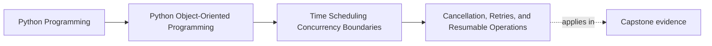

# Cancellation, Retries, and Resumable Operations

<!-- page-maps:start -->
## Page Maps

<!-- page-maps:end -->

Read the first diagram as a placement map: this page is one concept inside its parent
module, not a detached essay, and the capstone is the pressure test for whether the
idea holds. Read the second diagram as the working rhythm for the page: name the
problem, study the example, identify the boundary, then carry one review question
forward.

## Why this lesson matters

Cancellation and retries look like runtime details until they interrupt work halfway
through.

Then the system must answer:

- what already happened?
- what can be retried safely?
- where does work resume?

If those answers are unclear, cancellation and retry pressure produce duplicate effects,
partial state, and ambiguous recovery.

## Cancellation is a boundary event

Cancellation usually arrives from the runtime:

- a caller gave up
- a deadline expired
- a supervisor is shutting down work

That means cancellation is often first a coordination concern, not a domain rule.

The domain may need to reflect:

- that work was interrupted
- that a lease expired
- that a transition can no longer continue

But the arrival of cancellation itself is usually owned at the runtime boundary.

## Retry safety still matters here

After cancellation or failure, the next question is often "can we run this again?"

That answer depends on:

- whether side effects already escaped
- whether progress was durable
- whether the operation is idempotent or resumable

Students should not treat retries after cancellation as automatically safer than retries
after ordinary failure. The same duplicate-work risks still exist.

## Resumable work needs a checkpoint story

A resumable operation usually needs a clear answer to:

- where can we restart from?
- what progress is already durable?
- what must not run twice?

Without that, "resume" often means "rerun from the beginning and hope it is fine."

That may be acceptable for some work, but it should be a conscious policy rather than an
accident.

## Keep interruption semantics out of unrelated objects

One common mistake is to let deep domain objects learn too much about:

- cancellation tokens
- retry counters
- scheduler-specific interruption details

That usually widens runtime coordination concerns farther inward than necessary.

A stronger design lets the runtime boundary own interruption control while the core model
exposes the facts needed to recover honestly.

## Common mistakes

- assuming cancellation means no effect occurred
- retrying interrupted work without checking duplicate-effect risk
- pretending work is resumable with no durable checkpoint boundary
- pushing cancellation primitives through every layer
- mixing retry policy with domain meaning

These mistakes make interruption pressure contagious instead of owned.

## Review checklist

| Question | Good sign |
| --- | --- |
| is cancellation first handled at the runtime boundary? | yes |
| can the system say what progress is already durable? | yes |
| is retry or resume safety explicit instead of assumed? | yes |
| are interruption mechanics kept from infecting unrelated objects? | yes |

## Capstone connection

Use the capstone runtime to ask:

- if polling or worker execution is cancelled, what has definitely happened already?
- which actions are safe to retry?
- what state would need to exist before work could honestly resume instead of rerun blindly?

Those questions make interruption design concrete.

## Exit check

Leave this lesson only when you can do all of these:

- explain why cancellation does not automatically imply zero effect
- identify one condition that makes an interrupted operation safe or unsafe to retry
- point to one capstone path that would need a real checkpoint before it could be called resumable
