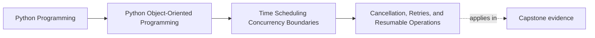
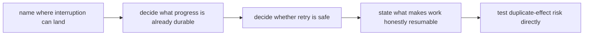

# Cancellation, Retries, and Resumable Operations

<!-- page-maps:start -->
## Page Maps

<!-- page-maps:end -->

Read the first diagram as a placement map: this lesson turns runtime interruption into a
design problem rather than an implementation footnote. Read the second diagram as the
lesson route: identify where interruption can land, decide what progress is already
durable, choose whether retry is safe, then name the checkpoint story that would make
resumption honest.

## Why this lesson matters

Cancellation and retries look like runtime details until they interrupt work halfway
through.

Then the system must answer:

- what already happened?
- what can be retried safely?
- where would work resume from?

If those answers are unclear, cancellation and retry pressure produces duplicate side
effects, partial state, and ambiguous recovery.

## Start with the interruption point

Ask this directly:

> If work stops at this exact line, what has definitely happened already?

That question is more useful than asking whether the operation is "safe."

It forces the design to separate:

- attempted work
- durable progress
- visible side effects

Without that separation, retries are usually guesses disguised as recovery.

## Cancellation is usually a runtime event first

Cancellation often arrives because:

- a caller gave up
- a deadline expired
- a supervisor is shutting work down

That means cancellation is usually first a coordination concern, not a domain rule.

The domain may later need to reflect:

- interrupted work
- expired leases
- invalidated transitions

But the arrival of cancellation itself is typically owned at the runtime boundary.

## Retry safety depends on what already escaped

After cancellation or failure, the next question is usually:

- can this run again safely?

That answer depends on:

- whether outward effects already escaped
- whether progress was recorded durably
- whether the operation is idempotent
- whether later execution can detect that some prior step already happened

Students should not treat retries after cancellation as automatically safer than retries
after ordinary failure. The same duplicate-effect risks still exist.

## Resumable work needs a checkpoint story

A resumable operation needs a clear answer to:

- where can we restart from?
- what progress is already durable?
- what must not run twice?

Without that, "resume" often means:

- rerun from the beginning
- hope the earlier attempt did not already escape

That may be acceptable for some operations, but only as a deliberate policy.

## Worked contrast: retriable versus honestly resumable

These are not the same thing:

| Claim | What it really means |
| --- | --- |
| retriable | rerunning the operation will not create unacceptable duplicate effects |
| resumable | the system knows which durable checkpoint to continue from rather than blindly restarting |

Many designs claim resumption when they only have retry with hope.

That difference matters because a real checkpoint story is usually more expensive and
therefore should only be promised when the workflow truly needs it.

## Use one checkpoint table

For a risky workflow, write this down:

| Step | If interruption lands here, what is durable? | Is retry safe? | What duplicate effect must be prevented? |
| --- | --- | --- | --- |

For `EnrollmentReminderCoordinator`, one row might be:

- payload built but no durable sent marker written yet
- nothing authoritative recorded
- retry may be safe only if no outward send escaped
- duplicate reminder send must not occur

This table is one of the most useful review tools in the whole module because it makes
interruption semantics concrete.

## Keep interruption mechanics out of unrelated objects

One common mistake is to let deep domain objects learn too much about:

- cancellation tokens
- retry counters
- scheduler-specific interruption details

That usually widens runtime coordination concerns farther inward than necessary.

A stronger design lets the runtime boundary own interruption control while the core model
exposes the facts needed to recover honestly.

## Test duplicate-effect risk directly

A weak test proves only that an exception or cancellation was observed.

A stronger proof route asks:

- if cancellation lands after outward send but before durable progress marker, what
  happens on retry?
- if retry occurs after partial durable state, what is skipped or resumed?
- what evidence proves the second run did not duplicate visible work?

Those are the questions the runtime boundary must survive in the real system.

## Review drill

For any interruptible operation, ask:

1. where can interruption land?
2. what is already durable at each point?
3. what makes retry safe or unsafe?
4. what checkpoint would be required before calling the work resumable?

If those answers are vague, recovery semantics are still too hopeful.

## Common mistakes

- assuming cancellation means no effect occurred
- retrying interrupted work without checking duplicate-effect risk
- pretending work is resumable with no durable checkpoint boundary
- pushing cancellation primitives through every layer
- mixing retry policy with domain meaning

All of these mistakes make interruption pressure contagious instead of owned.

## Capstone connection

Use the capstone runtime to ask:

- if worker execution is cancelled, what has definitely happened already?
- which actions are safe to retry?
- what durable state would need to exist before work could honestly resume instead of
  rerun blindly?

Those questions make interruption design concrete.

## Exit check

Leave this lesson only when you can do all of these:

- explain why cancellation does not automatically imply zero effect
- identify one condition that makes an interrupted operation safe or unsafe to retry
- point to one workflow that would need a real checkpoint before it could honestly be
  called resumable
