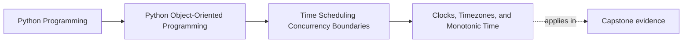

# Clocks, Timezones, and Monotonic Time

<!-- page-maps:start -->
## Page Maps

<!-- page-maps:end -->

Read the first diagram as a placement map: this page is one concept inside its parent
module, not a detached essay, and the capstone is the pressure test for whether the
idea holds. Read the second diagram as the working rhythm for the page: name the
problem, study the example, identify the boundary, then carry one review question
forward.

## Why this lesson matters

Time bugs often begin before concurrency does.

Students write code that calls `datetime.now()` everywhere, compares local times across
different contexts, and uses wall-clock timestamps to measure durations. That works
until:

- clocks jump
- daylight-saving rules change
- tests need deterministic time
- deadlines are measured by elapsed time rather than calendar meaning

This lesson teaches that "time" is not one thing. Different clock questions belong to
different boundaries.

## Not every time question is the same question

You may need to answer:

- what time is it for a human user?
- when should something expire?
- how long has this operation been running?
- when should a scheduler wake up again?

Those questions look related, but they do not all want the same representation or the
same clock source.

If the code treats them all as "just a datetime," the design is already weakening.

## Wall time and monotonic time serve different purposes

Wall time is useful for:

- user-visible timestamps
- logs
- audit records
- calendar or timezone-aware business rules

Monotonic time is useful for:

- elapsed duration
- deadlines based on "five seconds from now"
- timeout measurement
- scheduler stability when the wall clock changes

The key difference is simple:

- wall time answers "what clock time is it?"
- monotonic time answers "how much time has passed?"

Using the wrong one makes otherwise-correct logic unstable.

## Timezones are not formatting garnish

A timezone is part of meaning when human calendar interpretation matters.

If the system decides:

- a business day boundary
- a reporting cutoff
- a rule that depends on local midnight

then timezone choice belongs in the contract, not only in the display layer.

Students should leave this page knowing that "store UTC and forget it" is incomplete
when local business meaning still has to be reconstructed later.

## Clocks should be owned, not grabbed globally

Calling the system clock directly from deep inside the model makes time behavior harder
to test and harder to reason about.

A stronger default is:

- runtime or application boundary owns the real clock source
- domain objects receive time values or a deliberate clock abstraction only when needed

This keeps the question "who decides what time it is here?" explicit instead of
contagious.

## Duration logic should not depend on wall-clock stability

One common mistake is measuring elapsed time like this:

- record `datetime.now()` at start
- subtract `datetime.now()` later

That can fail when the wall clock changes.

If the question is duration, timeout, or deadline progression, monotonic time usually
belongs there instead.

That one distinction prevents a surprising amount of runtime fragility.

## Common mistakes

- calling `datetime.now()` directly throughout domain code
- using wall time to measure timeout duration
- treating timezone conversion as a presentation-only concern
- storing or comparing naive times where meaning depends on zone context
- hiding the ownership of the clock source

These mistakes turn time from a boundary concern into ambient global state.

## Review checklist

| Question | Good sign |
| --- | --- |
| is the code clear about whether it needs wall time or elapsed time? | yes |
| does timezone meaning live where calendar meaning actually matters? | yes |
| is the clock source owned explicitly rather than grabbed everywhere? | yes |
| are duration and timeout calculations protected from wall-clock jumps? | yes |

## Capstone connection

Use the capstone runtime to ask:

- which timestamps are for humans or audits?
- which time calculations are really elapsed-duration questions?
- which objects should stay ignorant of the system clock entirely?

Those questions make time a design surface rather than an incidental helper.

## Exit check

Leave this lesson only when you can do all of these:

- explain the difference between wall time and monotonic time
- identify one place where timezone meaning belongs in the contract
- point to one capstone path that should receive time from the boundary instead of calling the clock directly
