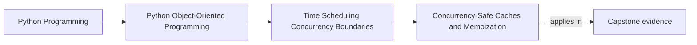

# Concurrency-Safe Caches and Memoization

<!-- page-maps:start -->
## Page Maps

<!-- page-maps:end -->

Read the first diagram as a placement map: this page is one concept inside its parent
module, not a detached essay, and the capstone is the pressure test for whether the
idea holds. Read the second diagram as the working rhythm for the page: name the
problem, study the example, identify the boundary, then carry one review question
forward.

## Why this lesson matters

Caches and memoization often look like easy performance wins. Under concurrency and time
pressure, they become correctness questions too.

Students need to ask:

- who owns cache mutation?
- when does cached data expire?
- what happens if two callers populate the same key at once?
- what happens if the cached value reflects time-sensitive state?

Without those answers, the cache stops being an optimization and starts becoming a second
source of accidental truth.

## A cache is a stateful boundary

A cache is not only a dictionary with a nicer name.

It owns decisions about:

- freshness
- invalidation
- duplication of work
- concurrent access

That means the cache contract needs just as much boundary thinking as other mutable
runtime surfaces.

## Memoization is safest when values are stable

Memoization works best when:

- inputs are stable
- outputs are deterministic
- the cached value is not invalidated by outside mutation or time drift immediately

The more the result depends on:

- current time
- mutable global state
- session attachment
- external side effects

the less safe naive memoization becomes.

## Concurrency changes cache behavior

Under concurrent use, the system may see:

- duplicate fills for the same key
- stale values read after another writer updated truth elsewhere
- lock contention around cache population

That is why concurrency-safe caching is not only about data structure safety. It is
about whether the cached contract still matches the truth contract under simultaneous use.

## Invalidation is part of the design

A cache without an invalidation story is not complete.

Students should be able to answer:

- when does this value stop being trustworthy?
- what event or time rule invalidates it?
- which boundary owns invalidation?

If the answer is "we restart the process sometimes," the cache policy is still mostly
undefined.

## Do not cache away ownership problems

Sometimes a cache is added because the real design problem is:

- repeated shared mutation
- unclear authoritative source
- too much work happening on a hot boundary

In those cases, the cache may hide pressure without resolving it.

The correct solution may instead involve:

- queue ownership
- snapshot replacement
- better boundary partitioning

## Common mistakes

- memoizing functions whose results depend on time or mutable state
- using caches with no owned invalidation policy
- assuming thread-safe map access solves semantic staleness
- turning caches into accidental authoritative stores
- allowing duplicate concurrent fills with expensive or side-effecting work

These mistakes trade visible slowness for hidden incoherence.

## Review checklist

| Question | Good sign |
| --- | --- |
| is the authoritative source still clearer than the cache? | yes |
| are cache freshness and invalidation rules owned explicitly? | yes |
| does concurrent access preserve the intended contract? | yes |
| is memoization used only where results are actually stable enough? | yes |

## Capstone connection

Use the capstone runtime to ask:

- which expensive lookups are safe to cache?
- which results are too time-sensitive or state-sensitive to memoize casually?
- where would invalidation have to happen if new incidents or samples change truth?

Those questions keep performance work answerable to correctness.

## Exit check

Leave this lesson only when you can do all of these:

- explain why concurrency-safe caching is about contract safety, not only lock safety
- identify one case where memoization would be unsafe because time or state keeps moving
- point to one capstone surface where invalidation ownership must be explicit before caching is added
