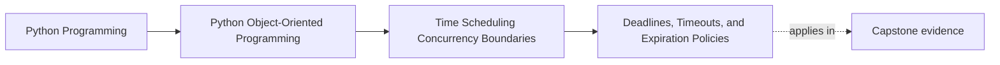
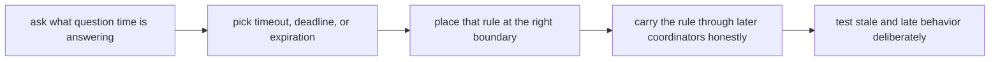

# Deadlines, Timeouts, and Expiration Policies

<!-- page-maps:start -->
## Page Maps

<!-- page-maps:end -->

Read the first diagram as a placement map: this lesson establishes the vocabulary the
rest of Module 07 depends on. Read the second diagram as the route through the page:
start with the question time is answering, choose whether the rule is a timeout, a
deadline, or an expiration policy, then place it at the right boundary and prove late
behavior honestly.

## Why this lesson matters

Learners often mix three different ideas:

- timeout
- deadline
- expiration policy

They sound similar, but they answer different questions. If the code treats them as one
generic number of seconds, the runtime becomes harder to reason about and easier to get
wrong under retries, queues, or scheduling pressure.

## Start with the question, not the duration

Before choosing a time value, ask:

> What exactly is this rule trying to control?

Possible answers:

- how long a caller is willing to wait
- the latest moment the work is still useful
- when a token, cache entry, or lease stops being valid

Those answers sound close, but they belong to different boundaries and behave
differently under retries or delays.

## A timeout is usually a waiting-budget rule

A timeout usually means:

- stop waiting after this duration
- return control to the caller or coordinator

Timeouts are commonly owned by runtime or integration boundaries such as:

- network calls
- worker coordination
- adapter code
- orchestration paths

The timeout is often about waiting behavior, not about business meaning.

## A deadline is a usefulness rule

A deadline usually means:

- after this moment, continuing the operation is no longer acceptable

Deadlines are often easier to carry across boundaries because downstream components can
compare themselves against one shared "not after this point" constraint.

That makes them better than per-layer timeouts when one end-to-end operation has a
single usefulness boundary.

## Expiration is about validity, not waiting

Expiration policy answers a different question:

- when does this value, lease, token, or cached result stop being valid?

That is often closer to business or state meaning than a timeout is.

A suppression window, temporary capability, or cache freshness rule may genuinely have a
semantic expiration. That meaning belongs where validity is owned, not merely where the
timer happens to run.

## Worked comparison

Use one table to keep the differences visible:

| Rule type | Question it answers | Typical owner |
| --- | --- | --- |
| timeout | how long may I wait? | runtime or integration boundary |
| deadline | until what moment is the work still worth doing? | coordinator or workflow boundary |
| expiration | when does this state stop being valid? | domain or state-validity boundary |

This table is worth keeping open because many codebases accidentally collapse all three
into one field such as `timeout_seconds`.

## Relative and absolute time are different tools

A timeout is often best expressed as a duration.

A deadline is often best expressed as an absolute "not after this instant" constraint.

Expiration may use:

- absolute timestamps for human or contract meaning
- monotonic duration rules for safe runtime measurement

The right representation depends on which question the system is answering. Choosing the
wrong one often creates confusing retry or stale-work behavior later.

## Do not push waiting policy into the wrong object

One common design failure is letting deep objects decide:

- how long to wait
- when to give up
- how to retry after timeout

Those are usually runtime coordination concerns.

The domain may know:

- whether a token is expired
- whether a rule stops being valid after a time boundary

But the runtime boundary usually knows:

- how much waiting budget remains
- which coordinator owns cancellation
- whether late work should still be attempted

## Carry owned time constraints instead of inventing new ones

Another frequent failure is each nested layer inventing its own timeout independently.

That leads to:

- conflicting wait budgets
- hidden lateness
- difficulty explaining which layer actually decided to stop

A stronger route is to carry one owned deadline or waiting budget through later
coordinators so they are all answering the same time question.

## Test late and stale behavior on purpose

A weak test only proves that a timeout value exists.

A stronger proof route asks:

- what happens when a worker sees the job after the deadline?
- what happens when a cache entry is technically present but semantically expired?
- what happens when one nested layer waits too long and leaves no time for the next?

These tests teach readers what late work actually means in the system.

## Review drill

For any time rule, ask:

1. is this rule about waiting, usefulness, or validity?
2. which boundary should own that answer?
3. should the rule travel as a duration or an absolute time?
4. what late or stale behavior must the system expose clearly?

If those answers are fuzzy, the time rule is still too vague.

## Common mistakes

- using one `timeout_seconds` value to mean timeout, deadline, and expiration at once
- putting network wait policy inside domain methods
- using wall-clock arithmetic for elapsed waiting budgets
- treating expiration as a scheduling detail instead of a validity rule
- allowing each nested layer to invent a new timeout instead of respecting one owned
  deadline

All of these mistakes make temporal behavior feel ambient instead of owned.

## Capstone connection

Use the capstone runtime path to ask:

- where should a worker stop waiting for input?
- where should a rule or suppression window become invalid?
- which boundary should carry an absolute deadline if one full operation has a fixed
  budget?

Those questions keep runtime pressure from turning into random time checks.

## Exit check

Leave this lesson only when you can do all of these:

- explain the difference between a timeout, a deadline, and an expiration policy
- identify one place where waiting policy belongs at the edge rather than in the model
- point to one runtime rule that is truly about validity rather than about waiting
