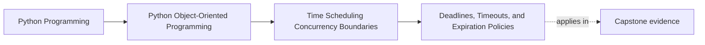

# Deadlines, Timeouts, and Expiration Policies

<!-- page-maps:start -->
## Page Maps

<!-- page-maps:end -->

Read the first diagram as a placement map: this page is one concept inside its parent
module, not a detached essay, and the capstone is the pressure test for whether the
idea holds. Read the second diagram as the working rhythm for the page: name the
problem, study the example, identify the boundary, then carry one review question
forward.

## Why this lesson matters

Students often mix three different ideas:

- a timeout
- a deadline
- an expiration policy

They sound similar, but they answer different questions. If the code treats them as one
generic number of seconds, the system becomes harder to reason about and easier to get
wrong under retry or scheduling pressure.

## A timeout is usually a boundary-control limit

A timeout usually means:

- stop waiting after this duration
- give the caller or coordinator a chance to decide what happens next

Timeouts are often owned by the runtime or integration boundary, not by deep domain
objects.

That is why a timeout often belongs near:

- network calls
- worker coordination
- boundary adapters
- orchestration code

## A deadline is a point beyond which work is no longer useful

A deadline usually means:

- this operation or decision stops being acceptable after a specific moment

Unlike a timeout, a deadline is often easier to pass around explicitly because it can be
compared by downstream coordinators that share the same constraint.

Deadlines help systems avoid each layer inventing its own local waiting budget.

## Expiration is about state meaning

Expiration policy usually answers:

- when does this value, token, lease, or cached result stop being valid?

That is closer to business or data meaning than a timeout is.

A cache entry, suppression window, or temporary capability may genuinely have a semantic
expiration rule. That rule should be modeled where the meaning belongs, not only where
the timer happens to run.

## Do not push runtime waiting policy into the wrong object

One common design failure is letting deep objects decide:

- how long to wait
- when to give up
- how to retry after timeout

Those are often runtime coordination concerns.

The domain may know:

- whether an object is expired
- whether a rule stops being valid after a time boundary

But the runtime boundary usually knows:

- how long a call may block
- which coordinator owns cancellation
- what waiting budget remains

## Absolute and relative time should be chosen deliberately

A timeout is often expressed as duration.

A deadline is often easier to express as an absolute "not after this moment" constraint.

Expiration may need:

- absolute timestamps for human or contract meaning
- monotonic duration rules for safe runtime measurement

The right representation depends on what question the system is actually answering.

## Common mistakes

- using one `timeout_seconds` value to mean timeout, deadline, and expiration at once
- putting network wait policy inside domain methods
- using wall-clock arithmetic for elapsed waiting budgets
- treating expiration as a scheduling detail instead of a validity rule
- allowing each nested layer to invent a new timeout instead of respecting one owned deadline

These mistakes make temporal behavior feel random instead of owned.

## Review checklist

| Question | Good sign |
| --- | --- |
| is the code clear about whether it models timeout, deadline, or expiration? | yes |
| does waiting policy stay near runtime coordination boundaries? | yes |
| does semantic expiration live where validity meaning belongs? | yes |
| are downstream components reusing owned time constraints instead of inventing new ones? | yes |

## Capstone connection

Use the capstone runtime and polling path to ask:

- where should a worker stop waiting for input?
- where should a rule or suppression window become invalid?
- which boundary should carry an absolute deadline if a full operation has a fixed budget?

Those questions keep runtime pressure from becoming ambient behavior.

## Exit check

Leave this lesson only when you can do all of these:

- explain the difference between a timeout, a deadline, and an expiration policy
- identify one place where waiting policy belongs at the edge rather than in the model
- point to one capstone time rule that is truly about validity rather than about waiting
