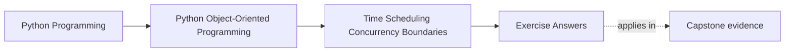
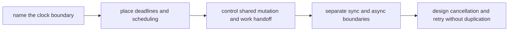

# Exercise Answers

<!-- page-maps:start -->
## Page Maps

<!-- page-maps:end -->

These answers are model explanations, not the only acceptable wording.

## How to use the answer page well

Do not read the model answers first and then reduce Module 07 to "use monotonic clocks,
avoid races, and be careful with async."

A better rhythm is:

1. finish the exercise with your own runtime-boundary packet
2. name the owner of time, shared mutation, bridge style, and cancellation risk
3. compare your reasoning with the model answer
4. revise anywhere your answer still lets runtime pressure spread without a named owner

What matters is whether the reasoning keeps time and concurrency as explicit boundary
contracts instead of invisible ambient behavior.

Strong Module 07 answers usually do five things:

- they choose clocks by semantic need rather than convenience
- they place deadlines, scheduling, and retries at named runtime boundaries
- they prefer explicit ownership transfer over casual shared mutation
- they keep sync/async bridging narrow and readable
- they define cancellation and retry in terms of state safety, not just exception flow

The strongest self-study packets also leave behind six concrete artifacts:

- one clock-decision note
- one deadline boundary review
- one mutation-ownership map
- one queue or lock justification
- one bridge review
- one cancellation and retry recommendation

If your answers rely mostly on "concurrency is hard," the reasoning is still too vague.

## Answer 1: Choose the right clock

A strong answer identifies:

- the kind of time the contract actually depends on
- where that clock is owned or injected
- which objects should never call the clock directly

What goes wrong with the wrong clock:

- expiration or timeout logic becomes vulnerable to wall-clock jumps, time-zone shifts, or
  test fragility

## Answer 2: Draw one deadline boundary

The important pieces are:

- where the deadline is computed
- which boundary enforces it
- what state change or refusal follows when it expires
- why this concern does not belong scattered across domain methods

The main lesson is that deadlines should be reviewable as one contract, not as repeated
timestamp comparisons.

## Answer 3: Review one scheduling concern

A strong answer names:

- the coordinator of repeated work
- the unit of work being scheduled
- the domain object that stays schedule-agnostic
- the proof path that avoids real sleeping

Scheduling is strongest when:

- it triggers work predictably without teaching domain objects about timers

## Answer 4: Place shared mutation honestly

A strong answer distinguishes:

- state that may have one owner
- state that needs synchronization
- state that should stop being shared at all

The important question is:

- what mutation story remains easiest to reason about under load

## Answer 5: Compare queueing and locking

Good answers usually show:

- locking as direct protection of one shared surface
- queueing as explicit ownership transfer and sequencing
- the tradeoff between latency, throughput, and boundary clarity

The main lesson is that:

- the better tool is the one that keeps authority over mutation easiest to audit

## Answer 6: Review one cache under concurrency pressure

A strong answer explains:

- what freshness or invalidation rule the cache promises
- whether cached values are safe to share
- what race or stale-read hazard must be prevented
- what test or runtime proof would expose drift first

Caching is weak when:

- time sensitivity and mutation are hidden behind a performance narrative

## Answer 7: Place one sync/async bridge

A strong answer identifies:

- the edge where async work actually begins
- the interfaces that should stay synchronous
- the bridge object or adapter that absorbs style conversion

What goes wrong when the bridge is too broad:

- every API becomes harder to read, harder to test, and more coupled to runtime choices

## Answer 8: Review one thread-aware or async-aware API

The important pieces are:

- what concurrency guarantees are promised
- what blocking or awaiting behavior callers must know
- what state assumptions remain stable
- what evidence makes those guarantees concrete

The main lesson is that:

- concurrency-aware APIs deserve the same contract discipline as public domain APIs

## Answer 9: Design one cancellation and retry path

A strong answer explains:

- what state transitions are safe interruption points
- what must complete atomically before interruption
- whether retry preserves the same contract afterward
- what duplicate side effect would reveal a bad design

The weakness to avoid is:

- treating cancellation as a generic exception path while state is half-changed

## Answer 10: Produce a runtime-boundary decision packet

The packet is strong when another maintainer can answer:

- which boundary owns clocks and deadlines
- how shared mutation is controlled
- where sync and async styles meet
- when retry is safe after cancellation
- what proof surface should fail first if runtime pressure leaks inward

If different readers infer different owners, the packet is still too ambiguous.

## Self-check

If your answers consistently explain:

- why one operation uses one kind of clock
- where one deadline or schedule is owned
- why one shared state surface locks, queues, or transfers ownership
- where one sync/async bridge stops
- how one cancellation path avoids duplicate work

then you are using Module 07 correctly.
