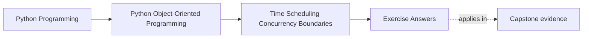
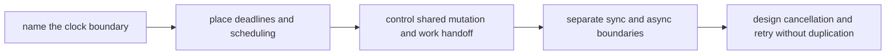

# Exercise Answers

<!-- page-maps:start -->
## Page Maps

<!-- page-maps:end -->

These are model answers for the `EnrollmentReminderCoordinator` scenario from the
exercise page. They are meant to show what a useful runtime packet looks like when one
workflow must survive time pressure, concurrent workers, and cancellation.

## Running scenario recap

`EnrollmentReminderCoordinator`:

- finds workshops nearing start time
- enqueues reminder work
- sends reminders asynchronously
- marks reminder state to prevent duplicates
- may be cancelled and retried by runtime supervisors

The design question is not "which concurrency library should we use?" The design
question is "which boundary owns time, mutation, and restart safety?"

## Answer 1: Choose the clock

Use:

- calendar time for workshop start timestamps and human schedule meaning
- monotonic time for measuring waits, timeout budgets, and retry delays

Ownership rule:

- the coordinator or runtime boundary owns clock access
- domain objects such as `WorkshopEnrollment` should not call `datetime.now()` directly

Bug from mixing them:

- a wall-clock jump can make timeout or delay logic fire too early or too late

That is why "what time is it?" and "how long have we waited?" must not be treated as the
same question.

## Answer 2: Deadline boundary

For "send reminder no later than thirty minutes before workshop start":

- compute deadline at the scheduling boundary
- store or pass a concrete cutoff with the queued work
- enforce the cutoff before delivery begins

If the worker sees the reminder after the cutoff:

- mark the work stale or skipped
- do not let the sender pretend it still met the original contract

The domain object should not contain scattered `if now > cutoff` checks. That would make
the time contract impossible to review.

## Answer 3: Scheduling concern

The repeated scan for upcoming workshops belongs to a coordinator or scheduler boundary,
not to the workshop model itself.

Good split:

- scheduler decides when to scan
- coordinator produces reminder work units
- worker executes reminder sends

Testing route:

- inject a fake clock
- call the scan method directly
- assert which work items are enqueued

No real sleeping is needed if the time boundary is explicit.

## Answer 4: Shared mutation

Reminder status should not be updated by several workers casually.

Cleaner design:

- one worker owns one reminder key at a time through queue handoff
- status transition is written through one clear boundary

Race if state is shared casually:

- two workers both read "not sent"
- both send the reminder
- both mark success afterward

That turns one logical notification into duplicate visible work.

## Answer 5: Queueing versus locking

Lock design:

- shared status map protected by a lock
- workers coordinate by entering critical sections

Queue design:

- work is partitioned so one worker owns one reminder attempt
- deduplication key travels with the work item

Better fit here:

- queue ownership

Why:

- it keeps mutation and retry reasoning closer together
- it scales operationally better than many callers sharing one lock surface

Rejected option:

- broad in-memory locking across several workers and retry paths

That design often solves one race by making ownership harder to see.

## Answer 6: Cache under concurrency pressure

Suppose the coordinator caches "reminders due in the next five minutes."

Safe only if:

- freshness window is explicit
- cached values are derived, not authoritative
- stale cache never decides whether a reminder is already sent

Hazard:

- cached due-soon set lags behind status updates and re-enqueues work already processed

Proof surface:

- tests that change reminder status and assert the cache does not create duplicate
  scheduling decisions

## Answer 7: Sync/async bridge

Keep:

- synchronous admin command surface for "replay reminders for workshop X"
- asynchronous sender and worker execution below that boundary

Bridge location:

- application or runtime adapter layer

Why not everywhere?

- if every layer becomes both sync-aware and async-aware, interfaces widen and reasoning
  about blocking behavior becomes harder than the workflow itself

## Answer 8: Concurrency-aware API

Example API:

- `replay_reminders(workshop_id)` is synchronous from the admin caller’s point of view
- it submits replay work and returns a submission result

Contract must say:

- whether it blocks until delivery or only until work acceptance
- whether repeated calls deduplicate
- what state callers may assume after return

"Thread-safe" alone is not enough. Callers need concrete meaning.

## Answer 9: Cancellation and retry path

Case:

- reminder payload generated
- worker cancelled before status is marked sent

Safe retry requires:

- send attempt and status update to have a clear atomic or idempotent relationship
- duplicate delivery to be prevented by a durable send marker or dedupe key

Unsafe design:

- send happens
- cancellation interrupts before any durable progress marker
- retry sends again with no way to know the first send already escaped

That is the exact shape of duplicate side effects the runtime packet should expose.

## Answer 10: Runtime packet

A compact final packet might read:

> `EnrollmentReminderCoordinator` owns time and scheduling decisions. Calendar time is
> used for workshop meaning; monotonic time is used for waits and retry delays. Reminder
> work is handed off through queue ownership rather than casual shared mutation. The
> sync-to-async bridge stays at the application edge. The main remaining risk is duplicate
> outward sends if cancellation happens after delivery but before durable sent-state, so
> retry safety must be tied to a durable dedupe marker.

That note is strong because another maintainer can answer:

- who owns clocks
- who owns mutation
- where async begins
- what retry is trying not to duplicate

## Self-check

You are using Module 07 correctly when another maintainer can answer all of these from
your packet:

- which clock is authoritative for one runtime rule
- what prevents two workers from sending the same reminder
- where a synchronous caller meets asynchronous execution
- why cancellation is safe or unsafe at one specific point
