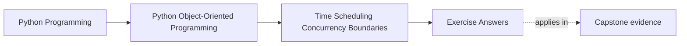
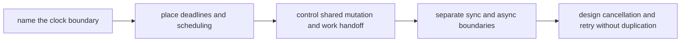

# Exercise Answers

<!-- page-maps:start -->
## Page Maps

<!-- page-maps:end -->

These model answers show what a strong runtime review packet looks like for the
`EnrollmentReminderCoordinator` scenario. Read them as one defended ownership model, not
as ten disconnected correct replies.

## Running scenario recap

`EnrollmentReminderCoordinator`:

- finds workshops nearing start time
- enqueues reminder work
- sends reminders asynchronously
- marks reminder state to prevent duplicates
- may be cancelled and retried by runtime supervisors

The key design question is not "which concurrency library should we use?" It is "which
boundary owns time, mutation, and retry safety?"

## Answer 1: Choose the clock

Use:

- calendar time for workshop start timestamps and reminder meaning
- monotonic time for waits, timeout budgets, and retry delays

Ownership rule:

- the coordinator or runtime boundary owns clock access
- domain objects such as `WorkshopEnrollment` should not call `datetime.now()` or
  event-loop time directly

Why this matters:

- a wall-clock jump can make wait logic fire too early or too late
- a domain object that reads the clock directly becomes harder to test and harder to
  reason about

This is the first runtime distinction the packet should make visible: "what time is it?"
and "how long have we waited?" are different questions.

## Answer 2: Deadline boundary

For "send reminder no later than thirty minutes before workshop start":

- compute the deadline at the scheduling boundary
- carry a concrete cutoff with the work item
- enforce the cutoff before delivery begins

If the worker sees the reminder after the cutoff:

- mark it stale, skipped, or expired
- do not let the sender pretend the original timing contract was met

The lesson is that deadline ownership should be centralized. Scattered `if now >
cutoff` checks across domain methods make the time rule impossible to review.

## Answer 3: Scheduling concern

The repeated scan for upcoming workshops belongs to a scheduler or coordinator boundary,
not to the workshop model itself.

Strong split:

- scheduler decides when to scan
- coordinator creates reminder work units
- worker performs reminder delivery

Strong test route:

- inject a fake clock
- call the scan boundary directly
- assert which work items are enqueued

No real sleeping is needed when the time boundary is explicit.

## Answer 4: Shared mutation ownership

Reminder status should not be mutated casually by several workers.

Cleaner ownership rule:

- one worker owns one reminder key at a time through queue handoff
- state transitions happen through one persistence or workflow boundary

Race if state is shared casually:

1. two workers read "not sent"
2. both send the reminder
3. both mark success afterward

That creates duplicate visible work while every individual step still looks locally
reasonable.

## Answer 5: Queueing versus locking

Lock design:

- shared status surface protected by a lock
- several callers still target the same mutable state directly

Queue design:

- one work item carries ownership of one reminder attempt
- dedupe key travels with the work

Better fit here:

- queue ownership

Why:

- retry reasoning stays close to mutation ownership
- duplicate-send prevention is easier to review
- workers can scale without every path depending on a broad shared lock surface

Rejected design:

- wide in-memory locking across workers and retries

That design may reduce one race while leaving ownership hard to see.

## Answer 6: Cache under runtime pressure

Suppose the coordinator caches "reminders due in the next five minutes."

That cache is safe only if:

- freshness rules are explicit
- the cache is derived, not authoritative
- stale cache does not decide whether a reminder was already sent

Dangerous bug:

- stale due-soon cache causes the system to enqueue work that current reminder state
  would reject

The first proof should be a test that changes reminder status and verifies the cache does
not create duplicate scheduling decisions.

## Answer 7: Sync/async bridge

Keep:

- synchronous admin command surface for "replay reminders for workshop X"
- asynchronous sender and worker execution below that boundary

Bridge location:

- application or runtime adapter layer

Why not widen everything?

- if every layer becomes both sync-aware and async-aware, interfaces broaden faster than
  the actual business problem

This is the runtime equivalent of letting storage details leak inward in Module 06.

## Answer 8: Concurrency-aware API

Example API:

- `replay_reminders(workshop_id)` stays synchronous for the admin caller
- it submits or coordinates reminder work and returns a submission result

The contract must state:

- whether it blocks until delivery or only until work acceptance
- whether repeated calls deduplicate
- what state callers may assume after return

"Thread-safe" is not enough. Callers need a reviewable statement of what actually
happens under concurrent use.

## Answer 9: Cancellation and retry path

Case:

- reminder payload generated
- worker cancelled before status is marked sent

Safe retry requires:

- a durable dedupe marker
- or an atomic relationship between external send and durable progress recording

Unsafe design:

1. send escapes
2. cancellation lands before durable sent-state
3. retry sends again with no evidence that the first attempt already happened

That is exactly the kind of duplicate side effect the runtime packet is meant to expose.

## Answer 10: Final runtime review packet

A compact strong packet might read:

> `EnrollmentReminderCoordinator` owns time and scheduling decisions. Calendar time is
> used for workshop meaning; monotonic time is used for waits and retry delays. Reminder
> work is handed off through queue ownership rather than casual shared mutation. The
> sync-to-async bridge stays at the application edge. The remaining high-risk point is
> cancellation after outward delivery but before durable sent-state, so retry safety
> depends on a durable dedupe marker.

That packet is strong because another maintainer can answer:

- who owns clocks
- who owns mutation
- where async begins
- what retry is trying not to duplicate

## Self-check

Your own runtime packet is ready when another reader can answer all of these from it:

- which clock is authoritative for one rule
- what prevents two workers from sending the same reminder
- where a synchronous caller meets asynchronous execution
- why cancellation is safe or unsafe at one specific point

If any answer still depends on "you know what I meant," tighten the packet before moving
on.
