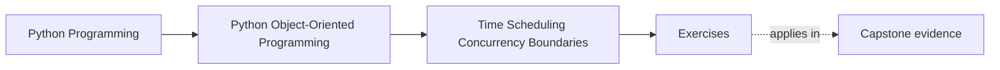
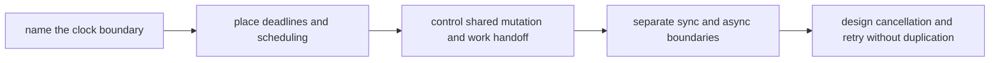

# Exercises

<!-- page-maps:start -->
## Page Maps

<!-- page-maps:end -->

Use this exercise day as one full runtime-boundary lab. The goal is not to memorize
`asyncio`, queue classes, or lock APIs. The goal is to show that one workflow under time
pressure can still be explained in terms of ownership, deadlines, mutation, and safe
retry.

If you are studying alone, build one runtime packet another maintainer could review
without needing your spoken explanation.

## Running lab scenario

Use one workflow for the whole day:

`EnrollmentReminderCoordinator`

The system:

- watches workshops that will start soon
- schedules reminder sends before the start time
- retries failed sends through a worker queue
- updates reminder status so the same attendee is not reminded twice
- exposes a synchronous admin surface but uses asynchronous delivery underneath

The pressure is intentional:

- deadlines depend on correct clock semantics
- multiple workers may race to send the same reminder
- queue delays may make scheduled work stale
- cancellation may land after partial progress

If you choose your own scenario, keep the same weight: one deadline-driven workflow, one
mutable status surface, one worker boundary, and one retry story that could duplicate
visible work if designed badly.

## What you are building by the end

Build one runtime review packet containing:

- one clock-decision note
- one deadline and stale-work rule
- one scheduler ownership note
- one mutation-ownership map
- one queue-versus-lock decision
- one sync/async bridge note
- one cancellation and retry safety note

If your work stays as ten disconnected answers, the exercise day is not finished.

## Working tables

Keep these two tables open and fill them as you go.

| Operation | Time or concurrency concern | Owning boundary | Objects that must stay unaware | Failure if the boundary leaks |
| --- | --- | --- | --- | --- |

| Operation | Cancellation point | Retry safe | Required durable state guard | Side effect that must not duplicate |
| --- | --- | --- | --- | --- |

The first table protects ownership. The second protects the system from runtime honesty
failures.

## Exercise 1: Choose the clock deliberately

For reminder delivery, decide:

- which rule uses wall-clock time
- which rule uses monotonic time
- where the clock should be injected or owned
- which object must not call `datetime.now()` or event-loop time directly

End by naming one bug that appears if calendar meaning and elapsed waiting are mixed.

## Exercise 2: Draw the deadline boundary

Take the rule:

- "send the reminder no later than thirty minutes before workshop start"

Explain:

- where the deadline is computed
- where the deadline is enforced
- what happens if queued work is already stale when a worker sees it
- why the domain object should not scatter deadline checks through its own methods

This exercise is about ownership of the rule, not arithmetic.

## Exercise 3: Place scheduling in one boundary

Choose one repeated activity, such as scanning for upcoming workshops, and decide:

- which coordinator or scheduler owns that repeated action
- what work unit gets enqueued
- what domain objects stay unaware of timers and polling
- how you would test the schedule without sleeping in real time

If the model itself needs to know about timer loops, the boundary is too wide.

## Exercise 4: Place shared mutation honestly

Take reminder status and decide:

- whether more than one worker may mutate it directly
- whether single ownership, queue handoff, or explicit locking is cleaner
- what race appears if the state is shared casually
- what review artifact would make the ownership rule easy to see

This is where "be careful with concurrency" must become a design rule with a visible
owner.

## Exercise 5: Compare queueing and locking

For duplicate reminder risk, compare:

- a lock around shared reminder state
- a queue that gives one worker ownership of each reminder key

Explain:

- what each design buys
- what each one complicates operationally
- which design makes retry and deduplication easier to reason about
- which design you are rejecting and why

Do not stop at "queues scale better" or "locks are simpler." Tie the choice to who owns
mutation.

## Exercise 6: Review one cache or memoized surface

Suppose the coordinator caches "next reminders due soon."

Explain:

- whether the cached value is safe to share
- what freshness rule matters
- what stale or racing bug would make the cache misleading
- what proof should fail first if the cache contract drifts

Caching here is a time contract before it is a performance trick.

## Exercise 7: Place the sync/async bridge

The admin UI triggers reminder replay synchronously, but delivery runs asynchronously.

Decide:

- where the bridge lives
- which API remains synchronous
- which API remains asynchronous
- what damage appears if both styles spread through every layer

The answer is weak if it only says "wrap it in async later." State the architectural
boundary.

## Exercise 8: Review one concurrency-aware API

Choose one API surface and explain:

- what blocking or awaiting behavior callers must know
- what concurrency guarantee is actually promised
- what state assumptions remain explicit
- what documentation, test, or proof should make the contract reviewable

Do not answer with "thread-safe" alone. Define what that means here.

## Exercise 9: Design one cancellation and retry path

Take this case:

- reminder payload generated
- worker is cancelled before status is marked sent

Explain:

- whether retry is safe
- what progress must be durable before cancellation becomes harmless
- what duplicate side effect would reveal the design is wrong
- where resumable progress should be recorded if needed

This is the exercise that turns retry from a slogan into an owned contract.

## Exercise 10: Assemble the runtime review packet

Finish the lab by assembling all prior work into one short packet.

A strong packet lets another maintainer answer all of these without your draft notes:

- which boundary owns time
- which boundary owns shared mutation
- where async begins and ends
- what durable marker makes retry safe
- which proof should fail first if the runtime boundary leaks inward

## Final review drill

Before opening the answer page, ask your packet these questions:

- "Which clock is authoritative for this rule?"
- "Who stops duplicate reminder sends under concurrency?"
- "What happens if cancellation lands halfway through the path?"
- "Which surface would expose stale work first?"

If those answers are still vague, tighten the packet. The exercise day is complete only
when the runtime pressure has an explicit owner.
