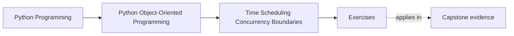
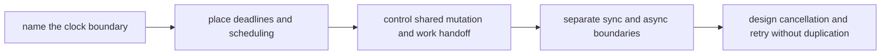

# Exercises

<!-- page-maps:start -->
## Page Maps

<!-- page-maps:end -->

Use these exercises as one full runtime-boundary lab. The goal is not to memorize
`asyncio`, threads, or lock APIs. The goal is to prove that a learner studying alone can
take one time-sensitive workflow and say who owns the clock, who owns mutation, where
async style begins, and when cancellation is safe.

## Running lab scenario

Use one workflow all day:

`EnrollmentReminderCoordinator`

The system:

- watches workshops that will start soon
- schedules reminder sends before the start time
- retries failed sends through a worker queue
- updates reminder status so the same attendee is not reminded twice
- exposes a synchronous admin surface but uses asynchronous delivery underneath

Pressure points:

- deadlines depend on correct time semantics
- multiple workers may race to send the same reminder
- queue delays may make old scheduled work stale
- cancellation may happen after partial progress

If you choose your own scenario, keep the same pressure: one deadline-driven workflow,
one shared mutable status surface, one worker boundary, and one retry story.

## What to keep open while you work

Build one runtime packet as you go. By the end it should contain:

- one clock-decision note
- one deadline-boundary note
- one mutation-ownership map
- one queue-versus-lock decision
- one sync/async bridge review
- one cancellation and retry recommendation

Useful tables:

| Operation | Time or concurrency concern | Owning boundary | Objects that must stay unaware | Failure if the boundary leaks |
| --- | --- | --- | --- | --- |

| Operation | Cancellation point | Retry safe | Required state guard | Side effect that must not duplicate |
| --- | --- | --- | --- | --- |

## Exercise 1: Choose the clock

For reminder delivery, decide:

- which part uses wall-clock time
- which part uses monotonic time
- where the clock should be injected or owned
- what object must not call `datetime.now()` or event-loop time directly

Then name one bug that appears if wall-clock and elapsed-time concerns are mixed.

## Exercise 2: Draw the deadline boundary

Take the rule "send the reminder no later than thirty minutes before workshop start."

Explain:

- where the deadline is computed
- where the deadline is enforced
- what happens if work reaches the queue too late
- why the domain object should not scatter deadline checks through its methods

This exercise is about boundary ownership, not arithmetic.

## Exercise 3: Review one scheduling concern

Choose one repeated activity, such as scanning for upcoming workshops, and decide:

- which coordinator schedules it
- what work unit gets enqueued
- what domain objects stay ignorant of timers
- how to test the schedule without sleeping in real time

If the design requires the domain model to know about timer loops, the boundary is too
wide.

## Exercise 4: Place shared mutation honestly

Take reminder status and decide:

- whether more than one worker may mutate it directly
- whether single ownership, queue handoff, or explicit locking is cleaner
- what race appears if the state is shared casually
- what review artifact would make the ownership rule easy to see

This is the point where "be careful with concurrency" must become a design rule.

## Exercise 5: Compare queueing and locking

For duplicate reminder risk, compare:

- a lock around shared reminder state
- a queue that gives one worker ownership of each reminder key

Explain:

- what each design buys
- what it complicates operationally
- which one makes retry and deduplication easier to reason about

End with one recommendation and one rejected design.

## Exercise 6: Review one cache or memoized surface

Suppose the coordinator caches "next reminders due soon."

Explain:

- whether the cached value is safe to share
- what freshness rule matters
- what stale or racing bug would make the cache misleading
- what proof should fail first if the cache contract drifts

Caching is a time contract before it is a performance choice.

## Exercise 7: Place the sync/async bridge

The admin UI triggers reminder replay synchronously, but the delivery path is asynchronous.

Decide:

- where the bridge lives
- which API remains synchronous
- which API remains asynchronous
- what design damage appears if both styles spread through every layer

This is where many codebases become harder to read than they need to be.

## Exercise 8: Review one concurrency-aware API

Choose one API surface and explain:

- what blocking or awaiting behavior callers must know
- what concurrency guarantee is actually being promised
- what state assumptions remain explicit
- what documentation or test should make the contract reviewable

Do not answer with "thread-safe" alone. State what that means here.

## Exercise 9: Design one cancellation and retry path

Take this case:

- reminder payload generated
- worker is cancelled before status is marked sent

Explain:

- whether retry is safe
- what state transition must be atomic before cancellation becomes harmless
- what duplicate side effect would reveal the design is wrong
- where resumable progress should be recorded if needed

## Exercise 10: Produce the runtime packet

Finish the lab by assembling:

- one timing table
- one retry table
- one bridge review paragraph
- one queue-versus-lock decision
- one concurrency-safe cache note

The packet is done only when another maintainer can answer:

- which boundary owns time
- which boundary owns shared mutation
- where async begins and ends
- when cancellation is safe

## Done means the runtime pressure has an owner

You are done with the exercise day when your packet can survive these review questions:

- "Which clock is authoritative for this rule?"
- "Who stops duplicate reminder sends under concurrency?"
- "What happens if cancellation lands halfway through the path?"

If those answers are still fuzzy, keep tightening the ownership language before you open
the answer page.
