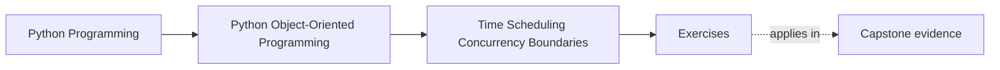
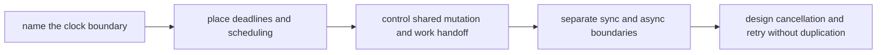
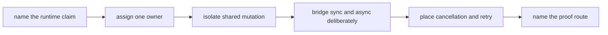

# Exercises


<!-- page-maps:start -->
## Page Maps




<!-- page-maps:end -->

Use these exercises to make time and concurrency pressure explicit instead of letting it
spread through the model as invisible runtime folklore.

The day is not about memorizing thread or asyncio APIs. It is about proving that clocks,
deadlines, queues, locks, cancellation, and async bridges have named owners and do not
quietly infect the whole design.

## How to work through this set

Treat the ten exercises as one full lab day on temporal contracts and concurrency
boundaries.

Before each answer:

1. name the operation or state transition under review
2. name the object or boundary that should own the time or concurrency pressure
3. state which objects must stay unaware of that pressure

Do the exercises in order. The day is one progression:

- Exercises 1-3 define clocks, deadlines, and scheduling boundaries
- Exercises 4-6 review shared mutation, work queues, caches, and ownership transfer
- Exercises 7-8 place sync/async bridges and API surface decisions
- Exercises 9-10 test cancellation, retries, and the full runtime boundary under failure

Keep one runtime-boundary packet as you go. By the end of the day it should contain:

- one clock-decision note
- one deadline or timeout boundary review
- one mutation-ownership map
- one queue or lock justification
- one sync/async bridge review
- one cancellation and retry recommendation

If those six artifacts are missing, you are probably still discussing mechanics instead
of ownership.

## Recommended working layout

If you want one lab tree that can support the whole day, use something like:

```text
module07-lab/
├── artifacts/
├── notes/
├── scratch/
└── tests/
```

Keep one timing table while you work:

| Operation | Time or concurrency concern | Owning boundary | Objects that must stay unaware | Failure if the boundary leaks |
| --- | --- | --- | --- | --- |

Keep one retry table:

| Operation | Cancellation point | Retry safe | Required state guard | What side effect must not duplicate |
| --- | --- | --- | --- | --- |



Use that route on purpose. It keeps the day centered on owned runtime pressure instead of
on incidental library details.

## Exercise 1: Choose the right clock

Take one operation and explain:

- whether it should depend on wall-clock time or monotonic time
- where that clock should be injected or owned
- what object must stay free of direct time lookup
- what bug appears if the wrong clock is used

Study note:
The first time decision is not "what API is convenient" but "what notion of time the
contract actually needs."

## Exercise 2: Draw one deadline boundary

Pick one timeout, expiration, or deadline rule and explain:

- where the deadline is calculated
- where it is enforced
- what state transition it may trigger
- why that concern belongs at that boundary rather than deeper in the model

Study note:
Deadlines are design boundaries, not scattered `if now > cutoff` checks.

## Exercise 3: Review one scheduling concern

Choose one scheduled or repeated activity and explain:

- what object or runtime boundary should coordinate it
- what work unit is being scheduled
- what domain object must stay ignorant of the schedule
- how you would test the schedule without sleeping in tests

Study note:
Scheduling should coordinate work; it should not redefine domain meaning.

## Exercise 4: Place shared mutation honestly

Take one mutable state surface and explain:

- whether shared mutation is acceptable at all
- whether a lock, queue, single owner, or immutable handoff is cleaner
- what race appears if the state is shared casually
- what boundary should expose the rule to reviewers

Study note:
The cleanest concurrency story is often "share less," not "lock more."

## Exercise 5: Compare queueing and locking

Pick one concurrency pressure point and explain:

- what a lock-based design would look like
- what a queue- or worker-based design would look like
- which one keeps ownership clearer
- what operational tradeoff you accept by choosing it

Study note:
The decision is about control over mutation and backpressure, not about fashion.

## Exercise 6: Review one cache under concurrency pressure

Take one cache or memoized value and explain:

- whether the cached value is immutable enough to share
- what invalidation or freshness rule matters
- what concurrency hazard appears if the cache is naïve
- what proof surface should fail if the cache contract drifts

Study note:
Caching is a time contract before it is a speed trick.

## Midday self-check

Before moving into sync/async boundaries and cancellation pressure, make sure your packet
already answers these questions clearly:

- which clock one operation should use
- where one deadline is owned
- whether one shared state surface should lock, queue, or transfer ownership
- how one concurrent cache stays valid

If you cannot answer those four questions in plain language, return to Exercises 1-6 and
make the packet more explicit before continuing.

## Exercise 7: Place one sync/async bridge

Choose one boundary between synchronous and asynchronous work and explain:

- where the bridge should live
- which API should stay synchronous
- which API should become asynchronous
- what design damage appears if every layer learns both styles

Study note:
Bridges are strongest at edges. They are weakest when they widen every interface.

## Exercise 8: Review one thread-aware or async-aware API

Take one public API and explain:

- what concurrency guarantees it offers
- what blocking behavior callers must know
- what state assumptions must remain explicit
- what documentation or test should make those guarantees reviewable

Study note:
Concurrency-aware APIs are contracts, not implementation trivia.

## Exercise 9: Design one cancellation and retry path

Take one meaningful workflow and explain:

- where cancellation may happen safely
- what must be atomic before cancellation is allowed
- whether retry is safe afterward
- what side effect or state duplication would prove the design is wrong

Study note:
Cancellable work is only safe when partial progress remains governable.

## Exercise 10: Produce a runtime-boundary decision packet

Assemble:

- one timing table
- one retry table
- one bridge review paragraph
- one queue-versus-lock decision
- one concurrency-safe cache note

The packet is strong when another maintainer can answer:

- which boundary owns time
- which boundary owns shared mutation
- where async style begins and ends
- when cancellation is safe
- what proof surface should fail first if runtime pressure leaks inward

## Done means more than finishing the page

You are done with the exercise day when your packet can survive three kinds of review:

- a design review asking where time pressure belongs
- an incident review asking where duplicate work or race conditions should have been
  stopped
- an API review asking whether sync and async boundaries are still readable

If the packet cannot survive those reviews, keep tightening the ownership language.
