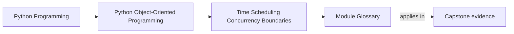

# Module Glossary

<!-- page-maps:start -->
## Page Maps

<!-- page-maps:end -->

This glossary belongs to **Module 07: Time, Scheduling, and Concurrency Boundaries** in
**Python Object-Oriented Programming**. Use it to keep the module's language stable
while you move between lesson pages, exercises, and capstone review.

## How to use this glossary

Return here when two ideas start sounding similar but should lead you to different design
choices.

Examples:

- deadline versus timeout
- ownership versus sharing
- scheduling versus domain meaning
- async support versus async everywhere

If two terms collapse into one vague idea, the design usually becomes vague too.

## Terms in this module

| Term | Meaning in this module | Why it matters |
| --- | --- | --- |
| backpressure | the rule that says incoming work may exceed safe processing capacity, so the runtime must slow, reject, queue, or shed work deliberately | prevents infinite buffering and hidden overload |
| boundary-owned clock | a clock controlled by the runtime edge rather than looked up directly from a domain object | keeps time testable and keeps business meaning separate from time capture |
| calendar time | wall-clock time such as timestamps, dates, and timezones that help describe when a real-world event happened | useful for business meaning, logging, and expiry records |
| cancellation | runtime interruption pressure that stops or abandons in-flight work because a caller, supervisor, or deadline gave up | must not be confused with "nothing happened" |
| checkpoint | durable progress marker that lets interrupted work resume honestly instead of rerunning blindly | required for trustworthy resumable operations |
| concurrency contract | the explicit statement of whether an API is safe to call from multiple threads or async tasks, and under what limits | turns caller assumptions into visible design truth |
| coordination object | a runtime-facing object that owns scheduling, worker flow, retry timing, deadlines, or supervision | keeps domain objects from absorbing orchestration policy |
| deadline | the latest acceptable completion point for a unit of work | answers "by when must this finish?" |
| expiration policy | the rule that says when data, a lease, or a decision is no longer valid | answers "when does this stop being trustworthy or usable?" |
| monotonic time | elapsed-time measurement that only moves forward and is safe for durations, waits, and timeout budgets | protects waiting logic from wall-clock jumps |
| owned mutation | the rule that one clear object, worker, thread, or loop is responsible for changing a specific piece of mutable state | reduces lock sprawl and shared-state ambiguity |
| queue handoff | transfer of work from a producer to an owned worker boundary through a command or payload | replaces casual shared mutation with deliberate ownership transfer |
| resumable operation | work that can restart after interruption because the system can prove what progress is already durable | stronger than "we can just try again" |
| retry safety | the ability to attempt work again without causing incorrect duplicate side effects or invalid repeated transitions | essential once failures, queues, or cancellations exist |
| scheduler policy | the runtime rule that decides when work runs, how often it repeats, and how timers are coordinated | belongs at the runtime edge, not inside business objects |
| sync-async bridge | a deliberate boundary that connects synchronous domain logic to asynchronous runtime or I/O behavior | keeps async requirements from spreading unnecessarily |
| thread-safe cache | a cache whose concurrent access rules are explicit and whose values remain subordinate to authoritative truth | avoids stale or racing shortcut state becoming primary truth |
| timeout | the maximum amount of waiting a caller or runtime boundary is willing to spend on an attempt | answers "how long will we wait this time?" |
| timezone conversion | translation between wall-clock contexts such as UTC and local zones | must stay separate from elapsed-time measurement |
| worker boundary | the place where queued work becomes owned execution under one coordinator or worker | central for backpressure, retries, and completion rules |

## Fast contrasts

| Do not confuse | With | Better distinction |
| --- | --- | --- |
| timeout | deadline | timeout is a waiting budget for one attempt; deadline is the final acceptable finish point |
| calendar time | monotonic time | calendar time explains when something happened; monotonic time measures elapsed duration safely |
| ownership | locking | ownership says who is allowed to mutate; locking is one mechanism that may protect that ownership |
| async-aware API | async-everywhere design | an async-aware API states where async matters; async-everywhere spreads it without enough reason |
| retry | resume | retry starts an attempt again; resume continues from proven durable progress |

## Review prompts

- Which terms in your current design name business meaning, and which name runtime pressure?
- Where have you used "thread-safe" or "async" as vague reassurance instead of a contract?
- Which capstone path still lacks a clear distinction between timeout, deadline, and expiry?

## Exit check

Leave this glossary only when you can do all of these:

- explain the difference between timeout, deadline, and expiration policy
- explain why ownership is a stronger design question than "where should I add a lock?"
- identify one place where a sync-async bridge is better than widening the whole model
