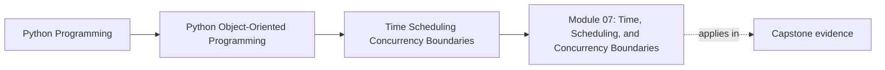

# Module 07: Time, Scheduling, and Concurrency Boundaries

<!-- page-maps:start -->
## Page Maps

<!-- page-maps:end -->

This module is where object design meets runtime pressure. The earlier modules taught you
how to place truth, transitions, persistence, and public seams. This module asks a new
question:

> When time, retries, queues, threads, or async work appear, which boundary should own
> that pressure and which parts of the model should remain ignorant of it?

If you cannot answer that question, runtime complexity spreads everywhere.

## What this module is really about

This module is not a tour of concurrency tools.

It is about keeping these distinctions sharp:

- calendar time versus elapsed time
- timeout versus deadline versus expiration
- shared mutation versus owned handoff
- sync core logic versus async edge coordination
- retry versus resume

Those distinctions are what keep runtime work from quietly rewriting the design.

## Running capstone path

Keep one path visible while you study:

1. a monitoring workflow decides whether a new incident state is valid
2. runtime coordination decides when work is attempted
3. workers or queues carry the work
4. retries or cancellation may interrupt the path
5. observers still need the domain meaning to remain clear

Every lesson in this module should make that path easier to reason about.

## Preflight

Before going further, you should already be able to do all of these:

- explain which boundary owns a domain invariant
- distinguish authoritative state from derived or downstream work
- explain why retries and side effects are not "just implementation details"

If those still blur together, reread the ownership and persistence modules first.

## What you should be able to do by the end

By the end of this module, you should be able to:

- choose the right clock for a rule and place it at the right boundary
- decide whether a concurrency problem is best solved by ownership transfer, a queue, a
  lock, or less shared mutation
- keep async style at the edges unless the core genuinely needs it
- explain where cancellation is safe and where retry becomes dangerous
- review a runtime change without letting scheduler concerns infect the whole model

## Read this module as one lab day

Use the lesson pages in this order:

1. clocks, timezones, and monotonic time
2. deadlines, timeouts, and expiration policies
3. schedulers and coordination objects
4. threads, locks, queues, and backpressure
5. caches under time and concurrency pressure
6. sync/async bridges and concurrency-aware APIs
7. cancellation, retries, and resumable work
8. the refactor page
9. the exercises and answer packet

If you jump straight to async or locks before time ownership is clear, the later pages
will feel more technical and less educational than they should.

## Lesson map

- [Clocks, Timezones, and Monotonic Time](clocks-timezones-and-monotonic-time.md)
- [Deadlines, Timeouts, and Expiration Policies](deadlines-timeouts-and-expiration-policies.md)
- [Schedulers, Timers, and Coordination Objects](schedulers-timers-and-coordination-objects.md)
- [Threads, Locks, and Owned Mutation](threads-locks-and-owned-mutation.md)
- [Queues, Workers, and Backpressure Boundaries](queues-workers-and-backpressure-boundaries.md)
- [Concurrency-Safe Caches and Memoization](concurrency-safe-caches-and-memoization.md)
- [Asyncio Tasks and Sync-Async Bridges](asyncio-tasks-and-sync-async-bridges.md)
- [Designing Thread-Aware and Async-Aware APIs](designing-thread-aware-and-async-aware-apis.md)
- [Cancellation, Retries, and Resumable Operations](cancellation-retries-and-resumable-operations.md)
- [Refactor: Runtime around Time and Concurrency Boundaries](refactor-runtime-around-time-and-concurrency-boundaries.md)
- [Exercises](exercises.md)
- [Exercise Answers](exercise-answers.md)
- [Glossary](glossary.md)

## Keep these support surfaces open

- `../guides/proof-matrix.md` when you want one runtime claim tied to one proof route
- `../guides/pressure-routes.md` when runtime concerns start competing with earlier
  ownership decisions
- `../reference/self-review-prompts.md` when you want to test whether time and
  concurrency still sound like boundary choices rather than ambient conditions

## Study route through the capstone

If the module still feels abstract, take this route:

1. inspect the runtime or coordination layer in the capstone
2. ask which parts truly need clocks, queues, retries, or async work
3. ask which domain objects should remain plain synchronous logic
4. ask what a worker cancellation would leave behind
5. compare that answer with the exercises and refactor page

That route turns the module into a concrete runtime review instead of a library survey.

## Questions to keep explicit

- Which boundary should own "what time is it now?"
- Which mutation path is dangerous enough that shared state should be replaced by owned
  handoff?
- Where does synchronous domain logic stop and async coordination begin?
- What retry path would duplicate visible work if you got cancellation wrong?

## Common failure modes

- using wall-clock time where monotonic time is required
- teaching domain objects about timers, polling cadence, or retry delay
- widening every API to async because one adapter is async
- using shared caches without explicit freshness or ownership rules
- calling work "resumable" without a durable checkpoint story

## Honest completion signal

You are ready to move on when you can take one capstone runtime change and explain:

- which boundary should absorb the new time or concurrency pressure
- which objects should stay unaware of it
- what proof or drill should fail first if that pressure leaks inward

## Closing criteria

You should finish this module able to keep Python object systems readable and testable
even when clocks, worker concurrency, retries, and async integration are real.

## Directory glossary

Use [Glossary](glossary.md) when you want the recurring runtime language kept stable
while you move between lessons, labs, and capstone review.
