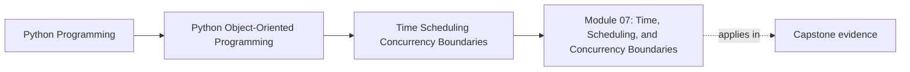

# Module 07: Time, Scheduling, and Concurrency Boundaries

<!-- page-maps:start -->
## Page Maps

<!-- page-maps:end -->

Read the first diagram as a placement map: this module takes the clean boundaries from
earlier modules and puts them under runtime pressure. Read the second diagram as the
session route: choose the right clock, place deadlines and scheduling where they belong,
decide who owns mutable state, then make retry and cancellation semantics explicit.

This module exists because many systems stay well-designed until time and concurrency
arrive. Then one adapter needs retries, one worker needs a queue, one timeout gets
introduced in a hurry, and suddenly every layer knows about clocks, async wrappers, and
shared mutable state.

The central question for the whole module is:

> When runtime pressure appears, which boundary should absorb it, and which objects
> should remain ignorant of it?

If you can answer that question, the design stays readable. If not, runtime mechanics
slowly become the architecture.

## Preflight

Before you start, make sure you can already do all of these:

- explain which boundary owns one domain invariant
- distinguish authoritative state from downstream work
- describe why retries and side effects are not "just implementation details"

If those are still fuzzy, revisit Modules 04 through 06 before continuing. Module 07
assumes you already know who owns truth before runtime starts stressing the design.

## What you should be able to protect

By the end of this module, you should be able to:

- choose the correct clock for one rule and place it at the right boundary
- distinguish timeout, deadline, expiration, retry delay, and stale work
- choose ownership transfer, queueing, or locking based on meaning instead of habit
- keep sync domain logic separate from async runtime coordination when possible
- explain where cancellation is safe and where retry would duplicate visible work

These are not separate runtime tricks. They are one ownership problem under time and
concurrency pressure.

## Why this module matters

Runtime pressure shows up in familiar ways:

- wall-clock time is used for elapsed waits and then jumps unexpectedly
- one shared object is touched by several workers with no ownership rule
- one async adapter causes every interface to widen to async
- retries are added before anyone decides what progress is durable
- queues and caches appear without freshness or deduplication contracts

This module teaches the earlier fix: put time and concurrency semantics at explicit
boundaries before operational complexity makes the codebase dishonest.

## The full session route

Treat Module 07 as one full runtime-boundary lab with four questions in view:

1. which boundary should ask "what time is it?"
2. which boundary should decide "is this work still valid?"
3. who owns mutation for this state surface?
4. what progress must be durable before retry or cancellation becomes safe?

If you can answer those four questions for one concrete workflow at the end of the
module, the session worked.

## Decision table: keep runtime pressure reviewable

| Design question | Strong answer | Weak answer |
| --- | --- | --- |
| which clock should this rule use? | wall clock for calendar meaning, monotonic for elapsed waiting | whichever time function is closest |
| how should shared state be coordinated? | owned mutation, queue handoff, or explicit invariant-preserving lock scope | "be careful, it is thread-safe somehow" |
| where should async begin? | at runtime or I/O edges that truly need it | everywhere because one adapter is async |
| what makes retry safe? | durable progress marker or idempotent boundary | hope the first attempt did not escape |
| how should stale work be handled? | explicit deadline, expiration, or skip policy | let workers guess |

Keep this table open while reading. It turns a technical runtime discussion back into one
ownership discussion.

## Running capstone path

Use one concrete path all the way through the module:

1. a monitoring or reminder workflow decides whether a state transition is valid
2. a coordinator decides when work should happen
3. a queue or worker performs the external work
4. cancellation or retry may interrupt the path
5. the system still needs the underlying business meaning to remain clear

Every lesson should make that path easier to review.

## Reading path

Use the lesson pages in this order:

1. clocks, timezones, and monotonic time
2. deadlines, timeouts, and expiration policies
3. schedulers, timers, and coordination objects
4. threads, locks, queues, and owned mutation
5. caches and memoization under runtime pressure
6. sync/async bridges and concurrency-aware APIs
7. cancellation, retries, and resumable work
8. the refactor page
9. the exercise day and answer packet

That order matters. If you jump straight to locks or async syntax, the later pages feel
like library tours instead of object-design lessons.

## Lesson map

- [Clocks, Timezones, and Monotonic Time](clocks-timezones-and-monotonic-time.md)
- [Deadlines, Timeouts, and Expiration Policies](deadlines-timeouts-and-expiration-policies.md)
- [Schedulers, Timers, and Coordination Objects](schedulers-timers-and-coordination-objects.md)
- [Threads, Locks, and Owned Mutation](threads-locks-and-owned-mutation.md)
- [Queues, Workers, and Backpressure Boundaries](queues-workers-and-backpressure-boundaries.md)
- [Concurrency-Safe Caches and Memoization](concurrency-safe-caches-and-memoization.md)
- [Asyncio Tasks and Sync-Async Bridges](asyncio-tasks-and-sync-async-bridges.md)
- [Designing Thread-Aware and Async-Aware APIs](designing-thread-aware-and-async-aware-apis.md)
- [Cancellation, Retries, and Resumable Operations](cancellation-retries-and-resumable-operations.md)
- [Refactor: Runtime around Time and Concurrency Boundaries](refactor-runtime-around-time-and-concurrency-boundaries.md)
- [Exercises](exercises.md)
- [Exercise Answers](exercise-answers.md)
- [Glossary](glossary.md)

## Keep these support surfaces open

- `../guides/proof-matrix.md` when you want one runtime claim tied to one proof route
- `../guides/pressure-routes.md` when runtime concerns start competing with earlier
  ownership decisions
- `../reference/self-review-prompts.md` when you want to test whether time and
  concurrency still sound like explicit boundary choices

## Study route through one workflow

If the module still feels abstract, use one concrete workflow such as
`EnrollmentReminderCoordinator` or the nearest capstone equivalent and keep answering:

- where the current time is obtained
- where deadlines are computed and enforced
- how work ownership transfers between scheduler, queue, and worker
- what state prevents duplicate visible work
- which point is safe or unsafe for cancellation

That route turns the module into one reviewable runtime packet instead of many small
concept notes.

## What independent learners should produce

By the end of the module, produce one runtime review packet containing:

- one clock-decision note
- one deadline and stale-work rule
- one mutation-ownership map
- one queue-versus-lock decision
- one sync/async bridge note
- one cancellation and retry safety note

If you cannot assemble that packet without mixing up clocks, retries, and ownership, the
module is not finished yet.

## Honest completion signal

You are ready to move on when you can take one runtime change and explain:

- which boundary should absorb the new time or concurrency pressure
- which objects should stay unaware of it
- what progress must be durable before cancellation or retry is safe
- what proof or drill should fail first if the pressure leaks inward

## Closing criteria

You should finish this module able to keep Python object systems readable and testable
even when clocks, worker concurrency, retries, async integration, and stale work are
real operational concerns.

## Directory glossary

Use [Glossary](glossary.md) when you want the recurring runtime vocabulary kept stable
while you move between lessons, lab work, and capstone review.
