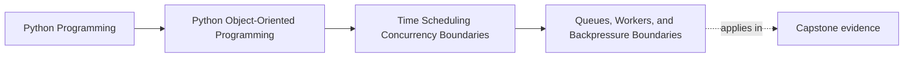
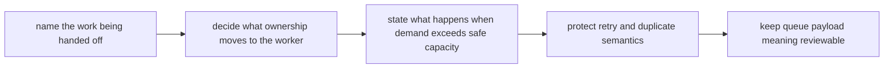

# Queues, Workers, and Backpressure Boundaries

<!-- page-maps:start -->
## Page Maps

<!-- page-maps:end -->

Read the first diagram as a placement map: this lesson explains how work leaves one
boundary and becomes owned runtime flow. Read the second diagram as the route through
the page: name the work unit, define the ownership handoff, state the backpressure
policy, then keep duplicate and retry meaning visible.

## Why this lesson matters

Queues are often introduced as infrastructure, but in design terms they solve a deeper
problem:

- too many actors want to do work now
- too few safe owners can perform that work at once

Queues and workers turn shared pressure into owned flow. Backpressure is the rule that
says the system cannot pretend infinite work fits through a finite boundary.

## Start with the handoff question

Ask this directly:

> What exact piece of work is leaving one boundary and becoming another boundary's
> responsibility?

That question matters because queues are not just buffers. They are ownership handoffs.

If the queued item is vague, the worker ends up reconstructing meaning from ambient
state and the handoff becomes much harder to review.

## A queue is an ownership transfer

When work is queued, the producer is no longer mutating the final state directly.

Instead, the producer is saying:

- here is work to be done
- another owned worker will take responsibility for attempting it

That handoff can simplify concurrency because it replaces casual shared mutation with a
clear transition of responsibility.

This is why queues belong in an object-design course: they change who owns the next state
transition.

## Workers own runtime coordination, not domain meaning

Workers usually own:

- how work is dequeued
- how many tasks run concurrently
- how retries are coordinated
- when work is acknowledged as completed or failed

These are runtime responsibilities.

The domain may say what a successful reminder or state transition means. The worker
boundary usually says when and under what operational pressure that attempt happens.

Confusing those two roles is how queueing starts to infect the core model.

## Queue payloads should carry enough meaning, but not everything

A queue item should carry enough context to preserve the intended work meaning without
forcing the worker to rediscover everything from surrounding state.

Good payload design asks:

- what command or event is actually being handed off?
- which identifiers must travel with it?
- which timing or dedupe context must travel too?
- what should the worker still reload from authoritative state?

That balance matters. A payload that is too thin becomes ambiguous. A payload that is too
fat becomes a leak of accidental implementation detail.

## Backpressure is an honesty rule

Backpressure means the system admits that demand can exceed safe processing capacity.

Without backpressure, systems tend to fail by:

- buffering endlessly
- timing out everywhere
- dropping work silently
- letting latency grow with no owned policy

Backpressure is the design answer to:

> What happens when more work arrives than this boundary can safely process?

If the system has no explicit answer, the queue is only hiding overload rather than
containing it.

## State backpressure policy in concrete terms

For one workflow, write the policy down:

| Pressure case | What happens? |
| --- | --- |
| queue is full | reject, delay, spill, or throttle explicitly |
| workers are saturated | slow producers or defer intake visibly |
| work is stale before execution | drop, expire, or reroute with a named rule |
| duplicates appear | dedupe or re-check authoritative state before visible effect |

This table matters because most weak queue designs avoid naming overload behavior until
production forces the answer.

## A queue does not remove retry and duplicate risk

Once work is queued, retries and duplicates often become more likely, not less.

That means queue design must still respect:

- retry safety
- duplicate handling
- visibility into partial completion

If a worker can repeat the same unit of work, the queue boundary has not escaped the
Module 05 and Module 07 recovery lessons. It has simply moved them.

## Review drill

For any queued workflow, ask:

1. what exact work unit is being handed off?
2. what ownership moves to the worker?
3. what happens when demand outpaces safe capacity?
4. what stops duplicate or retried work from creating duplicate visible effects?

If those answers are vague, the queue boundary is still more infrastructural than
architectural.

## Common mistakes

- using a queue but still letting many callers mutate the same state directly
- treating worker concurrency as unrelated to domain ownership
- assuming backpressure will "work itself out" with no policy
- stuffing queue payloads with accidental implementation detail
- ignoring duplicate or retried work once the queue exists

All of these mistakes recreate the same pressure the queue was supposed to contain.

## Capstone connection

Use the capstone polling or incident path to ask:

- which work should be handed to a worker instead of executed inline?
- where would a queue reduce shared mutation pressure?
- what should happen if work production outruns current worker capacity?

Those questions turn queueing into a design boundary rather than an infrastructure
afterthought.

## Exit check

Leave this lesson only when you can do all of these:

- explain why a queue is an ownership handoff rather than just a buffer
- identify where backpressure policy belongs in a runtime design
- point to one workflow that becomes clearer behind a worker boundary
