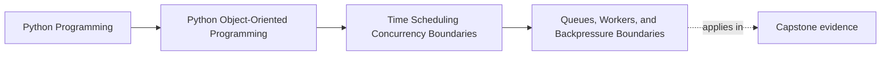

# Queues, Workers, and Backpressure Boundaries

<!-- page-maps:start -->
## Page Maps

<!-- page-maps:end -->

Read the first diagram as a placement map: this page is one concept inside its parent
module, not a detached essay, and the capstone is the pressure test for whether the
idea holds. Read the second diagram as the working rhythm for the page: name the
problem, study the example, identify the boundary, then carry one review question
forward.

## Why this lesson matters

Queues are often introduced as infrastructure, but in design terms they solve a deeper
problem:

- too many actors want to do work now
- too few safe owners can perform that work at once

Queues and workers help turn shared pressure into owned flow. Backpressure is the rule
that says the system cannot pretend infinite work fits through a finite boundary.

## A queue is an ownership handoff

When work is queued, the producer is no longer mutating the final state directly.

Instead, the producer is saying:

- here is work to be done
- another owned worker will take responsibility for executing it

That handoff can simplify concurrency because it replaces shared mutation with controlled
ownership transfer.

## Workers are runtime coordinators

Workers usually own:

- how work is dequeued
- how many tasks run concurrently
- how retries or failure handling are coordinated
- when work is acknowledged as completed or failed

These are runtime responsibilities, not aggregate semantics.

The domain may say what a successful command means. The worker boundary usually says when
and under what operational pressure that command gets attempted.

## Backpressure is a honesty rule

Backpressure means the system admits that demand can exceed safe processing capacity.

Without backpressure, systems often fail by:

- buffering endlessly
- timing out everywhere
- dropping work silently
- letting latency grow with no owned policy

Backpressure is the design-level answer to "what happens when more work arrives than the
current boundary can safely process?"

## Queue boundaries should preserve meaning

A queue item should usually carry enough context to preserve the intended work meaning
without forcing the worker to rediscover everything from ambient state.

But it should not become a leak of every internal detail either.

Good queue design asks:

- what command or event is actually being handed off?
- what identifiers or timing context must travel with it?
- what should remain reconstructable by the worker from authoritative state?

That balance is part of the contract.

## A queue is not a license to ignore idempotency

Once work is queued, retries and duplicates often become more likely, not less.

That means queue design must still respect:

- retry safety
- duplicate handling
- visibility into partial completion

If a worker can repeat the same unit of work, the earlier Module 05 retry lessons still
apply here.

## Common mistakes

- using a queue but still letting many callers mutate the same object directly
- treating worker concurrency as unrelated to domain ownership
- assuming backpressure will "work itself out" without a policy
- stuffing queue payloads with accidental implementation detail
- ignoring duplicate or retried work once the queue exists

These mistakes recreate the same pressure the queue was supposed to contain.

## Review checklist

| Question | Good sign |
| --- | --- |
| does the queue represent a real ownership handoff? | yes |
| do workers own runtime coordination rather than domain meaning? | yes |
| is there a visible backpressure policy when work outpaces capacity? | yes |
| does queued work still respect retry and duplicate-handling rules? | yes |

## Capstone connection

Use the capstone polling and incident path to ask:

- which work should be handed to a worker instead of executed inline?
- where would a queue reduce shared mutation pressure?
- what should happen if incident production outruns current worker capacity?

Those questions turn queues into a design boundary rather than an infrastructure afterthought.

## Exit check

Leave this lesson only when you can do all of these:

- explain why a queue is an ownership handoff rather than just a buffer
- identify where backpressure policy belongs in a runtime design
- point to one capstone operation that would be clearer behind a worker boundary
