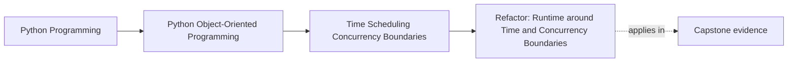
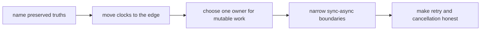

# Refactor: Runtime around Time and Concurrency Boundaries

<!-- page-maps:start -->
## Page Maps

<!-- page-maps:end -->

Read the first diagram as a placement map: this page is the practical synthesis of
Module 07. Read the second diagram as the refactor route: name what must survive, move
clock access outward, choose one owner for mutable work, narrow the async boundary, then
prove that retry and cancellation semantics are now clearer.

## Why this refactor matters

Runtime refactors often go wrong in the same way persistence refactors do:

- one operational need appears
- machinery is added quickly
- every layer learns just enough about time, queues, retries, or async behavior to
  become harder to review

The code looks more realistic but less truthful.

This page teaches the safer route: add runtime power while making ownership easier to
see.

## Running refactor target

Use one target throughout:

- `EnrollmentReminderCoordinator`

Messy starting point:

- domain objects read the current time directly
- several workers mutate reminder status casually
- retry logic is mixed into delivery code
- async behavior spreads across interfaces that do not need it

Refactor goal:

- one boundary owns clock access
- one boundary owns scheduling and stale-work decisions
- one boundary owns reminder mutation
- one bridge connects sync callers to async execution
- one explicit rule explains retry and cancellation safety

## Step 1: Name the truths that must survive

Before moving code, list the truths you refuse to lose:

- reminders must not be sent twice
- stale reminders must not pretend they met the original deadline
- domain objects should describe business meaning, not polling cadence
- cancellation and retry must not create invisible duplicate side effects

If the refactor weakens any of those truths, it is not cleanup. It is a semantic
regression with nicer tooling around it.

## Step 2: Move clock access to the runtime edge

Look for:

- `datetime.now()` inside domain or workflow objects
- timeout logic tied directly to wall-clock access
- tests that sleep instead of controlling time

Refactor toward:

- runtime-owned clock injection
- explicit timestamps passed into decision points
- monotonic time for waits and retry budgets

The separation to protect is:

- runtime boundary asks what time it is
- model or workflow logic decides what that time means

## Step 3: Pull cadence and stale-work policy into one coordinator

Scheduling questions belong together:

- when to scan
- when to retry
- when work becomes stale
- how many attempts are allowed

Those rules should live in one coordinator, scheduler, or runtime policy boundary, not
in aggregates and not scattered through worker code.

If a domain object still "knows" how often to wake up or when to retry, the boundary is
still too wide.

## Step 4: Replace casual sharing with owned handoff

When several workers touch the same reminder state, ask the harder but usually better
question:

- can one queue or worker own one reminder key at a time instead?

Stronger path:

1. enqueue work item
2. hand ownership to one worker
3. persist or acknowledge state transition through one boundary

Locks may still exist, but they should protect already-clear ownership, not rescue a
model that never decided who was allowed to mutate state.

## Step 5: Narrow the sync/async boundary

Do not widen every layer just because the sender or queue adapter is asynchronous.

Keep:

- domain decisions synchronous
- pure calculations synchronous
- async behavior at the runtime or I/O edge

One good review question is:

> If the delivery adapter became synchronous tomorrow, which layers should remain
> unchanged?

The more layers that would need rewriting, the more async style has leaked too far
inward.

## Step 6: Make interruption rules explicit

Once queues, workers, and async tasks exist, the runtime must answer:

- what progress is durable before cancellation?
- what work is safe to retry?
- what stale work must now be dropped?
- what state proves a reminder already escaped?

If those answers are missing, the runtime may be concurrent but it is not honest.

## Worked before-and-after comparison

| Surface | Before | After |
| --- | --- | --- |
| clock access | scattered through workflow code | runtime-owned and injected |
| scheduling | mixed into workers and model-adjacent code | one coordinator boundary |
| shared mutation | several workers touch the same state | owned queue or worker handoff |
| async spread | many layers widened unnecessarily | one explicit bridge |
| retry safety | assumed from intention | tied to durable progress marker |

This table is useful in review because it forces the team to prove that the runtime
became easier to reason about, not merely more featureful.

## Common false progress

These moves look advanced while preserving the real confusion:

- adding locks everywhere before deciding ownership
- making the whole model async because one adapter is async
- calling work resumable without a durable checkpoint or dedupe marker
- putting retry loops inside the same object that decides business meaning

All of these add machinery faster than they add clarity.

## Capstone connection

Use the capstone to practice the route:

1. name one runtime truth to preserve
2. move time lookup outward first
3. decide where one owner should replace shared mutation
4. keep async behavior at the edge unless the core truly needs it
5. state which proof should fail first if retry semantics are unsafe

That sequence turns runtime refactoring into one reviewable architectural move instead of
many isolated code changes.

## Exit check

Leave this page only when you can do all of these:

- describe an ordered route for separating time, scheduling, ownership, and async
  concerns
- explain why adding locks or async keywords first is often the wrong first move
- name the proof surfaces that must exist before calling a runtime refactor safe
