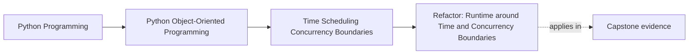

# Refactor: Runtime around Time and Concurrency Boundaries

<!-- page-maps:start -->
## Page Maps

<!-- page-maps:end -->

Read the first diagram as a placement map: this page is one concept inside its parent
module, not a detached essay, and the capstone is the pressure test for whether the
idea holds. Read the second diagram as the working rhythm for the page: name the
problem, study the example, identify the boundary, then carry one review question
forward.

## Why this refactor matters

Students often add time and concurrency to a working design by sprinkling in:

- `datetime.now()`
- background threads
- ad hoc timers
- async keywords
- shared caches

That usually makes the runtime feel more "real," but it also makes the object model
harder to reason about. Domain objects stop answering business questions and start
carrying scheduler, timeout, and ownership pressure they were never meant to own.

This refactor shows a safer path: move runtime pressure outward while preserving the
core truths the model already knows.

## Start by naming the truths that must survive

Before changing code, write down what the core model already guarantees.

For the monitoring capstone, those truths might include:

- what an incident means
- when a state transition is valid
- which facts are durable versus derived
- which object owns mutation of a specific aggregate

Those truths must remain understandable even after the runtime learns about polling,
worker queues, retries, and deadlines.

If the refactor changes these meanings accidentally, the runtime work is not a clean
extension. It is a domain rewrite disguised as infrastructure.

## Step 1: remove raw time from the model

Look for places where core objects directly ask the world for time.

Typical smells:

- `datetime.now()` inside entities or aggregates
- expiration decisions tied to wall-clock lookup at mutation time
- tests that depend on sleeping instead of controlling time

Replace that pattern with explicit time input or a boundary-owned clock.

The design goal is simple:

- the runtime owns "what time is it right now?"
- the model owns "what does this timestamp mean?"

That separation keeps time testable and keeps business meaning readable.

## Step 2: move cadence and waiting into coordinators

Once time is explicit, move scheduling behavior out of domain objects.

Do not let aggregates:

- sleep
- reschedule themselves
- decide polling cadence
- own retry delay policy

Instead, give that work to coordination objects such as:

- pollers
- schedulers
- supervisors
- runtime services

These objects may decide when work is attempted. The model should still decide whether
the attempted transition is valid.

## Step 3: replace shared mutation with owned handoff

If multiple threads or tasks currently touch the same mutable object, the next refactor
step is usually not "add more locks everywhere."

A better first question is:

- can this become an ownership handoff instead?

Very often the safer move is to:

- turn direct cross-thread mutation into queued commands
- let one worker or one loop own mutation
- move concurrent producers to the boundary

This reduces the amount of logic that must be concurrency-aware at all.

Locks still have a place, but they should protect a clearly owned boundary rather than
compensate for unclear ownership.

## Step 4: keep async at the edge unless the core truly needs it

Students often widen an entire runtime by making everything async as soon as one adapter
needs non-blocking I/O.

That is usually avoidable.

Ask instead:

- which operation is truly I/O-bound?
- which API is only a bridge into async infrastructure?
- which domain methods remain plain synchronous logic?

A strong refactor keeps:

- pure calculations synchronous
- domain state transitions synchronous
- async only where coordination with the outside world requires it

That keeps the core model usable from tests, scripts, and alternate runtimes without
dragging an event loop through every call site.

## Step 5: make interruption rules explicit

Once queues, schedulers, or async bridges appear, interruption pressure becomes real.

The refactor is not complete until the runtime can answer:

- what happens if this call times out?
- what progress is durable if a worker is cancelled?
- what work is safe to retry?
- what checkpoint would let this operation resume honestly?

If those answers do not exist, then the runtime may be concurrent, but it is not yet
trustworthy.

## A worked refactor route

Imagine an early monitoring runtime with these problems:

- a domain service polls on its own timer
- it reaches into repositories directly from many threads
- it caches recent results in shared mutable state
- it mixes retry counters, sleep intervals, and incident rules in one class

An ordered refactor route could look like this:

1. Extract timestamp capture so polling results and incident transitions receive time as
   explicit input.
2. Create a runtime poll coordinator that owns cadence, deadlines, and next-attempt
   policy.
3. Replace direct cross-thread mutation with a queue or single-owner worker boundary.
4. Move cache refresh and memoization behind the boundary that owns authoritative reads.
5. Keep incident evaluation as plain synchronous domain logic.
6. Add an async bridge only where adapters truly need concurrent I/O.
7. Document retry, timeout, and cancellation behavior at the runtime surface.

Notice what does **not** happen here:

- the aggregate does not become its own scheduler
- the model does not become async everywhere
- shared mutable state is not treated as the default

The runtime grows, but the model stays interpretable.

## Common mistakes

- refactoring by adding concurrency primitives before clarifying ownership
- letting time, retries, and cancellation leak into every domain method
- keeping polling cadence inside a business object because it "already has the context"
- turning every API async instead of isolating async bridges
- calling a design resumable without a checkpoint story

These mistakes widen pressure instead of containing it.

## Review checklist

| Question | Good sign |
| --- | --- |
| are business meanings still readable without runtime knowledge? | yes |
| does the runtime own clocks, waiting, scheduling, and worker coordination? | yes |
| is mutation owned instead of casually shared across threads or tasks? | yes |
| are retry, timeout, and cancellation effects answerable? | yes |
| did async stay near the real I/O boundary? | yes |

## Capstone connection

Use this refactor route to inspect the capstone runtime directly.

Ask:

- where should polling cadence live?
- which path should own mutation of incident state?
- what runtime service should own retry and timeout policy?
- which adapter truly needs async work, and which core objects should remain plain?

Those questions convert Module 07 from theory into a design rewrite plan.

## Exit check

Leave this refactor page only when you can do all of these:

- describe the order in which you would separate time, scheduling, ownership, and async
  concerns in a messy runtime
- explain why adding locks or async keywords first is often the wrong first move
- point to one capstone runtime path that should be moved outward without changing domain
  meaning
