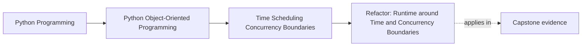

# Refactor: Runtime around Time and Concurrency Boundaries

<!-- page-maps:start -->
## Page Maps

<!-- page-maps:end -->

## Why this refactor matters

Students often add runtime realism by scattering:

- `datetime.now()`
- retry loops
- thread coordination
- async wrappers
- shared caches

through code that previously had a clear ownership model.

That makes the runtime feel more advanced while making the design harder to review.

This refactor page shows how to move time and concurrency pressure outward without
rewriting the domain by accident.

## Running refactor target

Use one concrete target:

- `EnrollmentReminderCoordinator`

Early messy version:

- domain objects know about current time
- several workers mutate reminder state
- retries and queue policy are mixed into delivery logic
- async boundaries widen every call path

Refactor goal:

- one boundary owns clocks
- one boundary owns scheduling
- one boundary owns reminder mutation
- sync and async styles meet only where they truly must

## Step 1: restate what must stay true

Before moving code, write down the truths you refuse to lose:

- reminders should not be sent twice
- a late reminder should not pretend it met the original deadline
- domain objects should still describe business meaning, not polling cadence
- retries should not create duplicate visible side effects

If the refactor weakens any of these truths, it is not a runtime cleanup. It is a
semantic regression.

## Step 2: pull clock access to the edge

Look for:

- `datetime.now()` inside domain objects
- expiration logic tied directly to wall-clock lookup
- tests that sleep instead of controlling time

Refactor toward:

- runtime-owned clock input
- explicit timestamps passed into decision points
- monotonic time for waiting and timeout budgets

The separation is:

- runtime asks what time it is
- model decides what that time means

## Step 3: move cadence into one coordinator

Scheduling questions belong together:

- when to scan
- when to retry
- when work becomes stale
- how many attempts are allowed

Those rules should live in a coordinator or scheduler boundary, not inside aggregates or
delivery objects.

If a domain object still "knows" how often to wake up, the boundary is not clean yet.

## Step 4: replace casual sharing with owned handoff

When several workers currently touch the same reminder state, ask:

- can one queue or worker own each reminder key instead?

Better path:

- enqueue work item
- hand ownership to one worker
- persist or acknowledge state transition at one boundary

Locking may still exist, but it should protect an already clear owner rather than rescue
unclear ownership.

## Step 5: narrow the async boundary

Do not widen every layer just because the delivery adapter is asynchronous.

Keep:

- domain decisions synchronous
- pure calculations synchronous
- async behavior at the runtime or I/O edge

The bridge should sit where coordination with the outside world begins, not where
business meaning is decided.

## Step 6: make interruption rules explicit

Once workers, queues, and async tasks exist, the runtime must answer:

- what progress is durable before cancellation?
- what work is safe to retry?
- what stale work must now be dropped?
- what state proves a reminder was already sent?

If those answers are missing, the runtime may be concurrent but it is not trustworthy.

## Worked refactor route

For the reminder workflow, an ordered route could be:

1. extract current-time lookup into the coordinator
2. compute reminder deadlines once at the scheduling boundary
3. move repeated scans into one scheduler or poller object
4. route reminder work through one owned queue
5. keep reminder-state transitions behind one persistence or workflow boundary
6. isolate async delivery behind one adapter-facing bridge
7. document cancellation and retry semantics in tests and runtime notes

That order matters because it reduces ambiguity before adding more runtime machinery.

## What not to do first

- do not add locks everywhere before deciding ownership
- do not make the whole model async because one boundary is async
- do not call work resumable without a checkpoint or durable progress marker
- do not keep retry policy inside the same object that decides domain meaning

Those moves add machinery faster than they add clarity.

## Capstone connection

Use this page to inspect one runtime path in the capstone and answer:

- where should time lookup move outward first?
- where should reminder or incident mutation gain one clear owner?
- where should async stay at the edge instead of widening the whole stack?

If you can answer those three, the runtime refactor has become reviewable.

## Exit check

Leave this page only when you can do all of these:

- describe one ordered path for separating time, scheduling, ownership, and async concerns
- explain why adding locks or async keywords first is often the wrong first move
- name one capstone runtime path that should move outward without changing domain meaning
