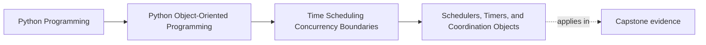
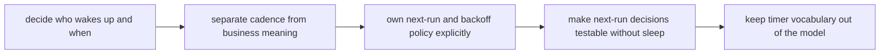

# Schedulers, Timers, and Coordination Objects

<!-- page-maps:start -->
## Page Maps

<!-- page-maps:end -->

Read the first diagram as a placement map: this page explains how time-driven runtime
coordination enters the system without rewriting the model. Read the second diagram as
the lesson route: decide who wakes up and when, separate cadence from meaning, own
rescheduling explicitly, then prove next-run behavior without real waiting.

## Why this lesson matters

Schedulers and timers are coordination tools. They decide when work is attempted, not
what that work means.

Learners often blur those roles and let scheduler behavior seep into the model itself.
Then:

- aggregates start knowing too much about polling cadence
- retries become entangled with business rules
- timer semantics hide inside domain methods

This lesson exists to keep timing coordination owned at the right boundary.

## Start with the wake-up question

Ask this directly:

> Who decides when the system should wake up and inspect work again?

That question usually points to a runtime boundary such as:

- a scheduler
- a polling loop coordinator
- a timer registry
- a periodic scan controller

It rarely points to the aggregate or value object itself.

Once you ask the question that way, timer logic stops looking like ambient behavior and
starts looking like an owned policy surface.

## A scheduler is usually a runtime boundary

A scheduler often owns questions like:

- when should polling happen next?
- how often should a check run?
- which jobs are pending now?
- what backoff applies after failure?

Those are coordination questions.

The domain may care that:

- a lease expired
- a suppression window ended
- a deadline passed

But the runtime usually decides when to wake up and inspect those facts.

## Timers are not the business rule

A timer can be useful without being the real rule.

For example:

- a timer wakes a coordinator every minute
- the domain still decides whether a workshop reminder is now stale or actionable

That distinction matters:

- timer or poller = coordination mechanism
- expiration or deadline rule = meaning

If those collapse into one thing, the system becomes harder to test and harder to
evolve.

## Coordination objects should stay explicit

Good coordination objects make runtime pressure visible:

- scheduler
- timer registry
- wake-up coordinator
- polling loop controller

They help answer:

- who owns next-run decisions?
- who reschedules after success or failure?
- where does backoff policy live?
- where does time pressure enter the system?

Those answers should not be hidden across callbacks and helpers that no reader can trace
end to end.

## Keep rescheduling policy out of the model

One easy mistake is letting business objects decide:

- when they should run again
- how long to sleep
- how to back off after failure

Those are usually runtime policies.

The model may expose facts that influence rescheduling, but the rescheduling decision
normally belongs to the coordinator that owns the loop.

That keeps the model from learning polling cadence or wake-up vocabulary it never needed.

## Make next-run policy visible in one table

For one scheduled workflow, write this down:

| Event | Who decides next run? | Why |
| --- | --- | --- |
| normal success | scheduler or coordinator | choose ordinary cadence |
| soft failure | scheduler or coordinator | apply retry or backoff policy |
| hard stop | coordinator or supervisor | decide no reschedule occurs |
| stale work found | coordinator | decide whether to skip, expire, or notify |

This table is useful because many timing designs fail not on the first run, but on the
second or third run when no one can explain who owns the next decision.

## Test scheduling without real sleep

Scheduling logic becomes much easier to trust when:

- clock access is controlled
- next-run decisions are explicit
- wake-up policy is separate from domain mutation

Then tests can ask:

- given this time and this result, what should be scheduled next?

That is much stronger than letting real timers fire and hoping the test eventually
observes the right behavior.

## Review drill

For any time-driven runtime path, ask:

1. who decides when to wake up?
2. what business meaning is being inspected rather than created by the timer?
3. who owns backoff or reschedule policy?
4. how can next-run behavior be tested without sleeping?

If those answers are fuzzy, scheduler logic is still too ambient.

## Common mistakes

- mixing "when to run" policy into aggregate methods
- letting timer callbacks mutate domain state directly with no visible coordination layer
- hiding retry and backoff behavior inside scheduler helpers with no contract
- assuming a polling interval is the same thing as a business deadline
- making tests depend on real sleep instead of explicit next-run rules

All of these mistakes let timing coordination distort the model.

## Capstone connection

Use the capstone runtime to ask:

- who decides when the next monitoring or reminder pass runs?
- which objects should remain unaware of polling cadence?
- if failure triggers backoff, where should that policy live?

Those questions keep timer behavior from hardening into accidental domain logic.

## Exit check

Leave this lesson only when you can do all of these:

- explain why schedulers and timers are coordination tools rather than business meaning
- identify one place where rescheduling policy belongs outside the model
- point to one runtime path where next-run logic should stay in the runtime boundary
