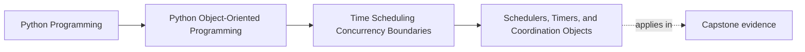

# Schedulers, Timers, and Coordination Objects

<!-- page-maps:start -->
## Page Maps

<!-- page-maps:end -->

Read the first diagram as a placement map: this page is one concept inside its parent
module, not a detached essay, and the capstone is the pressure test for whether the
idea holds. Read the second diagram as the working rhythm for the page: name the
problem, study the example, identify the boundary, then carry one review question
forward.

## Why this lesson matters

Schedulers and timers are coordination tools. They decide when work is attempted, not
what the work means.

Students often blur those roles and let scheduler behavior seep into the model itself.
Then:

- aggregates start knowing too much about polling cadence
- retries become entangled with business rules
- timer semantics hide inside domain methods

The goal of this lesson is to keep timing coordination owned at the right boundary.

## A scheduler is usually a runtime boundary

A scheduler often owns questions like:

- when should polling happen next?
- how often should this check run?
- which jobs are pending now?

Those are usually runtime orchestration concerns.

The domain may care that:

- a lease expired
- a suppression window ended
- a deadline passed

But the runtime usually decides when to wake up and inspect those facts.

## Timers are not business meaning by themselves

A timer can be useful without being the real rule.

For example:

- a timer may wake a worker every minute
- the domain rule may still say whether the object is expired or actionable

That separation matters. The timer is a coordination aid. The domain rule is the
meaningful validity or state rule.

If those collapse into one thing, the system becomes harder to test and harder to
evolve.

## Coordination objects should stay explicit

Good coordination objects often make runtime pressure visible:

- job schedulers
- timer registries
- wake-up coordinators
- polling loop controllers

They help answer:

- who owns the next-run decision?
- who reschedules after success or failure?
- where does time pressure enter the system?

Those answers should not be spread invisibly through many unrelated objects.

## Keep rescheduling policy out of the model

One easy mistake is to let business objects decide:

- when they should be run again
- how long to sleep
- how to back off on repeated failure

Those are often runtime policies.

The model may expose facts that influence rescheduling, but the rescheduling decision
usually belongs to the coordinator that owns the loop.

## Make scheduling testable

Scheduling logic becomes much easier to prove when:

- the clock source is controlled
- next-run decisions are explicit
- wake-up policy is separated from domain mutation

That way, tests can ask:

- given this time and this outcome, what should be scheduled next?

instead of relying on real waits or hidden timer callbacks.

## Common mistakes

- mixing "when to run" policy into aggregate methods
- letting timer callbacks mutate domain state directly with no visible coordination layer
- hiding retry and backoff behavior inside scheduler helpers with no contract
- assuming a polling interval is the same thing as a business deadline
- making tests depend on real sleeping instead of explicit next-run rules

These mistakes all let timing coordination distort the model.

## Review checklist

| Question | Good sign |
| --- | --- |
| is the scheduler clearly a runtime coordination boundary? | yes |
| are timing tools separated from domain meaning? | yes |
| is rescheduling policy owned explicitly rather than hidden in the model? | yes |
| can next-run behavior be tested without real waiting? | yes |

## Capstone connection

Use the capstone runtime to ask:

- who decides when the next monitoring pass runs?
- which objects should remain unaware of polling cadence?
- if failure triggers a backoff, where should that policy live?

Those questions keep timer behavior from turning into accidental domain logic.

## Exit check

Leave this lesson only when you can do all of these:

- explain why schedulers and timers are coordination tools rather than business meaning
- identify one place where rescheduling policy belongs outside the model
- point to one capstone path where next-run logic should stay in the runtime boundary
