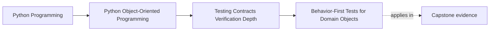

# Behavior-First Tests for Domain Objects

<!-- page-maps:start -->
## Page Maps

<!-- page-maps:end -->

Read the first diagram as a placement map: this page is one concept inside its parent
module, not a detached essay, and the capstone is the pressure test for whether the
idea holds. Read the second diagram as the working rhythm for the page: name the
problem, study the example, identify the boundary, then carry one review question
forward.

## Why this lesson matters

The easiest test to write is often the wrong one.

When a domain object is hard to verify, students often drift toward:

- patching collaborators
- asserting internal method calls
- checking helper-level implementation details

Those tests may pass, but they do not prove the object's real promise. Behavior-first
tests reverse that habit. They begin with the visible contract of the object and treat
implementation detail as replaceable unless the public behavior exposes it.

## Start from the object's promise

A domain-object test should usually answer one of these questions:

- what change in meaning should this command cause?
- what invariant must still hold after the change?
- what error should stop an invalid transition?
- what event, result, or durable fact should a caller observe?

If a test cannot answer one of those questions, it may be proving something too small
to justify its existence.

## Observable behavior is broader than return values

Students sometimes hear "test behavior, not implementation" and reduce that advice to
"only assert return values."

That is too narrow.

Observable behavior for domain objects can include:

- returned values
- changed state
- emitted domain events
- recorded decisions
- raised domain-specific errors

The important distinction is not "value versus state." The distinction is "external
contract versus internal accident."

## Domain language makes tests readable

A good behavior-first test often reads like a short design review.

Compare these styles:

- `test_calls_update_counter_after_activate`
- `test_activation_marks_rule_active_and_records_activation_event`

The second name does more than sound nicer. It tells a reviewer:

- which domain operation happened
- which outcome matters
- which meaning the test is defending

That makes the test suite part of the model's explanation, not just its tooling.

## One behavior per test does not mean one assertion

Students also over-correct in the other direction. They split one meaningful behavior
into many tiny tests just to keep assertion counts low.

That usually harms readability.

If one command has one coherent promise, it may be correct for a test to verify several
connected consequences together:

- the object changes state
- one event is emitted
- one invalid future path is now blocked

Those are not three unrelated assertions. They are one behavior claim seen from three
angles.

## A worked example

Suppose an incident aggregate exposes `acknowledge(actor, at)` and promises:

- only open incidents may be acknowledged
- acknowledgement records who acted and when
- an `IncidentAcknowledged` event is emitted once

A weak test might patch the event collector and assert that one internal helper was
called.

A stronger test would:

1. construct an open incident
2. call `acknowledge`
3. assert the incident is now acknowledged
4. assert the actor and timestamp were captured correctly
5. assert exactly one domain event with the right meaning was emitted

That test proves the contract a caller relies on. It does not care whether the aggregate
uses one helper, three helpers, or no helpers next month.

## Value objects deserve exact tests, not many tests

Some students neglect value objects because they seem simple.

In practice, value objects often carry precise semantic rules around:

- validation
- normalization
- equality
- ordering
- serialization round-trips

They may not need many tests, but the tests they do need should be very sharp. A small
semantic type with weak tests can still destabilize a large system.

## Common mistakes

- asserting internal call order instead of externally visible meaning
- naming tests after helpers rather than domain behavior
- patching too early because setup feels awkward
- splitting one coherent behavior across many tiny unreadable tests
- treating value objects as too simple to deserve contract-level verification

## Review checklist

| Question | Good sign |
| --- | --- |
| does the test name describe domain behavior instead of implementation trivia? | yes |
| would the test still make sense after an internal refactor? | yes |
| does the test assert visible outcomes a caller actually depends on? | yes |
| is the object's promise clearer after reading the test? | yes |

## Capstone connection

Use the capstone aggregates and policies to ask:

- which tests already defend visible behavior well?
- which tests mostly pin helpers, mocks, or incidental call structure?
- where would a reviewer learn more from state, event, and error assertions than from interaction assertions?

This is how the test suite becomes evidence for the design instead of proof that the
current file layout exists.

## Exit check

Leave this lesson only when you can do all of these:

- explain what makes a test behavior-first instead of implementation-first
- identify one case where several assertions still belong to one coherent behavior test
- rewrite one capstone test name so it states the domain promise being defended
