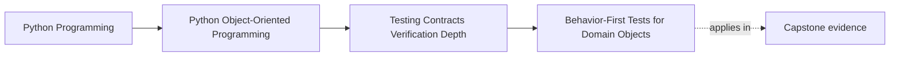

# Behavior-First Tests for Domain Objects

<!-- page-maps:start -->
## Page Maps

<!-- page-maps:end -->

This lesson is about proving the promise of a domain object instead of pinning the way
today's implementation happens to get there.

The easiest test to write is often the wrong one:

- patch a collaborator
- assert a helper was called
- inspect internal choreography

Those tests may pass while the object's real promise drifts.
Behavior-first tests reverse that habit by starting with the visible contract.

## Keep one aggregate promise visible

Use one capstone rule:

`WorkshopEnrollment` must never confirm more attendees than the seat limit.

A caller does not care:

- which helper updated a counter
- which branch computed the new state
- which private method emitted an event

The caller cares about:

- whether confirmation was allowed
- whether state changed honestly
- whether the visible domain outcome is correct

That distinction is the center of the lesson.

## Start from the object's promise

A strong domain-object test usually answers one of these:

- what meaning should this command change?
- what invariant must still hold?
- what domain error should stop an invalid transition?
- what event, state, or result should a caller observe?

If a test cannot answer one of those questions, it is probably proving something too
small to matter.

## Behavior is broader than return values

"Test behavior, not implementation" does not mean "assert only the return value."

Observable behavior for domain objects can include:

- returned values
- changed state
- emitted domain events
- recorded decisions
- raised domain-specific errors

The important distinction is not value versus state.
The distinction is external contract versus internal accident.

## Test names should read like design claims

A strong behavior-first test name usually sounds like a sentence from the model review.

Weak:

- `test_calls_update_counter_after_confirm`

Stronger:

- `test_confirming_the_last_available_seat_records_one_confirmation`

The second name teaches:

- which command happened
- what domain state mattered
- what promise the suite is defending

That makes the test suite part of the system's explanation.

## One behavior may need several assertions

Students often over-correct and split one meaningful promise into many tiny tests just
to keep assertion counts low.

That usually weakens the teaching value.

If one command has one coherent promise, one test may correctly verify:

- the new state
- the domain event
- the blocked future path

Those are not unrelated facts.
They are several faces of one behavior claim.

## Worked capstone example

Suppose `WorkshopEnrollment.confirm(attendee_id, at)` promises:

- confirmation succeeds only while capacity remains
- the attendee becomes confirmed exactly once
- one domain event records the confirmation

A behavior-first test should:

1. start from an enrollment with visible seat limits
2. confirm one attendee
3. assert the attendee is now confirmed
4. assert capacity meaning changed as expected
5. assert exactly one domain event with the right meaning was emitted

That test still makes sense if the aggregate is internally refactored next month.

## Value objects deserve sharp tests too

Some students treat value objects as too small to need real design tests.

That is a mistake.
Value objects often carry precise semantic rules around:

- validation
- normalization
- equality
- ordering
- round-trip meaning

They may need fewer tests than aggregates, but the tests they do need should still be
written in behavior language, not constructor trivia.

## Build one behavior packet before you test

Before writing a behavior-first suite for an object, write a small packet:

- command name
- visible promise
- invariant that must survive
- event or error the caller may observe

If that packet is hard to write, the object contract may still be underspecified.

The exercise is valuable even before the first test exists.

## Common failure modes

- asserting internal call order instead of visible meaning
- naming tests after helpers or storage details
- patching too early because construction feels awkward
- splitting one coherent behavior across many tiny unreadable tests
- treating value objects as too simple for contract-level proof

## Behavior review card

Use this short card when reviewing one object test:

| Question | What you want to see |
| --- | --- |
| does the test name describe domain behavior rather than implementation trivia? | yes |
| would the test still make sense after an internal refactor? | yes |
| does it assert outcomes a caller really depends on? | yes |
| is the object's promise clearer after reading the test? | yes |

## Capstone connection

Use this page to ask:

- which capstone tests already defend visible behavior well
- which tests mostly pin helpers or incidental choreography
- where state, event, and domain-error assertions would teach more than interaction
  assertions

That is how the suite becomes evidence for the design rather than evidence that the
current file layout exists.

## Exit check

Leave this lesson only when you can do all of these:

- explain what makes a test behavior-first instead of implementation-first
- identify one case where several assertions still belong to one coherent behavior test
- rewrite one capstone test name so it states the domain promise being defended
