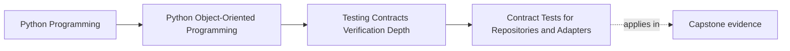

# Contract Tests for Repositories and Adapters

<!-- page-maps:start -->
## Page Maps

<!-- page-maps:end -->

This lesson is about one hard rule:

An interface does not prove replaceability.

Two repositories or adapters can expose the same methods and still disagree on the
caller-facing truth in ways that make tests falsely reassuring.

Contract tests exist to stop that drift by writing the shared semantic promise once and
running it against every implementation that claims the same boundary.

## Keep one replaceability claim visible

Use two capstone surfaces:

- `WorkshopEnrollmentRepository`
- one outward boundary such as certificate artifact storage or incident publishing

Ask the same question of both:

What is the promise a caller depends on if this implementation is swapped?

If that question cannot be answered in semantic language, the contract is still too
close to storage or transport detail.

## Contract tests should be written in caller language

Start from what a caller relies on, not from how a backend happens to work.

For `WorkshopEnrollmentRepository`, the contract might include:

- loading a missing record has one clear absence meaning
- save then load preserves aggregate meaning, not only field presence
- stale writes fail with one explicit conflict behavior
- two implementations agree on version and lifecycle semantics

For an outward publishing boundary, the contract might include:

- accepted normalized input shape
- visible success or acknowledgement meaning
- failure translation the workflow can reason about

These are caller questions.
They are the right raw material for a shared suite.

## A contract suite should expose dishonest substitutes quickly

An in-memory implementation often drifts in ways that look harmless until real workflow
pressure appears.

Common problems:

- it preserves object identity instead of reconstructing meaning
- it ignores optimistic conflict rules
- it accepts data a real transport or store would reject
- it makes writes visible more generously than the durable path does

Without a shared suite, those differences become "test convenience."
With a shared suite, they become explicit incompatibilities that must be fixed or split.

## Build the contract around one repeatable packet

A useful contract packet for this module should answer five things:

1. what absence means
2. what round-trip must preserve
3. what conflict or duplication behavior must match
4. what failure belongs to the public contract
5. what backend detail stays outside the shared suite

That packet keeps the suite narrow enough to reuse and strong enough to matter.

## Example: repository contract for `WorkshopEnrollment`

An honest shared suite could require:

1. saving a legal enrollment then loading it back preserves seat limit, attendee state,
   and version meaning
2. loading a missing enrollment produces the same absence behavior in every
   implementation
3. saving with an out-of-date version fails in the same semantic way
4. repeated unchanged saves do not invent lifecycle drift or phantom state changes

What this suite should not care about:

- table shape
- ORM configuration
- exact serialization format
- index layout

Those concerns still deserve tests, but they are backend-specific tests, not the shared
contract.

## Example: adapter contract for outward publication

Suppose two incident-sink implementations claim the same outward role.

The contract might require:

- both accept the same normalized incident representation
- both report success, retryable failure, or terminal failure through the same boundary
  meaning
- both handle duplicate publication or idempotency markers consistently enough for the
  workflow to reason about them

Again, the contract is not:

- how the HTTP request is built
- how the file is stored
- which queue client is used

The contract is what the host workflow may rely on when implementations are swapped.

## Honest capability differences should change the design

Shared suites are valuable because they reveal when one interface is lying.

If one repository supports optimistic conflict checks and another does not, or one
adapter can signal retryable failure while another only crashes generically, you have to
decide honestly:

- narrow the shared contract
- split the interface
- define a second capability-specific contract

The wrong move is to keep one broad interface and quietly accept semantic drift.

## What belongs outside the shared contract

Keep these concerns in implementation-specific tests:

- exact SQL or query shape
- driver retry policy
- storage-engine tuning
- serializer implementation details
- performance behavior unique to one backend

Those are real concerns. They just are not the cross-implementation promise.

## A good contract suite makes failures interpretable

When one shared suite fails, the question should be obvious:

- this implementation does not actually preserve the caller's promised behavior

That is much more useful than a pile of copied tests that happen to look similar but
diverge over time.

Contract suites help because they turn replaceability from assumption into evidence.

## Common failure modes

- copying nearly identical tests per implementation instead of extracting one shared
  suite
- keeping the contract too happy-path and ignoring absence, conflict, or failure
  translation
- letting in-memory substitutes skip semantic rules for convenience
- hiding real capability gaps instead of splitting the contract honestly
- writing backend-detail assertions and calling them contract tests

## Contract review card

Use this short review card when extracting or reviewing a shared suite:

| Question | What you want to see |
| --- | --- |
| is the suite written in caller-facing semantic language? | yes |
| do all claimed substitutes run the same suite? | yes |
| are absence, conflict, and failure paths included? | yes |
| are backend-only concerns kept out of the shared suite? | yes |
| do capability gaps change the design instead of hiding inside the interface? | yes |

## Capstone connection

Use this page to ask:

- which current in-memory or fake substitute is more generous than the real path
- which repository or adapter boundary most needs one extracted semantic suite next
- which interface is currently pretending to unify implementations that really need
  separate capabilities

That is where testing convenience becomes architecture evidence.

## Exit check

Leave this lesson only when you can do all of these:

- explain why an interface alone does not prove replaceability
- name one semantic rule every implementation of a capstone boundary must share
- identify one backend-specific concern that should stay outside the shared contract
