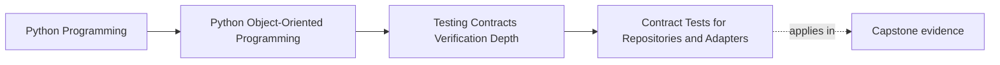

# Contract Tests for Repositories and Adapters

<!-- page-maps:start -->
## Page Maps

<!-- page-maps:end -->

Read the first diagram as a placement map: this page is one concept inside its parent
module, not a detached essay, and the capstone is the pressure test for whether the
idea holds. Read the second diagram as the working rhythm for the page: name the
problem, study the example, identify the boundary, then carry one review question
forward.

## Why this lesson matters

An interface is not proof of replaceability.

Students often build:

- an in-memory repository for tests
- a database repository for production
- several adapters that all implement the same protocol

Then they assume the shared interface is enough to guarantee equivalent behavior.

It is not.

Replaceability is a semantic claim. Contract tests exist to prove that each
implementation honors the same promise under the same important conditions, especially
the awkward ones.

## A contract test defines shared truth once

The purpose of a contract suite is not to test one implementation well. It is to define
the truth that all implementations must satisfy.

For a repository, that truth may include:

- what "missing" means
- how identity and version conflicts behave
- whether round-tripping preserves domain meaning
- when writes become visible
- which errors belong to the contract versus the storage mechanism

Once that truth is written down as tests, every implementation must answer to it.

## Start from promises, not storage details

Repository contract tests should be framed in terms a caller depends on, not in terms a
backend happens to use.

For example, a good shared question is:

- does saving then loading preserve the aggregate meaning?

A weaker backend-specific question is:

- did the SQL row include every current column?

The second question may still matter in backend-specific tests, but it is not the shared
contract. Contract tests should stay at the semantic boundary the application relies on.

## Shared suites expose dishonest substitutes

In-memory substitutes often drift in ways that make tests falsely reassuring.

Common examples:

- the in-memory repository never enforces optimistic conflicts
- it preserves Python object identity instead of serializing and reconstructing meaning
- it accepts invalid payload shapes a real transport would reject
- it returns data too eagerly compared with the production boundary

Without a shared contract suite, these differences become invisible until production or
integration testing.

## Adapters need contract tests too

The same idea applies beyond repositories.

If several adapters claim to be equivalent incident sinks, metric sources, or storage
surfaces, a contract might cover:

- accepted input shape
- failure translation
- timeout semantics
- duplicate handling
- guaranteed outputs or acknowledgements

The transport may differ. The caller-facing promise should not drift silently.

## Honest differences must become explicit structure

Contract testing often reveals that two implementations are not truly interchangeable.

That is useful information.

If one repository supports:

- optimistic concurrency
- bulk loading
- transactional save semantics

and another does not, you have several honest options:

- narrow the shared contract
- split the interface
- define capability-specific contracts

The wrong move is to keep one broad interface and quietly let implementations differ.

## A worked example

Suppose the capstone has both an in-memory incident repository and a durable repository.
The shared contract might require:

- loading a missing incident returns the same absence behavior in both implementations
- saving then loading preserves incident state, version, and emitted-event handling rules
- saving with an out-of-date version fails in the same semantic way
- a second save of unchanged state does not invent extra lifecycle drift

One backend may implement this with plain Python structures. Another may use a database
transaction. The contract suite does not care how they do it. It cares that the caller's
truth is preserved.

## What belongs outside the shared contract

Not every backend-specific concern belongs in the shared suite.

Keep separate tests for:

- exact SQL shape
- driver-specific retry behavior
- transport configuration
- storage-engine tuning
- performance characteristics unique to one backend

Those tests still matter. They are just not the cross-implementation contract.

## Common mistakes

- copying similar tests across implementations instead of extracting one shared suite
- keeping the contract too happy-path and ignoring conflicts, missing values, or failure translation
- letting in-memory substitutes skip important semantic checks
- hiding capability gaps instead of splitting contracts honestly
- writing backend-detail assertions and calling them contract tests

## Review checklist

| Question | Good sign |
| --- | --- |
| is the shared suite written in caller-facing semantic language? | yes |
| does every claimed substitute run the same suite? | yes |
| are failure and conflict paths covered, not just round-trips? | yes |
| are honest capability differences explicit in the design? | yes |

## Capstone connection

Use the capstone boundaries to ask:

- which repositories or adapters are currently assumed replaceable but not proven so?
- where does the in-memory testing substitute behave more generously than the production path?
- which shared boundary would benefit most from one extracted semantic suite?

This is often where testing stops being convenience scaffolding and becomes architecture
evidence.

## Exit check

Leave this lesson only when you can do all of these:

- explain why an interface alone does not prove replaceability
- name one semantic rule that all repository implementations must share
- identify one backend-specific concern that should stay outside the shared contract suite
