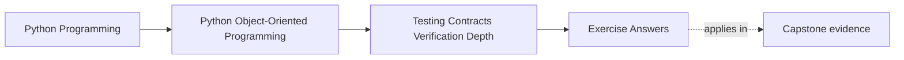
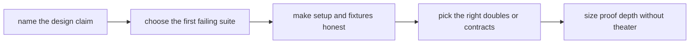

# Exercise Answers

<!-- page-maps:start -->
## Page Maps

<!-- page-maps:end -->

These are model answers for the two running claims from the exercise page:

- `WorkshopEnrollment` must never confirm more attendees than the seat limit
- `CertificateIssuanceService` must not duplicate visible issuance when retried

The point of the answers is to show how proof shape follows design claim, not how to
collect more tests by reflex.

## Answer 1: First failing suite

For the seat-limit claim:

- first failing suite: behavior-first domain tests on `WorkshopEnrollment`

Why:

- the claim belongs to aggregate-owned truth
- the aggregate should reject over-capacity transitions directly

Why not start heavier:

- an integration suite would prove more of the path, but if the aggregate itself allows
  over-capacity confirmation, the design is already broken earlier

For the retry claim:

- first failing suite: workflow-level integration or contract-style test around issuance
  boundary plus fake adapters

Why:

- duplicate-visible-work risk lives across persistence and external side effects
- pure unit tests can miss the ordering and durable-progress story

Why not weaker:

- a mocked helper test can prove calls happened; it cannot honestly prove duplicate
  issuance stayed impossible

## Answer 2: Lifecycle proof path

For the seat-limit claim, the proof must express sequence:

1. create an enrollment with limited seats
2. confirm attendees up to capacity
3. attempt one more confirmation
4. assert the transition is rejected and prior truth remains intact

Good proof shapes:

- behavior-first examples for main scenarios
- stateful or property-based tests if many orderings matter

What a final-count-only test misses:

- whether the object briefly entered an illegal state
- whether the wrong side effect happened before the rejection

Lifecycle rules are about allowed histories, not just final values.

## Answer 3: Workflow proof path

For the issuance retry claim, a useful workflow proof expresses:

1. issuance begins
2. durable issuance state is written
3. downstream side effect is interrupted or retried
4. rerun occurs
5. user-visible issuance is still not duplicated

Mock-heavy weakness:

- you can prove one call order and still miss whether durable state actually protects the
  next run

Stronger route:

- fake repository plus fake storage or email boundary
- one workflow test that reruns from an interrupted point

That better matches the real contract.

## Answer 4: Repository or adapter contract surface

Take `WorkshopEnrollmentRepository`.

Caller promise:

- load and save aggregates in domain language
- reject stale writes through explicit concurrency semantics

Contract suite should protect:

- save/load round-trip of meaningful aggregate state
- conflict behavior on stale version

Backend detail that stays outside:

- table layout
- ORM session behavior
- serialization quirks

What mock-only tests might miss:

- two implementations both satisfy the mock expectations while disagreeing on real
  substitute compatibility

## Answer 5: Fixture or builder audit

Suppose you have `enrollment_with_waitlist(...)`.

Good helper behavior:

- default state is legal
- overrides are explicit and domain-named
- seat limit and attendee ordering remain visible near the test

Bad helper behavior:

- hidden defaults auto-fill too much state
- helper silently creates "valid enough" objects that obscure why the test matters

Owner:

- the test surface closest to the invariant, not a generic shared bucket with unclear
  semantics

Setup is part of the proof. If it hides the important shape, the test becomes harder to
trust.

## Answer 6: Doubles decision

For `CertificateIssuanceService`, useful choices may be:

- fake repository to preserve meaningful state transitions
- fake object storage boundary if you need replayable durable behavior
- spy or fake notification sender if you only need to inspect visible outcomes

Weak default:

- using mocks everywhere because they are fast to type

Why weak:

- call choreography can stay green while durable behavior drifts

Choose doubles by what truth they preserve, not by what syntax they shorten.

## Answer 7: Runtime check or assertion boundary

Example assumption:

- a stored issuance record must never claim success without an artifact location once the
  workflow says delivery completed

Good boundary:

- runtime assertion or defensive check at the workflow or rehydration boundary

Test:

- corrupt state fixture should fail loudly at the boundary

Bad pattern:

- repeating the same check in every helper and adapter

That creates noise instead of a clear executable contract.

## Answer 8: Snapshot or approval boundary

Good approval candidate:

- one user-facing report or exported representation whose exact shape matters

Bad approval candidate:

- a huge internal debug dump with unstable timestamps, ordering noise, or internal ids

What stays out:

- nondeterministic metadata
- irrelevant formatting churn

Review practice:

- reviewer should know what stable contract the artifact is protecting

Snapshots help when representation matters. They hurt when they fossilize noise.

## Answer 9: Confidence ladder

For the seat-limit claim:

1. smallest useful proof: aggregate behavior tests around confirmation rules
2. next stronger proof: stateful or property-based sequences around confirm/release paths
3. heaviest proof: repository-backed integration path with concurrency conflict checks

For the issuance retry claim:

1. smallest useful proof: workflow test with fakes proving no duplicate visible issuance
2. next stronger proof: contract or integration test against real substitute boundaries
3. heaviest proof: full end-to-end retry path through durable storage and downstream side
   effect boundaries

The ladder is honest because it scales with risk instead of jumping straight to the most
expensive proof.

## Answer 10: Proof packet

A compact final packet might read:

> The seat-limit claim should fail first in aggregate behavior tests because the
> invariant is aggregate-owned. The retry-no-duplication claim should fail first in a
> workflow-level test with meaningful fakes because the risk spans durable state and
> external side effects. Builders must keep seat and issuance state visible, not magical.
> Contract suites protect replaceable repositories and adapters. Heavier suites are kept
> for substitute compatibility and interruption pressure, not used by default for every
> claim.

That note is strong because another maintainer can answer:

- what proof fits which claim
- why that proof is not too weak
- why that proof is not theater

## Self-check

You are using Module 08 correctly when another maintainer can answer all of these from
your packet:

- which suite should fail first for one claim
- what setup keeps the invariant visible
- what double preserves meaningful truth
- what stronger proof is reserved for higher risk rather than used automatically
