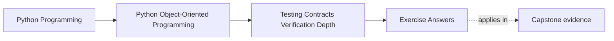
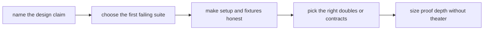

# Exercise Answers

<!-- page-maps:start -->
## Page Maps

<!-- page-maps:end -->

These answers are model explanations, not the only acceptable wording.

## How to use the answer page well

Do not read the model answers first and then reduce Module 08 to "pick better tests and
avoid too many mocks."

A better rhythm is:

1. finish the exercise with your own proof packet
2. name the claim, the first failure surface, and the reason that proof depth fits
3. compare your reasoning with the model answer
4. revise anywhere your answer still confuses convenience with evidence

What matters is whether the reasoning ties verification directly to design claims and
operational risk.

Strong Module 08 answers usually do five things:

- they start from a design claim instead of from a favorite test style
- they identify the first meaningful failure surface for that claim
- they treat fixtures, builders, and doubles as part of proof design
- they keep snapshots and runtime checks narrow and intentional
- they size confidence ladders by risk instead of by habit

The strongest self-study packets also leave behind six concrete artifacts:

- one design-claim inventory
- one first-failing-suite map
- one fixture or builder review
- one doubles decision note
- one approval-boundary judgment
- one confidence-ladder recommendation

If your answers rely mostly on "more tests would help," the reasoning is still too vague.

## Answer 1: Name the first failing test

A strong answer identifies:

- the design claim that matters
- the suite or check that should fail first
- why that surface is close enough to the claim
- why weaker or heavier proof would be less fitting

The main lesson is:

- first failure is a precision question, not a volume question

## Answer 2: Review one lifecycle proof path

The important pieces are:

- what sequence of actions the design claim depends on
- what test style can express that sequence honestly
- what false confidence appears when the path is shortened
- what human-facing artifact should explain the same story

Lifecycle tests are strongest when:

- they make transition order visible instead of only inspecting final data

## Answer 3: Draw one repository or adapter contract surface

A strong answer names:

- what the caller is truly promised
- what contract test protects that promise
- what backend detail must not leak into the contract
- what drift mocks might miss

The important question is:

- if the backend changed tomorrow, what proof would still have to remain green

## Answer 4: Justify one property-based test

A strong answer explains:

- the invariant that spans many inputs
- why example tests alone are too narrow
- what generator space matters
- what family of bugs the property test could reveal

Property-based testing is strongest when:

- the rule is broader than a few remembered examples

## Answer 5: Audit one fixture or builder

Good answers usually show:

- what setup the fixture hides
- whether that hiding helps or harms understanding
- who should own the test data shape
- how the fixture could accidentally make invalid states look normal

The main lesson is that:

- setup is part of the proof, not just preparation

## Answer 6: Compare doubles honestly

A strong answer distinguishes:

- when a fake preserves a real interaction shape
- when a stub is enough
- when a mock becomes brittle or misleading
- when a contract test is the cleaner way to protect the boundary

The weakness to avoid is:

- proving call choreography while missing contract drift

## Answer 7: Place one runtime check or assertion boundary

The important pieces are:

- which assumption deserves executable defense
- where the check belongs
- what test proves the check matters
- what confusion appears if the same check is repeated everywhere

Runtime checks are strongest when:

- they protect one meaningful boundary and teach readers what must stay true

## Answer 8: Review one snapshot or approval boundary

A strong answer explains:

- what behavior the artifact is meant to protect
- what unstable representation details should remain outside it
- what review process keeps it trustworthy
- what maintenance drag appears if the artifact grows too broad

Approval artifacts are weak when:

- they become large enough that reviewers stop noticing what changed

## Answer 9: Build one confidence ladder

A strong answer names:

- the smallest proof that still guards the claim
- the next stronger layer and what it adds
- the heaviest proof route and when it becomes justified
- how the ladder avoids both shallow comfort and expensive theater

The main lesson is that:

- confidence comes from fit between claim and proof, not from always choosing the largest
  suite

## Answer 10: Produce a verification decision packet

The packet is strong when another maintainer can answer:

- which suite should fail first for one claim
- which setup and doubles keep the claim readable
- where runtime or approval checks help more than they hurt
- what stronger proof exists if risk increases
- what evidence is already enough for the current question

If different readers infer different proof targets, the packet is still too ambiguous.

## Self-check

If your answers consistently explain:

- why one claim belongs to one first-failing suite
- how one lifecycle rule deserves sequential proof
- what one repository or adapter contract test protects
- why one fixture or double choice clarifies rather than hides
- how one confidence ladder scales proof honestly

then you are using Module 08 correctly.
