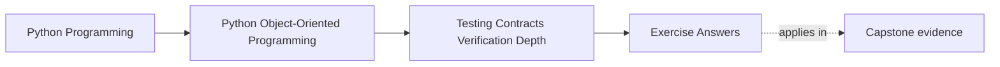
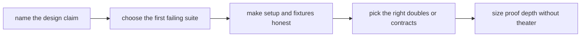

# Exercise Answers

<!-- page-maps:start -->
## Page Maps

<!-- page-maps:end -->

Use these answers as model reasoning, not as lines to memorize.

The point is to show how a strong maintainer explains:

- why one proof should fail first
- why another proof can wait
- what a setup artifact is teaching
- what a double preserves or hides

If the answers feel shorter than the review packet you built, that is fine. The packet
was your working evidence; this page is the model interpretation of that evidence.

## Running claims

The model answers keep the same two claims from the exercise page:

1. `WorkshopEnrollment` must never confirm more attendees than the seat limit
2. `CertificateIssuanceService` must not create duplicate visible issuance after retry

The contrast matters. One claim belongs to aggregate-owned lifecycle truth. The other
belongs to a workflow that spans persistence and side effects.

## Answer 1: Claim inventory

A strong claim inventory could read like this:

- `WorkshopEnrollment` owns the rule that confirmation cannot exceed capacity.
- The first visible failure of that rule would be an attendee appearing confirmed when
  there is no seat left.
- A weak proof might still stay green if it checks only a final count and ignores
  whether the object briefly entered an impossible state.

- `CertificateIssuanceService` owns the workflow promise that retry does not create
  duplicate visible issuance.
- The first visible failure would be duplicated artifact publication, notification, or
  user-facing completion evidence.
- A weak proof might stay green if it confirms one method call sequence while ignoring
  durable progress between attempts.

The important part is that each claim is written in contract language, not test-tool
language.

## Answer 2: First failing proof

For the seat-limit claim:

- first failing proof: behavior-first aggregate tests on `WorkshopEnrollment`
- why: the invariant belongs directly to aggregate-owned truth
- weaker proof would miss: a mock-driven service test can pass while the aggregate still
  permits an illegal transition
- stronger proof can wait: repository-backed integration is valuable later, but not
  before the aggregate itself proves the rule

For the retry claim:

- first failing proof: workflow-level integration test with meaningful fakes for
  persistence and the outward side-effect boundary
- why: the risk spans durable progress and visible work, not one helper call
- weaker proof would miss: call-order tests do not prove that rerun behavior is safe
- stronger proof can wait: full end-to-end infrastructure proof may matter later, but a
  workflow proof should fail before that

That is the core module habit: choose the earliest honest proof, not the loudest one.

## Answer 3: Seat-limit lifecycle proof

A strong lifecycle sketch would say:

1. create enrollment with a small explicit seat count
2. confirm attendees until the last legitimate seat is consumed
3. attempt one more confirmation
4. observe rejection or waitlisting according to the owned rule
5. confirm the object still preserves prior truth and has not partially corrupted its
   internal state

Good first proof shapes:

- behavior-first examples for the core sequence
- stateful tests if the object supports many meaningful histories

Possible later escalation:

- property-based or generated stateful coverage if the transition space becomes wide

What a final-count-only check misses:

- whether an invalid intermediate state briefly existed
- whether a side effect or event escaped before the rejection was enforced

This is why lifecycle proof must narrate time, not only outcomes.

## Answer 4: Retry workflow proof

A strong workflow sketch would say:

1. start issuance with explicit durable preconditions
2. persist progress far enough that a retry can detect prior work
3. simulate interruption before or during external publication
4. rerun the workflow
5. verify no duplicate visible artifact or completion evidence appears

Why mocks are too weak here:

- they can prove that expected calls occurred once in a synthetic run
- they do not prove what the second run learns from durable progress
- they often hide whether the visible effect boundary was already crossed

The right question is not "did the method get called?" It is "what evidence proves the
workflow remains externally safe when the system is interrupted?"

## Answer 5: Repository contract surface

Take `WorkshopEnrollmentRepository`.

Caller-facing contract:

- load and save aggregates in domain language
- preserve meaningful state round-trips
- reject stale writes through explicit conflict semantics

What a shared contract suite should defend:

- save/load round-trip with real aggregate meaning
- conflict behavior for stale versions
- absence or lookup failure semantics

What stays outside the contract:

- table shape
- ORM session details
- storage serialization trivia

What a naive mock-based proof might miss:

- two substitutes can satisfy the same mocked call shape while disagreeing about conflict
  handling or state preservation

That is exactly why substitute compatibility needs a shared semantic suite.

## Answer 6: Fixture or builder audit

Suppose a builder hides seat limit, attendee order, and enrollment state in defaults.

That is too magical for this module.

A better builder keeps visible:

- seat count
- current confirmations
- waitlist or release history when relevant

Safe defaults can still help:

- legal starting state
- harmless optional metadata

Owner:

- the nearest test surface that shares the semantic need, not a vague global bucket

Why:

- setup is part of the proof
- if the setup obscures the interesting pressure, the test becomes harder to audit than
  the production code it is supposed to protect

## Answer 7: Choosing the right double

Take the outward artifact or notification boundary in certificate issuance.

Option review:

- stub: useful only if you need a fixed answer and no real behavior
- fake: useful when visible workflow state must be preserved across retry
- spy: useful when you need to inspect what visible outcome was attempted
- mock: often too weak here because it turns retry safety into choreography checking
- shared contract suite: useful if several implementations claim the same outward
  publishing contract

Best default for the retry claim:

- fake plus targeted observation of visible outcomes

Clearly wrong default:

- mock-everything interaction tests

Why:

- they optimize for typing speed while hiding durable truth

## Answer 8: Defensive check or assertion boundary

Example assumption:

- a persisted issuance record must never claim completed delivery without the durable
  artifact location or equivalent completion marker

Good classification:

- this is closer to an internal integrity or rehydration boundary than to a caller
  validation rule

Good placement:

- workflow or reconstitution boundary where persisted state is trusted again

Good proof:

- corrupt-state fixture should fail loudly at that boundary

Bad pattern:

- duplicating the same check in every helper, adapter, and consumer path

That creates noise without clarifying ownership.

## Answer 9: Approval boundary

Good candidate:

- one user-facing exported certificate summary or reviewed report whose representation is
  part of the promise

Bad candidate:

- large internal debug dumps with timestamps, ids, and unstable ordering noise

What must stay out of the artifact:

- nondeterministic metadata
- irrelevant formatting churn
- private debugging details

Reviewer question the artifact should answer:

- "Did the stable external representation change in a way we meant to support?"

If it cannot answer that, the artifact is probably snapshot theater.

## Answer 10: Confidence ladder

For the seat-limit claim:

1. smallest useful proof: aggregate behavior tests around legal and illegal confirmation
   paths
2. stronger proof: stateful sequence tests for confirm, release, and follow-on state
   transitions
3. heaviest proof: repository-backed conflict and concurrency path when operational risk
   increases

For the retry claim:

1. smallest useful proof: workflow test with meaningful fakes proving no duplicate
   visible issuance
2. stronger proof: contract or substitute tests across supported outward boundaries
3. heaviest proof: full interruption-and-retry path through durable infrastructure

Why not start with the heaviest layer:

- it costs more to run and explain
- it often hides which lower layer actually owns the truth
- it can leave the suite broad but still conceptually blurry

## Model packet summary

A compact final packet might conclude:

> The seat-limit claim belongs first to aggregate behavior and lifecycle proof because
> seat truth is aggregate-owned. The retry-no-duplication claim belongs first to a
> workflow proof with durable state and visible side-effect boundaries because the risk
> spans retries rather than isolated calls. Builders must keep pressure values visible.
> Repository and adapter replaceability require shared contracts, not mock convenience.
> Heavier infrastructure proof is reserved for higher operational pressure, not used as
> the default answer to every claim.

That packet is strong because another maintainer can reconstruct the reasoning without
hearing the original conversation.

## Self-check

You are using Module 08 well when another maintainer can answer all of these from your
packet:

- which proof should fail first and why
- what setup keeps the important truth visible
- which boundary deserves contract-level proof
- what heavier layer is reserved for higher risk rather than habit
