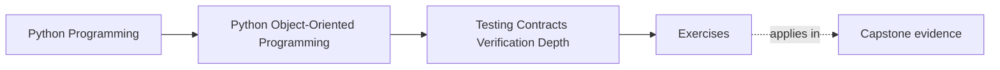
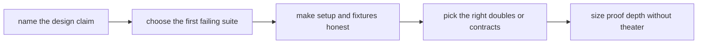

# Exercises

<!-- page-maps:start -->
## Page Maps

<!-- page-maps:end -->

Use these exercises as one full proof-design lab. The goal is not to collect test
vocabulary. The goal is to prove that a learner studying alone can take one design claim
from the capstone and choose the first failing suite, the right setup shape, the right
double or contract check, and the right confidence ladder.

## Running lab scenario

Use two claims from earlier modules:

- `WorkshopEnrollment` must never confirm more attendees than the seat limit
- `CertificateIssuanceService` must not duplicate visible issuance when retried

Those claims are useful because they force different proof shapes:

- a lifecycle and invariant-heavy domain claim
- a workflow and boundary-heavy retry claim

If you choose different claims, keep the same contrast: one stateful domain rule and one
cross-boundary workflow rule.

## What to keep open while you work

Build one proof packet as you go. By the end it should contain:

- one design-claim inventory
- one first-failing-suite map
- one fixture or builder review
- one doubles decision note
- one approval or assertion-boundary judgment
- one confidence-ladder recommendation

Useful tables:

| Design claim | First failing suite or check | Why this surface fits | Stronger proof not yet needed | Weaker proof would miss |
| --- | --- | --- | --- | --- |

| Invariant or contract | Setup artifact | Owner of that setup | Hidden risk if reused carelessly |
| --- | --- | --- | --- |

## Exercise 1: Choose the first failing suite

For each of the two running claims, decide:

- which suite should fail first
- why that suite is close enough to the claim
- why a heavier suite is not the first answer
- why a weaker suite would miss the real break

Do not answer with "unit tests first" by habit. Name the actual proof surface.

## Exercise 2: Review one lifecycle proof path

Use the seat-limit claim and describe:

- what sequence of operations the proof must perform
- whether behavior-first tests, stateful tests, or property-based tests fit best
- what false confidence appears if you only check the final count
- what human review note should tell the same story

This exercise is about proving the rule through time, not just through a snapshot.

## Exercise 3: Review one workflow proof path

Use the certificate retry claim and explain:

- which workflow path the test must model
- which boundary result matters most
- what a pure mock-heavy unit test would miss
- what stronger route would prove duplicate-visible-work protection

The question here is not "can the function be called?" It is "what evidence proves the
workflow contract under interruption?"

## Exercise 4: Draw one repository or adapter contract surface

Pick one replaceable boundary, such as:

- `WorkshopEnrollmentRepository`
- object-storage adapter
- reminder sender adapter

Then explain:

- what callers are allowed to assume
- what contract test should protect that promise
- what backend detail must stay outside the contract
- what drift a mock-only test strategy would miss

## Exercise 5: Audit one fixture or builder

Choose one setup helper and explain:

- what important shape it hides
- whether that hidden setup clarifies or obscures the invariant
- who should own the helper
- what misunderstanding appears if the helper becomes too magical

Good setup shortens noise. It must not hide the reason the proof matters.

## Exercise 6: Compare doubles honestly

Pick one collaborator and choose between:

- fake
- stub
- spy
- mock
- shared contract suite

Explain:

- what each option would reveal or hide
- which one best matches the design claim
- what interface drift risk matters here

This is where many tests become easy to write and weak to trust.

## Exercise 7: Place one runtime check or assertion boundary

Pick one assumption and explain:

- whether it deserves a runtime check
- where that check belongs
- what test proves the check matters
- what confusion appears if the same check is duplicated everywhere

Assertions are not free decoration. They are part of the boundary story.

## Exercise 8: Review one snapshot or approval boundary

Choose one output or artifact and explain:

- whether it deserves a golden file or approval boundary
- what unstable detail must stay out of the artifact
- what review practice keeps the artifact meaningful
- what risk appears if the artifact becomes broad and noisy

This exercise is about protecting real external representation, not fossilizing every
string.

## Exercise 9: Build one confidence ladder

For one important claim, write:

- the smallest useful proof
- the next stronger proof and what it adds
- the heaviest proof route and when it becomes justified
- how the ladder avoids both under-testing and theater

The goal is to match cost to risk rather than treating every claim equally.

## Exercise 10: Produce the proof packet

Finish the lab by assembling:

- one proof table
- one test-data table
- one doubles choice note
- one assertion or approval-boundary review
- one confidence-ladder recommendation

The packet is done only when another maintainer can answer:

- which suite should fail first for one claim
- what setup is honest and readable
- how one replaceable boundary stays under contract
- what proof is enough before escalating to heavier suites

## Done means the evidence fits the claim

You are done with the exercise day when your packet can survive these review questions:

- "Why should this suite fail first?"
- "What important invariant is this fixture helping or hiding?"
- "What stronger proof would you add only if the risk increased?"

If those answers are still fuzzy, keep tightening the evidence language before you open
the answer page.
