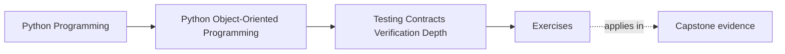
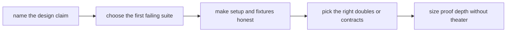
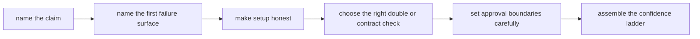

# Exercises


<!-- page-maps:start -->
## Page Maps




<!-- page-maps:end -->

Use these exercises to turn testing into design evidence instead of a generic quality
ritual.

The day is not about collecting test buzzwords. It is about proving that ownership
boundaries, lifecycle rules, repository contracts, adapters, and review claims are backed
by the right executable evidence at the right depth.

## How to work through this set

Treat the ten exercises as one full lab day on verification strategy and contract depth.

Before each answer:

1. name the design claim under review
2. name the first suite or check that should fail if the claim stops being true
3. state why weaker or stronger proof routes would be less appropriate

Do the exercises in order. The day is one progression:

- Exercises 1-3 connect domain claims to behavior, lifecycle, and contract tests
- Exercises 4-6 review property checks, fixtures, and doubles
- Exercises 7-8 size runtime checks, snapshots, and approval boundaries honestly
- Exercises 9-10 assemble a full confidence ladder for one meaningful surface

Keep one proof packet as you go. By the end of the day it should contain:

- one design-claim inventory
- one first-failing-suite map
- one fixture or builder ownership review
- one doubles decision note
- one approval-boundary judgment
- one confidence-ladder recommendation

If those six artifacts are missing, you are probably still discussing test style instead
of evidence.

## Recommended working layout

If you want one lab tree that can support the whole day, use something like:

```text
module08-lab/
├── artifacts/
├── notes/
├── scratch/
└── tests/
```

Keep one proof table while you work:

| Design claim | First failing suite or check | Why this surface fits | Stronger proof not yet needed | Weaker proof would miss |
| --- | --- | --- | --- | --- |

Keep one test-data table:

| Invariant or contract | Setup artifact | Owner of that setup | Hidden risk if reused carelessly |
| --- | --- | --- | --- |



Use that route on purpose. It keeps the day centered on evidence discipline instead of on
test count.

## Exercise 1: Name the first failing test

Take one ownership or lifecycle claim and explain:

- which suite should fail first if the claim stops being true
- why that suite is close enough to the claim
- why another suite would be too weak
- why a heavier suite would be unnecessarily expensive at first

Study note:
The first failure question is often more useful than the coverage question.

## Exercise 2: Review one lifecycle proof path

Choose one state transition or invariant and explain:

- whether the proof should be behavior-first, stateful, or integration-heavy
- what sequence of actions the test must express
- what false confidence appears if the path is shortened too much
- what human review artifact should tell the same story

Study note:
Lifecycle rules need tests that respect sequence, not only end state.

## Exercise 3: Draw one repository or adapter contract surface

Take one repository or adapter and explain:

- what callers are allowed to assume
- what contract test should enforce those assumptions
- what backend-specific detail must stay outside the contract
- what drift a mock-heavy unit test might miss

Study note:
Contract tests exist to keep replaceable boundaries honest.

## Exercise 4: Justify one property-based test

Pick one object model rule and explain:

- what property stays true across many examples
- why a few example tests are not enough
- what generator or input space matters
- what kind of bug the property check could reveal first

Study note:
Property-based tests earn their keep when a rule is broader than a handful of examples.

## Exercise 5: Audit one fixture or builder

Review one fixture or builder and explain:

- what setup it hides
- whether that hidden setup clarifies or obscures the invariant
- who should own that test data shape
- what misunderstanding appears if the fixture becomes too magical

Study note:
Good setup makes intent clearer. Bad setup erases the reason the test matters.

## Exercise 6: Compare doubles honestly

Take one collaborator and explain:

- whether a fake, stub, spy, mock, or contract test is the cleanest choice
- what each alternative would reveal or hide
- what interface drift risk matters here
- what proof route best matches the real design claim

Study note:
Doubles are useful when they clarify the contract, not when they merely make tests easy
to write.

## Midday self-check

Before moving into runtime checks and approval boundaries, make sure your packet already
answers these questions clearly:

- which suite should fail first for one important claim
- how one lifecycle rule should be tested as a sequence
- what one repository contract test protects
- whether one fixture clarifies or hides the invariant

If you cannot answer those four questions in plain language, return to Exercises 1-6 and
make the packet more explicit before continuing.

## Exercise 7: Place one runtime check or assertion boundary

Take one assumption and explain:

- whether it should be checked at runtime
- where the assertion or defensive check should live
- what test should prove the check matters
- what damage appears if the check is duplicated or placed too low

Study note:
Runtime checks are executable contract language, not leftover paranoia.

## Exercise 8: Review one snapshot or approval boundary

Choose one saved-output or snapshot-style proof and explain:

- what behavior it is actually protecting
- what unstable detail should stay outside the snapshot
- what review practice keeps the artifact meaningful
- what risk appears if the snapshot becomes too large or too noisy

Study note:
Approval artifacts should preserve intent, not fossilize accidental formatting.

## Exercise 9: Build one confidence ladder

Take one important surface and explain:

- what the smallest useful proof is
- what the next stronger proof adds
- what the heaviest proof route should be reserved for
- how the ladder avoids both under-testing and theater

Study note:
Confidence ladders scale proof by risk instead of treating every claim the same.

## Exercise 10: Produce a verification decision packet

Assemble:

- one proof table
- one test-data table
- one doubles choice note
- one assertion-boundary review
- one confidence-ladder recommendation

The packet is strong when another maintainer can answer:

- which suite should fail first for one design claim
- what setup artifacts are honest and readable
- how one replaceable boundary stays under contract
- where approval or runtime checks stop
- what evidence is enough before escalating to heavier proof

## Done means more than finishing the page

You are done with the exercise day when your packet can survive three kinds of review:

- a design review asking whether proof matches the actual claim
- a test review asking whether fixtures or doubles hide too much
- a delivery review asking whether the confidence ladder is right-sized for the risk

If the packet cannot survive those reviews, keep tightening the evidence language.
