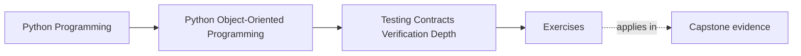
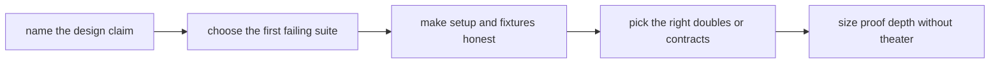

# Exercises

<!-- page-maps:start -->
## Page Maps

<!-- page-maps:end -->

Use this page as one full proof-design workshop, not as ten quick prompts.

Your goal is to leave with a reviewable packet that proves you can do all of these for a
real claim:

- name the claim in design language
- choose the first proof that should fail
- keep setup honest and readable
- choose doubles and contracts by semantic value
- escalate to heavier proof only when risk justifies it

If the packet cannot teach another maintainer why one proof shape is right, the exercise
day is not finished.

## Running workshop scenario

Keep these two claims on the table all day:

1. `WorkshopEnrollment` must never confirm more attendees than the seat limit
2. `CertificateIssuanceService` must not create duplicate visible issuance when a retry
   happens after interruption

These two claims are useful because they force different proof families:

- a stateful aggregate claim with lifecycle pressure
- a workflow claim spanning persistence and side effects

Do not replace both claims with easier versions. The contrast is part of the lesson.

## What you are building by the end

Create one proof packet with these sections:

- claim inventory
- first-failing proof map
- sequence sketch for the lifecycle claim
- workflow sketch for the retry claim
- fixture and builder review
- doubles and contract decision note
- assertion and approval-boundary note
- confidence ladder for one high-risk claim

Keep the packet compact enough that another maintainer could read it in one sitting.

## Packet tables to prepare first

Use these tables as working documents while you solve the exercises.

| Design claim | First proof that should fail | Why this proof is close enough | Weaker proof would miss | Stronger proof can wait because |
| --- | --- | --- | --- | --- |

| Boundary or invariant | Setup artifact | What must stay visible in the setup | Hidden risk if the helper gets too magical |
| --- | --- | --- | --- |

| Collaborator or boundary | Best double or proof route | Why it preserves the right truth | Risk if replaced with a weaker option |
| --- | --- | --- | --- |

## Exercise 1: Write the claim inventory

Write each running claim in one sentence without mentioning tests yet.

Then add:

- which object or workflow owns the claim
- which later consumer would notice the break first
- which kind of wrong answer would still look green if you proved the claim badly

If the claim sentence already sounds fuzzy, stop and repair it before moving on.

## Exercise 2: Choose the first failing proof

For each claim, decide which proof should fail first.

You must choose a concrete surface, such as:

- behavior-first aggregate tests
- sequence or stateful tests
- repository contract suite
- workflow integration test with meaningful fakes
- approval artifact review

For each choice, write:

- why it is the first failing proof
- what weaker proof would miss
- what stronger proof exists but does not belong first

Habit answers such as "start with unit tests" are not enough.

## Exercise 3: Sketch the seat-limit lifecycle proof

Design the minimal but honest sequence for the `WorkshopEnrollment` claim.

Your sketch must name:

1. the starting state
2. the confirm steps that reach the boundary
3. the over-capacity attempt
4. the visible result after rejection
5. the one additional history step that proves the object did not enter a corrupted
   intermediate state

Then answer:

- would simple examples be enough?
- where would a stateful test add more confidence?
- what property, if any, might be justified later?

## Exercise 4: Sketch the retry workflow proof

Design the proof route for duplicate-visible issuance prevention.

Your sketch must name:

1. the durable state before retry
2. the exact interruption or repeat condition
3. the visible side effect that must not duplicate
4. the boundary that proves the workflow really resumed safely
5. the operator-facing symptom that would appear if the proof were too weak

Then explain why a mock-heavy unit test would not be enough.

## Exercise 5: Draw one repository contract surface

Pick one replaceable boundary, such as:

- `WorkshopEnrollmentRepository`
- certificate artifact store
- notification sender

Write down:

- what callers are truly allowed to assume
- what behavior a shared contract suite should defend
- what backend detail must stay outside the contract
- what bad substitute could still pass a naive mock-based test

This exercise is about replaceability in semantic terms, not interface shape alone.

## Exercise 6: Audit one fixture or builder

Choose one helper you would expect to exist for this module.

Explain:

- which values must stay visible near the test
- which defaults are safe to hide
- which defaults would make the proof suspicious
- who should own the helper and why

Then rewrite one example setup in plain language so another maintainer could audit the
important shape without opening helper internals.

## Exercise 7: Decide the right double

Pick one collaborator in the retry workflow and compare at least four options:

- stub
- fake
- spy
- mock
- shared contract suite

For each option, say:

- what it would preserve
- what it would hide
- whether it is good enough for this claim

End by choosing one best option and one clearly wrong option.

## Exercise 8: Place one defensive check or assertion boundary

Choose one assumption from the workflow and decide:

- is this a caller-facing contract failure or an internal invariant break?
- where should the check live?
- what proof should demonstrate the check matters?
- what duplication would turn the check into noise instead of a boundary signal?

The point is to keep runtime checks aligned with ownership rather than scattering them
everywhere.

## Exercise 9: Review one approval boundary

Choose one output or artifact and decide whether it deserves approval-style review.

Write:

- what stable representation is being protected
- which unstable details must stay out
- what reviewer question the artifact should answer
- what would make the artifact become maintenance tax instead of useful evidence

If you cannot name the contract the artifact protects, it should probably not exist.

## Exercise 10: Build the confidence ladder

Choose the higher-risk claim and write a three-level confidence ladder:

1. the smallest useful proof
2. the next stronger proof and exactly what new risk it covers
3. the heaviest proof route and the operational trigger that would justify paying for it

Then add one sentence explaining why using the heaviest proof first would be wasteful or
misleading.

## Assemble the proof packet

Before opening the answer page, assemble your final packet with:

- the three tables from the start
- one lifecycle proof sketch
- one retry workflow sketch
- one setup audit
- one doubles decision note
- one approval-boundary note
- one confidence ladder

The packet should let another maintainer answer all of these without extra conversation:

- which claim belongs to which proof
- what setup keeps the important shape visible
- which boundaries require contract suites instead of hopeful mocks
- when heavier proof should be added and why

## Done means the proof matches the claim

You are done only when your packet survives these review questions:

- "Why should this proof fail before any stronger one?"
- "What important truth is this builder keeping visible?"
- "What exactly would a weaker proof miss here?"
- "What operational risk would justify the next heavier layer?"

If those answers still sound generic, tighten the packet before you move to the answer
page.
