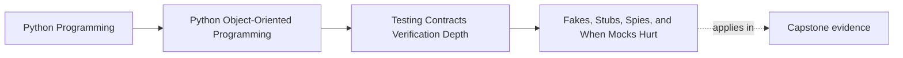

# Fakes, Stubs, Spies, and When Mocks Hurt

<!-- page-maps:start -->
## Page Maps

<!-- page-maps:end -->

Read the first diagram as a placement map: this page is one concept inside its parent
module, not a detached essay, and the capstone is the pressure test for whether the
idea holds. Read the second diagram as the working rhythm for the page: name the
problem, study the example, identify the boundary, then carry one review question
forward.

## Why this lesson matters

Test doubles are useful because real boundaries are sometimes too slow, too expensive,
too noisy, or too hard to control in a focused test.

They become dangerous when they stop standing in for a boundary and start dictating how
the implementation is allowed to think.

That is why the main question is not:

- which double type exists?

It is:

- what question is this test trying to answer?

Different doubles are good at answering different questions. When the tool and the
question do not match, the test can pass while the design drifts.

## The double types matter because their risks differ

Use the classic names only as a starting point:

- **stub**: gives predetermined answers so the test can reach a code path
- **fake**: behaves like a lightweight working implementation with real state transitions
- **spy**: records what happened so the test can inspect it afterward
- **mock**: encodes expected interactions up front and often fails if the choreography changes

These are not status levels. They are tradeoffs.

## Prefer the weakest double that answers the real question

If the test only needs one returned value, a stub may be enough.

If the test needs to exercise meaningful state change across a boundary, a fake is often
better.

If the test needs to inspect what was published or recorded after the behavior happened,
a spy may fit well.

If the interaction itself is the contract, then a mock may be justified.

The goal is not to avoid mocks at all costs. The goal is to avoid choosing a stronger
and more brittle tool than the proof requires.

## Fakes often reveal boundary truth better than mocks

Repositories, sinks, caches, and unit-of-work boundaries frequently behave more honestly
under a fake than under a stack of mocks.

Why:

- real control flow still happens
- state accumulates and can be inspected
- the test sees semantic effects instead of only call counts
- interface drift is harder to hide

This is especially valuable in object-oriented systems where much of the meaning lives in
state changes over time.

## Interaction testing is justified only when the interaction is the contract

A common mistake is to assert every internal call because it feels precise.

But many interactions are not promises. They are one current implementation route.

An interaction assertion is justified when the boundary itself promises something like:

- one notification must be published
- one adapter must be invoked exactly once
- one transaction boundary must surround the operation
- one ordering of effects is externally significant

If the interaction is not itself part of the caller-facing contract, pinning it can make
refactors noisy without increasing confidence.

## Mocks hurt when they freeze choreography instead of meaning

Mock-heavy tests often fail for the wrong reasons:

- an internal helper was reordered
- an object was split into two collaborators
- a boundary call was combined or renamed without changing behavior

Meanwhile the real semantic bug may remain invisible because the mock accepted overly
generous arguments or never exercised a realistic stateful path.

That is why mocks can create an illusion of precision while actually weakening the proof.

## A worked example

Suppose an application service should:

- load an incident
- apply a domain transition
- save it
- publish one event

A mock-heavy test might assert a detailed sequence of repository and publisher calls.

A stronger test might use:

- a fake repository, so the aggregate is loaded and saved through a believable boundary
- a spy publisher, so the emitted event can be inspected afterward

Then the proof focuses on:

- did the transition happen?
- was the aggregate persisted?
- was the right event published?

That usually says more about the real contract than a long interaction script.

## When a mock is the right tool

There are still honest uses for mocks.

Examples:

- proving a retry policy stops after a fixed number of attempts against one boundary
- proving a coordinator calls a cancellation hook when a contract requires it
- proving an integration wrapper sends one command through a narrow transport interface

In these cases, the interaction itself is the observable meaning.

Use mocks there deliberately, and keep the contract explicit in the test name and
assertions.

## Common mistakes

- using mocks by default before deciding what the test is proving
- replacing a stateful fake with a pile of call expectations
- asserting internal choreography that is not part of the contract
- using permissive mocks that hide argument-shape drift
- forgetting that spies inspect after behavior, while mocks prescribe before behavior

## Review checklist

| Question | Good sign |
| --- | --- |
| does the chosen double match the real proof question? | yes |
| are stateful boundaries exercised with fakes when that reveals more truth? | yes |
| are interaction assertions limited to actual contract-level interactions? | yes |
| would an internal refactor keep most of these tests meaningful? | yes |

## Capstone connection

Use the capstone test suite to ask:

- which mock-heavy tests are really trying to prove stateful repository behavior?
- where would a fake plus spy reveal more than a detailed interaction script?
- which interaction assertions defend a real boundary promise and which only defend current choreography?

This is the point where doubles stop being a library feature and become a design choice.

## Exit check

Leave this lesson only when you can do all of these:

- explain why the weakest sufficient double is usually the right choice
- identify one case where a fake is better than a mock
- identify one case where a mock is justified because the interaction is the contract
