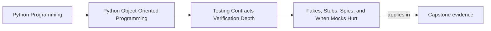

# Fakes, Stubs, Spies, and When Mocks Hurt

<!-- page-maps:start -->
## Page Maps

<!-- page-maps:end -->

This lesson is about choosing the weakest double that still proves the claim honestly.

Test doubles are useful because real boundaries can be:

- slow
- expensive
- hard to control
- noisy in a focused proof

They become harmful when they stop standing in for the boundary and start dictating how
the implementation is allowed to think.

That is why the first question is not:

- which double type exists?

It is:

- what truth is this test trying to preserve?

## Keep one workflow visible

Use one capstone path:

- load confirmed enrollment or issuance state
- perform one workflow step
- save progress
- publish one visible outcome

Now ask:

Which boundary needs believable state, and which boundary only needs one returned answer
or one post-behavior observation?

That question usually tells you which double is honest enough.

## The classic names matter because their risks differ

Use the names only as a starting vocabulary:

- `stub`: supplies predetermined answers so the path can run
- `fake`: behaves like a lightweight working implementation with meaningful state
- `spy`: records what happened so the test can inspect it afterward
- `mock`: prescribes interactions up front and often fails if choreography changes

These are not status levels.
They are tradeoffs between realism, control, and brittleness.

## Prefer the weakest double that answers the proof question

If the test only needs one returned value, a stub may be enough.

If the test needs meaningful state across time, a fake is often better.

If the test needs to inspect what was published after behavior happened, a spy may fit.

If the interaction itself is the contract, then a mock may be justified.

The goal is not to avoid mocks completely.
The goal is to avoid using a stronger and more brittle tool than the claim requires.

## Fakes often reveal more truth than mocks

Repositories, sinks, caches, and unit-of-work boundaries frequently behave more honestly
under a fake than under a stack of mocks.

Why:

- real control flow still happens
- state accumulates and can be inspected
- interface drift is harder to hide
- the test sees semantic effects rather than only call counts

This matters especially in object-oriented systems where meaning lives in state change
over time.

## Interaction testing is justified only when the interaction is the contract

Many internal interactions are not promises.
They are one current implementation route.

An interaction assertion is justified when the boundary itself promises something like:

- one notification must be published
- one adapter must be invoked exactly once
- one retry policy stops after a fixed number of attempts
- one transaction boundary must surround the operation

If the interaction is not part of the caller-facing contract, pinning it often creates
refactor noise without adding real confidence.

## Mocks hurt when they freeze choreography instead of meaning

Mock-heavy tests often fail for the wrong reasons:

- an internal helper moved
- one collaborator became two
- a boundary call was renamed or regrouped

Meanwhile the real semantic bug may stay invisible because the mock:

- accepted overly generous arguments
- never exercised stateful behavior
- never modeled durable progress across retries

This is why mocks can create an illusion of precision while weakening the proof.

## Worked capstone example

Suppose a workflow should:

- load one enrollment or issuance record
- apply a transition
- save it
- publish one visible outcome

A brittle test might mock the repository, publisher, clock, and helper objects and then
assert a long call script.

A stronger test might use:

- a fake repository, so state is actually loaded and saved
- a spy publisher, so the visible published outcome can be inspected afterward

Then the proof can focus on:

- did the transition happen?
- did progress persist?
- was the right visible effect emitted?

That is closer to the caller's truth than a choreography script.

## When a mock is the right tool

Mocks still have honest uses.

Examples:

- proving a retry coordinator stops after a fixed number of attempts
- proving a narrow transport wrapper sends one required command
- proving a cancellation hook is invoked because the contract says it must be

In those cases, the interaction itself is the meaning.

Use mocks deliberately there, and make the contract visible in the test name.

## Build a doubles packet

Before choosing a double, write a short packet:

- boundary under test
- truth the test must preserve
- what state, if any, needs to accumulate
- whether the interaction itself is part of the contract

That packet usually reveals whether you need:

- a stub
- a fake
- a spy
- a mock
- or a shared contract suite instead of a double

## Common failure modes

- using mocks by default before deciding what the test is proving
- replacing a useful fake with a pile of call expectations
- asserting internal choreography that is not part of the contract
- using permissive mocks that hide argument-shape drift
- forgetting that spies inspect after behavior while mocks prescribe before behavior

## Doubles review card

Use this short card when reviewing a double choice:

| Question | What you want to see |
| --- | --- |
| does the chosen double match the real proof question? | yes |
| are stateful boundaries exercised with fakes when that reveals more truth? | yes |
| are interaction assertions limited to contract-level interactions? | yes |
| would an internal refactor keep most of these tests meaningful? | yes |

## Capstone connection

Use this page to ask:

- which mock-heavy capstone tests are really trying to prove stateful repository truth
- where a fake plus spy would reveal more than a detailed interaction script
- which interaction assertions defend a real boundary promise and which only defend
  current choreography

That is where doubles become a design choice instead of a library habit.

## Exit check

Leave this lesson only when you can do all of these:

- explain why the weakest sufficient double is usually the right choice
- identify one case where a fake is better than a mock
- identify one case where a mock is justified because the interaction is the contract
