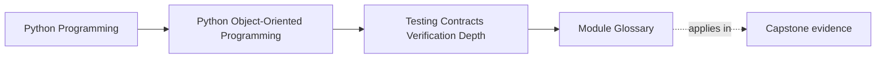

# Module Glossary

<!-- page-maps:start -->
## Page Maps

<!-- page-maps:end -->

This glossary belongs to **Module 08: Testing, Contracts, and Verification Depth** in
**Python Object-Oriented Programming**. Use it to keep the module's proof language
stable while moving between lesson pages, exercises, and capstone review.

## How to use this glossary

Return here when two testing ideas start sounding similar even though they should lead
to different design decisions.

Examples:

- behavior test versus contract test
- stateful test versus property-based test
- assertion versus domain error
- integration suite versus approval boundary

If those distinctions blur, the verification strategy usually blurs with them.

## Terms in this module

| Term | Meaning in this module | Why it matters |
| --- | --- | --- |
| approval boundary | a public or reviewer-facing output whose exact representation is important enough to be stored and reviewed as a golden artifact | keeps snapshots focused on real contracts |
| behavior-first test | a test that proves a domain object's visible promise through outcomes such as state, events, results, or domain errors | prevents the suite from pinning helper choreography |
| confidence ladder | the ordered set of proof layers used to cover different risks at different costs | keeps the suite explainable and right-sized |
| contract test | a shared semantic suite run against every implementation that claims the same boundary promise | proves replaceability instead of assuming it |
| defensive check | a runtime guard at a boundary that rejects malformed, unsupported, or corrupted input before it spreads | protects entry points without confusing them with full proof |
| domain error | a caller-facing failure that represents an invalid or unsupported request under the public contract | differs from an internal invariant break |
| fake | a lightweight working implementation of a boundary that preserves meaningful state and flow | often reveals boundary truth better than a mock |
| fixture ownership | the rule that test setup should have a clear readable owner so the important data shape is visible near the proof | prevents hidden setup from weakening tests |
| golden file | a stored reviewed artifact representing a stable external output or contract | useful only when the representation truly matters |
| integration suite | a test layer that proves composed workflow or boundary interaction risk across multiple parts of the system | catches failures lower layers cannot see honestly |
| internal invariant assertion | a runtime check that marks a supposedly impossible internal state or control-flow condition | signals a programmer or integrity failure rather than a caller mistake |
| property | an always-true design claim, usually tested across many generated examples or sequences | broadens proof where a few examples are too narrow |
| shrink | the process of reducing a failing generated case to a smaller counterexample | turns broad failures into teachable evidence |
| spy | a double that records what happened so the test can inspect the result afterward | useful when post-behavior inspection matters |
| stateful test | a test that proves correctness across a sequence of operations rather than a single isolated call | necessary for lifecycle-heavy objects |
| stub | a double that supplies predetermined answers so a test can reach a path | useful when only a returned value matters |
| substitute compatibility | the claim that several repositories or adapters can stand in for one another under one semantic contract | should be proved by shared suites, not interface names |
| test data builder | a helper that creates valid or intentionally varied domain objects with visible meaningful overrides | reduces setup noise without hiding important values |
| transition map | an explicit description of allowed, forbidden, and meaningful lifecycle paths for a stateful object | drives honest stateful test coverage |

## Fast contrasts

| Do not confuse | With | Better distinction |
| --- | --- | --- |
| behavior-first test | contract test | behavior-first proves one object's visible promise; contract test proves several implementations honor the same boundary semantics |
| stateful test | property | stateful tests often narrate important histories; properties prove broad always-true claims across many cases |
| fake | mock | a fake preserves meaningful behavior and state; a mock prescribes expected interaction choreography |
| domain error | invariant assertion | a domain error is part of the caller-facing contract; an invariant assertion marks an internal break that should have been impossible |
| integration suite | approval boundary | an integration suite proves composed behavior; an approval boundary protects a stable reviewed representation |

## Review prompts

- Which capstone proof surfaces are still being described with vague words like "coverage" instead of a named contract or invariant?
- Where is the suite currently using a stronger proof tool than the claim requires?
- Which terms in your current test review would become clearer if you replaced them with the language in this glossary?

## Exit check

Leave this glossary only when you can do all of these:

- explain the difference between behavior proof, contract proof, and integration proof
- explain why a fake and a mock are not interchangeable
- name one capstone output that is an approval boundary and one that is not
