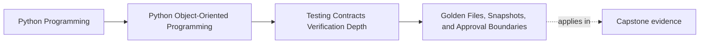

# Golden Files, Snapshots, and Approval Boundaries

<!-- page-maps:start -->
## Page Maps

<!-- page-maps:end -->

Read the first diagram as a placement map: this page is one concept inside its parent
module, not a detached essay, and the capstone is the pressure test for whether the
idea holds. Read the second diagram as the working rhythm for the page: name the
problem, study the example, identify the boundary, then carry one review question
forward.

## Why this lesson matters

Snapshot-style tests feel efficient because they capture a large output with one stored
artifact.

They also fail in one of two predictable ways:

- they freeze internal noise and generate endless meaningless churn
- they become so large that reviewers approve diffs without understanding them

The core design question is not "should we snapshot this?"

It is:

- is this output a boundary we genuinely want humans to review as a stable contract?

If the answer is no, a golden file is often the wrong tool.

## Snapshots are contract-review tools

A golden file or approval test is strongest when the exact representation matters to
someone outside the implementation.

Good examples:

- public CLI output
- generated configuration or reports
- wire-format payloads
- stable debug or audit views used by humans

In these cases, the stored artifact is not just test data. It is the reviewed shape of a
public promise.

## Do not snapshot unstable internal detail

Weak snapshot targets often include:

- object dumps with incidental field ordering
- timestamps that change every run
- randomly generated identifiers
- large internal structures with no public consumer

These snapshots teach the wrong lesson. They imply that every implementation detail
deserves to be frozen, which makes refactoring harder without adding real confidence.

## Normalize noise before freezing meaning

If a representation is worth snapshotting, remove the parts that would make the proof
dishonest.

That may include normalizing:

- timestamps
- ordering
- nondeterministic identifiers
- platform-specific paths
- environment-dependent metadata

The goal is not to fake stability. It is to preserve the meaningful contract and remove
the accidental volatility that distracts from it.

## Approval boundaries should stay small enough to review

One giant snapshot is often worse than several focused ones.

A reviewer should be able to answer:

- what surface changed?
- why does this representation matter?
- which part of the contract moved?

If the approval artifact is too large for that kind of reading, then it is serving the
test runner better than the human.

## Snapshot changes should trigger contract review, not routine maintenance

When a golden file changes, the right question is not:

- how do we get the test green again?

It is:

- did the public-facing promise change intentionally?

This mindset matters. Approval tests are valuable only if a changed artifact causes
someone to inspect whether the visible contract drift is desirable.

## A worked example

Suppose the capstone exposes a CLI summary of incidents for human operators.

That output may deserve a golden file if:

- column layout matters
- labels and ordering matter
- reviewers need to notice wording or formatting drift

Before freezing it, normalize anything noisy:

- current timestamps
- randomly ordered collections
- generated IDs that are irrelevant to the displayed contract

Now the golden file protects the reviewable operator-facing representation rather than a
transient runtime accident.

By contrast, snapshotting the entire in-memory aggregate graph would likely be weaker. It
would freeze internal structure that no boundary consumer relies on directly.

## Use narrower tests when the output has only a few meaningful dimensions

If a boundary has only two or three important facts, direct assertions may be better
than a snapshot.

For example:

- one error code
- one status line
- one normalized JSON field set

In those cases, a full approval artifact can be heavier than the claim it is proving.

## Common mistakes

- snapshotting internal structures because they are easy to dump
- keeping noisy unstable fields in the golden file
- storing artifacts too large for meaningful review
- auto-approving changed snapshots without contract discussion
- using snapshots where a few direct assertions would be clearer

## Review checklist

| Question | Good sign |
| --- | --- |
| is the snapshot protecting a real boundary contract? | yes |
| have unstable details been normalized out? | yes |
| is the artifact small enough for a human to review honestly? | yes |
| would a diff trigger a real conversation about contract drift? | yes |

## Capstone connection

Use the capstone to ask:

- which outputs are truly public or reviewer-facing enough to deserve approval tests?
- which current representation checks are freezing internal shape instead of boundary meaning?
- what should be normalized so a stored artifact highlights real contract changes only?

That is how approval testing becomes a review tool instead of a churn generator.

## Exit check

Leave this lesson only when you can do all of these:

- explain what makes an output worthy of a golden-file test
- identify one noisy field that should be normalized before approval review
- point to one capstone output that deserves direct assertions instead of a snapshot
